# Pruebas en placa de los filtros FIR

Registro de las pruebas de los filtros FIR sobre la FRDM-MCXN947. El objetivo
es determinar qué combinaciones de filtro y frecuencia de muestreo se ejecutan
en tiempo real sin sobrecargar el CPU.

Se probaron dos versiones del firmware:

1. **Prueba anterior:** procesamiento por bloques de 32 muestras (commit
   `b0468c8`).
2. **Prueba actual:** procesamiento muestra a muestra (commit `73d90b0`, que
   revierte el procesamiento por bloques).

Ambas pruebas se hicieron con el firmware compilado en modo **Release**. La
sección siguiente explica qué cambia respecto de Debug y por qué se eligió.

## Compilación en modo Release

### Debug y Release

MCUXpresso define dos configuraciones de compilación para el proyecto:

| | Debug | Release |
|---|---|---|
| Optimización | `-O0` (ninguna) | `-Os` (optimiza tamaño) |
| Traducción del código C | Literal, línea por línea: cada variable se lee y escribe en memoria, cada función se llama completa | El compilador reorganiza el código: usa registros, elimina pasos redundantes, inserta funciones cortas en el lugar donde se usan |
| Depuración | Cómoda: breakpoints y paso a paso se corresponden con el código | Más incómoda: algunas variables aparecen como *optimized out* y el paso a paso salta |
| Velocidad | Lenta | Rápida |

Ninguna de las dos configuraciones fija el nivel de optimización a mano en el
`.cproject`, así que usan los valores por defecto de MCUXpresso. Hasta estas
pruebas el proyecto se compilaba siempre en Debug.

### Por qué se probó en Release

En las primeras pruebas en placa (compiladas en Debug), solo algunos filtros
funcionaban y en algunas frecuencias. El análisis de `CAMBIOS_DISENIO_FILTROS.md`
mostró que el pasa bajos, diseñado con corte en 3600 Hz, cortaba en ~1,2 kHz a
44 kHz y en ~1,1 kHz a 48 kHz. Eso equivale a que la placa procesaba a una Fs
efectiva de ~14,7 kHz: el filtrado tardaba más que el período de muestreo. De
ahí se estimó un costo de **~40 a 60 ciclos por tap**, muy por encima de los ~3
ciclos por tap que suponía el script de diseño.

La causa probable era que, en Debug, CMSIS-DSP (la biblioteca que implementa
`arm_fir_q15`) se compila desde el código fuente sin optimización. Un FIR hace
cientos o miles de multiplicaciones y sumas por muestra, y ese tipo de bucle
es el que más se beneficia de la optimización. Compilar en Release era la
forma más simple de comprobarlo sin cambiar el código.

Se verificó además que CMSIS-DSP se compila con las instrucciones DSP del
Cortex-M33 habilitadas (`-mcpu=cortex-m33` define `__ARM_FEATURE_DSP`), que
`arm_fir_q15` usa para hacer dos multiplicaciones por instrucción.

### Ajustes necesarios para usar Release

- **Consola por UART:** la configuración Release no tenía definido el símbolo
  `SDK_DEBUGCONSOLE_UART`, que sí tenía Debug. Sin él, los `PRINTF` salen por
  *semihosting* (la consola de MCUXpresso, a través del debugger) en lugar de
  la UART. El semihosting detiene el procesador completo en cada mensaje,
  incluidas las interrupciones del ADC y el filtrado, lo que alteraría las
  mediciones. Se agregó el símbolo a Release.
- **Configuración de lanzamiento:** la carpeta del proyecto TP2 tenía un
  `.launch` copiado del TP1, que apuntaba al ejecutable del TP1. Se reemplazó
  por el del TP2 y MCUXpresso generó uno para Release
  (`Release/MCXN947_Project_TP2.axf`).

### Resultado

Con Release el costo bajó de ~40–60 a **~7–14 ciclos por tap** (procesamiento
por bloques, ver la prueba anterior). También se probó `-O3` en la carpeta
`CMSIS/DSP`, con los mismos resultados que `-Os`, por lo que se mantuvo `-Os`.

## Prueba anterior: procesamiento por bloques (commit `b0468c8`)

### Condiciones

| | |
|---|---|
| Fecha | 15/10/2026 |
| Rama / commit | `tp2-dev-coeff` @ `b0468c8` |
| Coeficientes | `filter_coeffs.h` generado por `disenio_filtros_tp2.m` con presupuesto de CPU (`MAX_FIR_TAPS = 1490`) |
| Procesamiento | Por bloques de 32 muestras (`PROCESSING_BLOCK_SIZE = 32`), filtrado en `PendSV` |
| Detección de sobrecarga | Sí: si un bloque no se filtra a tiempo, el firmware pasa a BYPASS y lo informa por UART |
| Compilación | Release, `-Os`. Se repitió con `-O3` en la carpeta `CMSIS/DSP` |
| Consola | minicom en `/dev/ttyACM0`, 115200 8N1 |
| Instrumental | Ninguno |

Los taps coinciden con los de la prueba actual salvo en los filtros que el
script con presupuesto de CPU ensanchó o marcó como no viables:

| Filtro | Taps (8k / 16k / 22k / 44k / 48k) |
|---|---|
| Pasa bajos (LP) | 34 / 64 / 86 / 170 / 186 |
| Pasa altos (HP) | 344 / 688 / 948 / 1062 / 1160 |
| Pasa banda (BP) | 346 / 690 / 946 / 1062 / 1158 |
| Elimina banda (BS) | 646 / 1288 / 718 / 1478 / 1490 |

### Método

Con cada filtro activo se recorrieron las frecuencias de muestreo de menor a
mayor. Cuando el filtro no entraba en tiempo real, el firmware lo detectaba,
pasaba a BYPASS e imprimía
`[DSP] Sobrecarga: el filtro no entra en tiempo real a ... Hz`.

### Resultados

| Filtro | 8k | 16k | 22k | 44k | 48k |
|---|---|---|---|---|---|
| LP | ✅ | ✅ | ✅ | ✅ | ✅ |
| HP | ✅ | ✅ | ❌ | ❌ * | ❌ * |
| BP | ✅ | ✅ | ❌ | ❌ * | ❌ * |
| BS | ✅ | ❌ | ❌ * | ❌ * | ❌ * |

\* No se probó: el firmware pasó a BYPASS en la Fs anterior. Se infiere del
bloqueo a menor Fs (salvo el BS a 22 kHz, que tiene menos taps que a 16 kHz
por el ensanche de transición y no se llegó a probar).

- **LP:** pasa en todas las frecuencias de muestreo, incluida 48 kHz.
- **HP y BP:** sobrecarga a partir de 22 kHz.
- **BS:** sobrecarga a partir de 16 kHz.

Con `-O3` en la carpeta `CMSIS/DSP` los resultados fueron los mismos que con
`-Os`.

> **Nota:** los logs registrados para `-Os` y para `-O3` son idénticos,
> incluidas las cantidades de bloques perdidos. Conviene confirmar que el log
> de `-O3` no sea una copia del de `-Os`.

### Log por minicom

```
========================================
  TP2 DSP - Filtros FIR (FRDM-MCXN947)
  Etapas: ADC -> Buffer -> FIR -> DAC/UART
  Envie 'h' para ver comandos por consola
========================================

[INFO] Frecuencia de muestreo: 8000 Hz
[DSP] Modo/Filtro activo: LOWPASS
[INFO] Frecuencia de muestreo: 16000 Hz
[INFO] Frecuencia de muestreo: 22000 Hz
[INFO] Frecuencia de muestreo: 44000 Hz
[INFO] Frecuencia de muestreo: 48000 Hz
[INFO] Frecuencia de muestreo: 8000 Hz
[DSP] Modo/Filtro activo: HIGHPASS
[INFO] Frecuencia de muestreo: 16000 Hz
[INFO] Frecuencia de muestreo: 22000 Hz
[DSP] Sobrecarga: el filtro no entra en tiempo real a 22000 Hz -> BYPASS (bloques perdidos: 1)
[DSP] Modo/Filtro activo: BYPASS
[INFO] Frecuencia de muestreo: 44000 Hz
[INFO] Frecuencia de muestreo: 48000 Hz
[INFO] Frecuencia de muestreo: 8000 Hz
[DSP] Modo/Filtro activo: LOWPASS
[DSP] Modo/Filtro activo: HIGHPASS
[DSP] Modo/Filtro activo: BANDPASS
[INFO] Frecuencia de muestreo: 16000 Hz
[INFO] Frecuencia de muestreo: 22000 Hz
[DSP] Sobrecarga: el filtro no entra en tiempo real a 22000 Hz -> BYPASS (bloques perdidos: 2)
[DSP] Modo/Filtro activo: BYPASS
[INFO] Frecuencia de muestreo: 44000 Hz
[INFO] Frecuencia de muestreo: 48000 Hz
[INFO] Frecuencia de muestreo: 8000 Hz
[DSP] Modo/Filtro activo: LOWPASS
[DSP] Modo/Filtro activo: HIGHPASS
[DSP] Modo/Filtro activo: BANDPASS
[DSP] Modo/Filtro activo: BANDSTOP
[INFO] Frecuencia de muestreo: 16000 Hz
[DSP] Sobrecarga: el filtro no entra en tiempo real a 16000 Hz -> BYPASS (bloques perdidos: 3)
[DSP] Modo/Filtro activo: BYPASS
```

## Prueba actual: procesamiento muestra a muestra (commit `73d90b0`)

### Condiciones

| | |
|---|---|
| Fecha | 29/10/2026 |
| Rama / commit | `tp2-dev-coeff` @ `73d90b0` |
| Coeficientes | `filter_coeffs.h` generado por `disenio_filtros_tp2.py` (sin presupuesto de CPU, `MAX_FIR_TAPS = 3864`) |
| Procesamiento | Muestra a muestra (`PROCESSING_BLOCK_SIZE = 1`), dentro de la ISR del ADC |
| Compilación | Release, `-Os` (incluida la carpeta `CMSIS/DSP`), con `SDK_DEBUGCONSOLE_UART` |
| Clock del core | 150 MHz (`BOARD_BootClockPLL150M`) |
| Consola | minicom en `/dev/ttyACM0`, 115200 8N1 |
| Instrumental | Ninguno (sin generador de señales ni osciloscopio) |

> Los cambios de configuración de Release (`-Os` en CMSIS y `SDK_DEBUGCONSOLE_UART`)
> están en el `.cproject` local y todavía no se commitearon.

### Botones: asignación real

Durante las pruebas se detectó que **los botones están invertidos respecto de
los comentarios del código y del menú de ayuda** (`'f' ... [SW3]`,
`'m' ... [SW2]`):

| Botón | Pin | Interrupción | Función real |
|---|---|---|---|
| SW2 | P0_23 | `GPIO0_INT_0` (salida 0, por defecto) | Cambia la **frecuencia de muestreo** |
| SW3 | P0_6 | `GPIO0_INT_1` (`ICR[6]` con `IRQS = 1` en `pin_mux.c`) | Cambia el **filtro** |

Queda pendiente decidir si se corrigen los comentarios y la ayuda, o si se
invierte la asignación en `pin_mux.c`.

Ambos botones siguen funcionando aunque el filtrado sature el CPU: tienen la
misma prioridad que la ISR del ADC, pero un número de IRQ menor (17 y 18 contra
46), así que se atienden entre muestra y muestra.

### Método

Sin generador ni osciloscopio no se puede medir la respuesta en frecuencia en
la placa; esa verificación la hace el script de diseño sobre los coeficientes
Q15. Lo que sí se puede comprobar es si cada filtro **entra en tiempo real**.

El filtrado corre dentro de la ISR del ADC, que tiene prioridad sobre el loop
principal (donde se imprimen los mensajes y se atienden los comandos UART). Si
el filtro tarda más que el período de muestreo (`150 MHz / Fs` ciclos), la ISR
ocupa el 100 % del CPU y el loop principal deja de ejecutarse. Por lo tanto:

1. Se elige la Fs con `f` (o SW2) y el filtro con `m` (o SW3).
2. Se envía `h` por minicom.
3. Resultado:
   - ✅ La ayuda aparece enseguida: el filtro entra en tiempo real.
   - ⚠️ La ayuda aparece con demora: el filtro entra, pero al límite.
   - ❌ No hay respuesta: el filtro sobrecarga el CPU.

Esta prueba solo distingue "entra / no entra". No mide el porcentaje de CPU
utilizado.

### Prueba 1: cambio de frecuencia de muestreo en BYPASS

Tras un reset (8 kHz, BYPASS), se cambió la Fs cinco veces. La consola informó
las cinco frecuencias en orden y volvió a 8 kHz, sin bloqueos.

| Fs | Resultado |
|---|---|
| 8000 Hz | ✅ |
| 16000 Hz | ✅ |
| 22000 Hz | ✅ |
| 44000 Hz | ✅ |
| 48000 Hz | ✅ |
| Vuelta a 8000 Hz | ✅ |

**Conclusión:** el cambio de Fs con SW3 y la salida por UART funcionan en las
cinco frecuencias. En BYPASS no hay carga de filtrado, así que esta prueba sirve
de referencia para las siguientes.

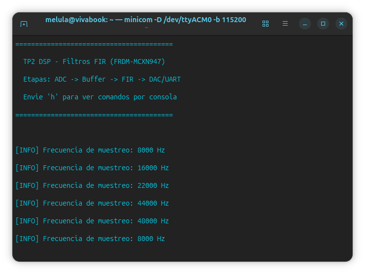

### Prueba 2: filtros en cada frecuencia de muestreo

Los cambios de filtro se hicieron primero con el comando `m` y, a partir de
16 kHz, con SW3 (ver el protocolo corregido más abajo).

| Filtro | Taps (8k / 16k / 22k / 44k / 48k) | 8k | 16k | 22k | 44k | 48k |
|---|---|---|---|---|---|---|
| Pasa bajos (LP) | 34 / 64 / 86 / 170 / 186 | ✅ | ✅ | ✅ | ✅ | ❌ (debugger) |
| Pasa altos (HP) | 344 / 688 / 948 / 1890 / 2052 | ✅ | ⚠️ al límite | ❌ | ❌ | ❌ * |
| Pasa banda (BP) | 346 / 690 / 946 / 1890 / 2064 | ✅ | ❌ | ❌ * | ❌ * | ❌ (debugger) |
| Elimina banda (BS) | 646 / 1288 / 1774 / 3534 / 3864 | ✅ | ❌ | ❌ * | ❌ * | ❌ * |

\* No se probó directamente: se infiere del bloqueo del pasa altos a la misma
Fs, porque el filtro tiene prácticamente la misma cantidad de taps o más.

**8 kHz:** con cada uno de los cuatro filtros activo, la consola confirmó el
cambio de filtro (`[DSP] Modo/Filtro activo: ...`) y respondió a `h` mostrando
la ayuda completa, sin demora. Los cuatro filtros entran en tiempo real a
8 kHz, incluido el elimina banda (646 taps, el más largo a esta Fs).

| Pasa bajos y pasa altos | Pasa banda y elimina banda |
|---|---|
| 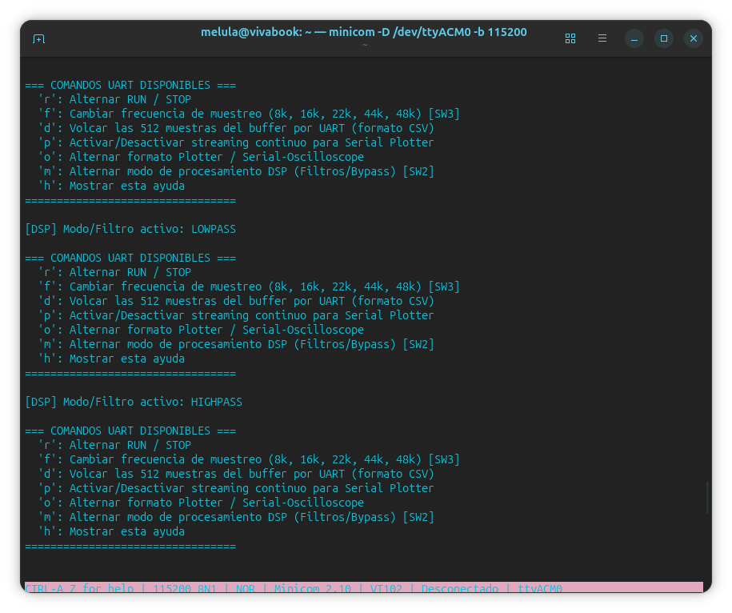 |  |

**16 kHz, elimina banda:** se pasó de 8 kHz a 16 kHz con el elimina banda
activo (1288 taps a 16 kHz). El LED cambió de color, lo que indica que el
cambio de Fs se aplicó, pero la consola quedó bloqueada en medio del mensaje
de confirmación (`[I`):

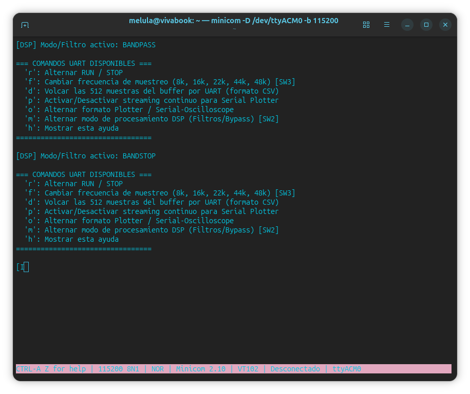

El loop principal empezó a imprimir `[INFO] Frecuencia de muestreo: 16000 Hz` y
no volvió a ejecutarse: el filtrado dentro de la ISR del ADC ocupa todo el
tiempo entre muestras (9375 ciclos a 16 kHz). Sobrecarga confirmada.

Para salir del bloqueo se presionó SW2, creyendo que cambiaba el filtro. En
realidad cambió la Fs a 22 kHz (el LED cambió de color) y el elimina banda
siguió activo, así que la consola siguió bloqueada. Así se descubrió la
inversión de los botones descrita más arriba.

Al pasar a BYPASS con SW3, la consola volvió a responder sin necesidad de
reset: el sistema se recupera solo en cuanto la carga de procesamiento vuelve a
entrar en el período de muestreo. Al destrabarse se completó el mensaje que
había quedado cortado (`[INFO] Frecuencia de muestreo: 16000 Hz`).

**16 kHz, pasa bajos y pasa altos:** desde BYPASS, el pasa bajos (64 taps)
confirmó el cambio y respondió a `h`. Al pasar al pasa altos (688 taps) la
consola dejó de responder: no llegó a imprimirse el mensaje
`[DSP] Modo/Filtro activo: HIGHPASS`.

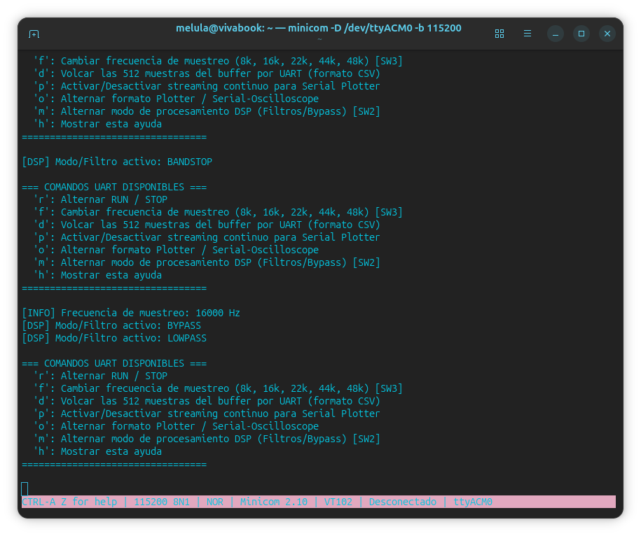

En una captura posterior aparece la confirmación
`[DSP] Modo/Filtro activo: HIGHPASS` seguida de la ayuda, lo que hizo pensar
que el pasa altos respondía con demora. Lo más probable es que esos mensajes
se hayan completado recién al pasar a un filtro más liviano, igual que el
mensaje cortado `[I` del caso anterior: el texto que el loop principal estaba
imprimiendo cuando se bloqueó sale después, al recuperarse.

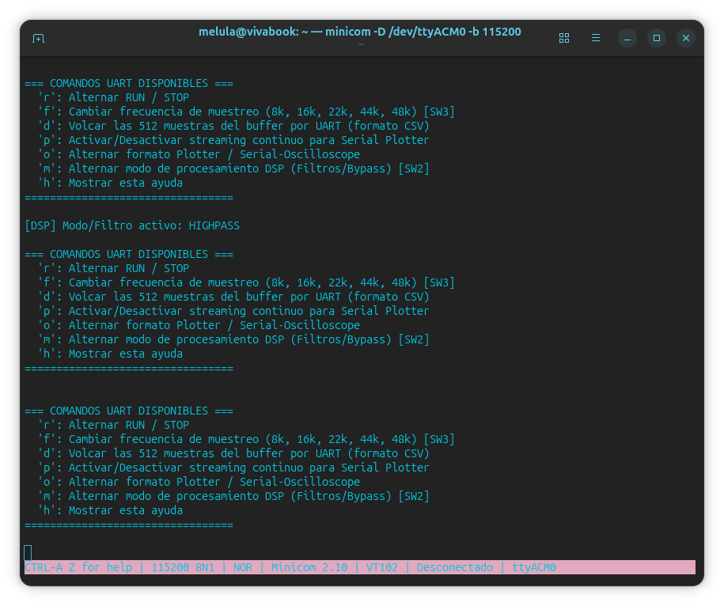

**16 kHz, repetición con el protocolo corregido:** tras un reset, se pasó a
16 kHz con `f` y se cambió de filtro solo con SW3, esperando más de 10 s en
cada uno y sin enviar teclas durante los bloqueos.

- **Pasa altos (688 taps):** la consola mostró solo `[D` (el comienzo de
  `[DSP] Modo/Filtro activo: HIGHPASS`) y no imprimió nada más.
- **Pasa banda (690 taps):** no apareció ningún mensaje. ❌

En una segunda repetición (reset, 16 kHz con `f`, filtros con SW3), el pasa
altos sí imprimió completo `[DSP] Modo/Filtro activo: HIGHPASS`, y la consola
se bloqueó recién al pasar al pasa banda:

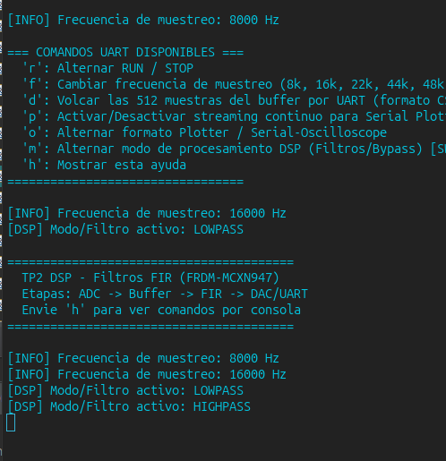

Como en una corrida el pasa altos se bloqueó y en la otra no, a 16 kHz queda
**justo en el límite** del tiempo disponible (⚠️): usa prácticamente el 100 %
del CPU, y cualquier diferencia mínima decide si al loop principal le queda
tiempo o no. En la segunda corrida no se envió `h`, así que no se confirmó que
la consola siguiera respondiendo con el pasa altos activo. El pasa banda, con
apenas 2 taps más, no entra en ninguna de las dos corridas.

A 16 kHz, con procesamiento muestra a muestra, el pasa bajos entra con margen,
el pasa altos queda al límite, y el pasa banda y el elimina banda no entran.

**22 kHz:** el pasa bajos (86 taps) confirmó el cambio y respondió a `h` con la
ayuda completa. Al pasar al pasa altos (948 taps) la consola imprimió solo `[`
y se bloqueó. El pasa banda (946 taps) y el elimina banda (1774 taps) no se
probaron: tienen prácticamente la misma cantidad de taps o más, así que también
se bloquearían.

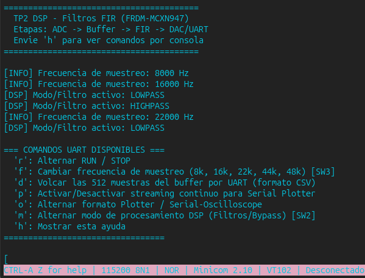

**44 kHz:** el pasa bajos (170 taps) confirmó el cambio y respondió a `h`. Al
pasar al pasa altos (1890 taps) la consola dejó de responder.

En la captura, la línea `[DSP] Modo/Filtro activo: HIGHPASS` que aparece antes
de `[INFO] Frecuencia de muestreo: 44000 Hz` **no corresponde a 44 kHz**: es el
mensaje que había quedado cortado en `[` a 22 kHz, que se terminó de imprimir
al destrabarse la placa. El nombre del filtro se evalúa cuando empieza el
`PRINTF`, por eso dice HIGHPASS aunque el filtro ya haya cambiado. Esto
confirma que los mensajes que se imprimen después de un bloqueo pueden estar
desfasados respecto del estado real.

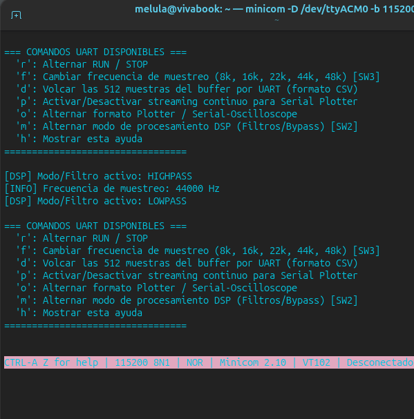

**48 kHz:** tras un reset se llegó a 48 kHz en BYPASS con `f` (sin carga, sin
bloqueos). Al pasar al pasa bajos con SW3 no apareció ningún mensaje, ni
respondió a `h`.

Para confirmar en qué filtro quedó la placa se usó el debugger. Cuando la placa
se bloquea, la consola no sirve para saberlo: el mensaje que anuncia el filtro
no llega a imprimirse. Pero el procesador guarda en memoria la configuración
del filtro que está ejecutando, y MCUXpresso permite leerla pausando la
ejecución (*Suspend*) y consultando la variable `s_fir_instance.numTaps` en la
vista *Expressions*. Esa variable es la **cantidad de coeficientes (taps) del
filtro activo**, y cada combinación de filtro y Fs tiene un valor distinto.

El valor fue **186**, que corresponde únicamente al pasa bajos a 48 kHz. Queda
confirmado que el bloqueo es de ese filtro: ni siquiera el pasa bajos entra a
48 kHz con procesamiento muestra a muestra.

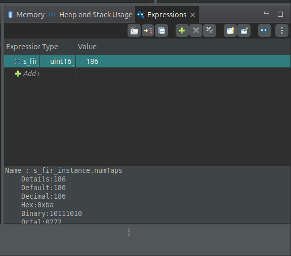

Al destrabar la placa con SW3 (pasando por los filtros hasta BYPASS), los
mensajes de recuperación aparecieron más abajo en la terminal y no se vieron
en el momento. Hay que mirar siempre el final de la salida de minicom.

#### Diagnóstico con el debugger de un bloqueo

En una de las pruebas la consola dejó de responder mientras se creía que el
filtro activo era el pasa bajos (64 taps a 16 kHz, que no puede saturar el
CPU). Los botones seguían funcionando (el LED cambiaba con la Fs), pero no
aparecía ningún mensaje. Para ver qué estaba haciendo el procesador se pausó
la ejecución (*Suspend*) desde MCUXpresso, sin resetear la placa.

La pila de llamadas muestra que el loop principal estaba a mitad de imprimir
un cambio de filtro (`PRINTF` de `MCXN947_Project_TP2.c:237`) y que lo
interrumpió la ISR del ADC, que estaba dentro de `arm_fir_q15`:

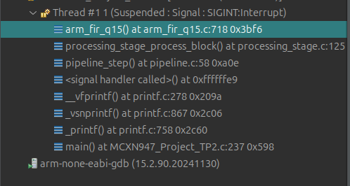

Inspeccionando `s_fir_instance.numTaps` en la vista *Expressions* se obtuvo
**2064**, que corresponde únicamente al **pasa banda a 48 kHz**:

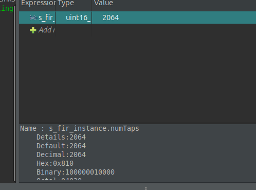

Es decir, el bloqueo no era del pasa bajos ni un error del programa: con los
botones se había avanzado hasta el pasa banda a 48 kHz, que necesita unos
2064 × 14 ≈ 29 000 ciclos por muestra cuando hay 3125 disponibles (unas 9
veces más). El loop principal no llega a terminar el `PRINTF` que anuncia el
cambio, y por eso la consola no muestra en qué filtro quedó.

Conclusiones de este diagnóstico:

- Cuando la placa se bloquea, la consola no sirve para saber en qué filtro y
  Fs está, porque el mensaje que lo anuncia no llega a imprimirse. Hay que
  llevar la cuenta de los botones presionados, o pausar con el debugger.
- La pila de llamadas también mostró que el pipeline estaba en modo STOP
  (`pipeline.c:58`, reproducción del buffer en loop), que se activa con la
  tecla `r`. Probablemente se envió `r` por error durante el bloqueo. No
  cambia la carga: en STOP también se filtra una muestra por cada interrupción
  del ADC.

> **Posible problema a revisar (no confirmado):** `uart_stage_try_getchar()`
> (`uart_stage.c`) no borra el flag de *overrun* de la LPUART. Si durante un
> bloqueo se envían muchas teclas, el buffer de recepción se desborda y,
> según el manual, la LPUART deja de almacenar datos mientras ese flag esté
> activo. Eso haría que la placa deje de recibir comandos hasta un reset. No
> se llegó a observar de forma aislada en estas pruebas.

#### Protocolo corregido para repetir las pruebas

1. Reset y selección de la Fs con `f`.
2. Cambio de filtro solo con SW3 (no con `m`).
3. Esperar unos 10 s a que aparezca la confirmación del filtro.
4. Enviar una sola `h` y esperar otros 10 s.
5. No enviar más teclas mientras la placa esté bloqueada.

Resultado: ✅ responde enseguida, ⚠️ responde con demora, ❌ no responde.

#### Resultado esperado

En la prueba anterior (Release `-Os`, procesamiento por bloques de 32
muestras), los casos límite (HP a 16 kHz entra, HP a 22 kHz no) acotaron el
costo real a entre ~7 y ~14 ciclos por tap. Con ese rango y los taps actuales, se espera:

| Filtro | 8k | 16k | 22k | 44k | 48k |
|---|---|---|---|---|---|
| LP | ✅ | ✅ | ✅ | ✅ | ✅ |
| HP | ✅ | ⚠️ | ❌ | ❌ | ❌ |
| BP | ✅ | ⚠️ | ❌ | ❌ | ❌ |
| BS | ✅ | ❌ | ❌ | ❌ | ❌ |

Al procesar de a una muestra, `arm_fir_q15` paga en cada muestra un costo fijo
por llamada (incluido el desplazamiento del buffer de estado), así que el
resultado real podría ser algo peor que el de la prueba por bloques.

#### Costo de procesamiento estimado a partir de los resultados

A 150 MHz hay `150e6 / Fs` ciclos disponibles por muestra. El costo de cada
muestra tiene dos partes:

- un **costo fijo** `F`, que no depende del filtro: entrada a la ISR, lectura
  del ADC, escritura del DAC, buffers circulares y llamada a `arm_fir_q15`;
- un **costo por tap** `c`, proporcional a la longitud del filtro.

Un filtro entra si `F + c · taps ≤ 150e6 / Fs`. Los tres casos límite de las
pruebas alcanzan para acotar ambos valores:

| Caso | Taps | Ciclos disponibles | Resultado | Condición |
|---|---|---|---|---|
| HP a 16 kHz | 688 | 9375 | ⚠️ al límite (BP con 690 no entra) | `F + 688 c ≈ 9375` |
| LP a 44 kHz | 170 | 3409 | ✅ | `F + 170 c ≤ 3409` |
| LP a 48 kHz | 186 | 3125 | ❌ | `F + 186 c > 3125` |

Resolviendo:

- **costo por tap: entre ~11,5 y ~12,5 ciclos**;
- **costo fijo: entre ~800 y ~1450 ciclos por muestra.**

El costo fijo explica por qué las Fs altas son tan exigentes aunque el filtro
sea corto: a 48 kHz solo ese costo ocupa entre un cuarto y casi la mitad de los
3125 ciclos disponibles, y lo que queda no alcanza ni para los 186 taps del
pasa bajos.

En la prueba anterior, con bloques de 32 muestras, el HP a 16 kHz y el LP a
48 kHz entraban sin bloqueos. Con bloques, el costo fijo por llamada se reparte
entre 32 muestras en lugar de pagarse en cada una, y `arm_fir_q15` aprovecha
mejor las instrucciones SIMD. Volver al procesamiento muestra a muestra hizo
el filtrado más lento. Para medir los valores exactos hay que usar
`DWT->CYCCNT`.

## Conclusiones

Comparación de las dos versiones del firmware (Release `-Os`):

| Filtro | 8k | 16k | 22k | 44k | 48k |
|---|---|---|---|---|---|
| LP, por bloques | ✅ | ✅ | ✅ | ✅ | ✅ |
| LP, muestra a muestra | ✅ | ✅ | ✅ | ✅ | ❌ |
| HP, por bloques | ✅ | ✅ | ❌ | ❌ | ❌ |
| HP, muestra a muestra | ✅ | ⚠️ | ❌ | ❌ | ❌ |
| BP, por bloques | ✅ | ✅ | ❌ | ❌ | ❌ |
| BP, muestra a muestra | ✅ | ❌ | ❌ | ❌ | ❌ |
| BS, por bloques | ✅ | ❌ | ❌ | ❌ | ❌ |
| BS, muestra a muestra | ✅ | ❌ | ❌ | ❌ | ❌ |

Las diferencias aparecen justo en los casos donde los taps son los mismos en
las dos versiones (LP a 48 kHz: 186; HP y BP a 16 kHz: 688 y 690), así que se
deben al tipo de procesamiento y no a los coeficientes.

- A 8 kHz entran los cuatro filtros en las dos versiones.
- Los filtros con cortes en baja frecuencia (HP, BP y BS) necesitan cientos o
  miles de taps y dejan de entrar a partir de 16 o 22 kHz.
- El procesamiento por bloques rinde más: con él entran el LP a 48 kHz y el
  HP y el BP a 16 kHz, que muestra a muestra no entran o quedan al límite.
  Además, esa versión detectaba la sobrecarga y pasaba sola a BYPASS, lo que
  evitaba que la placa quedara bloqueada.
- Muestra a muestra, a 48 kHz no entra ningún filtro, ni siquiera el pasa
  bajos, por el costo fijo por muestra.
- Los botones están invertidos respecto de la documentación (SW2 cambia la Fs,
  SW3 cambia el filtro).
