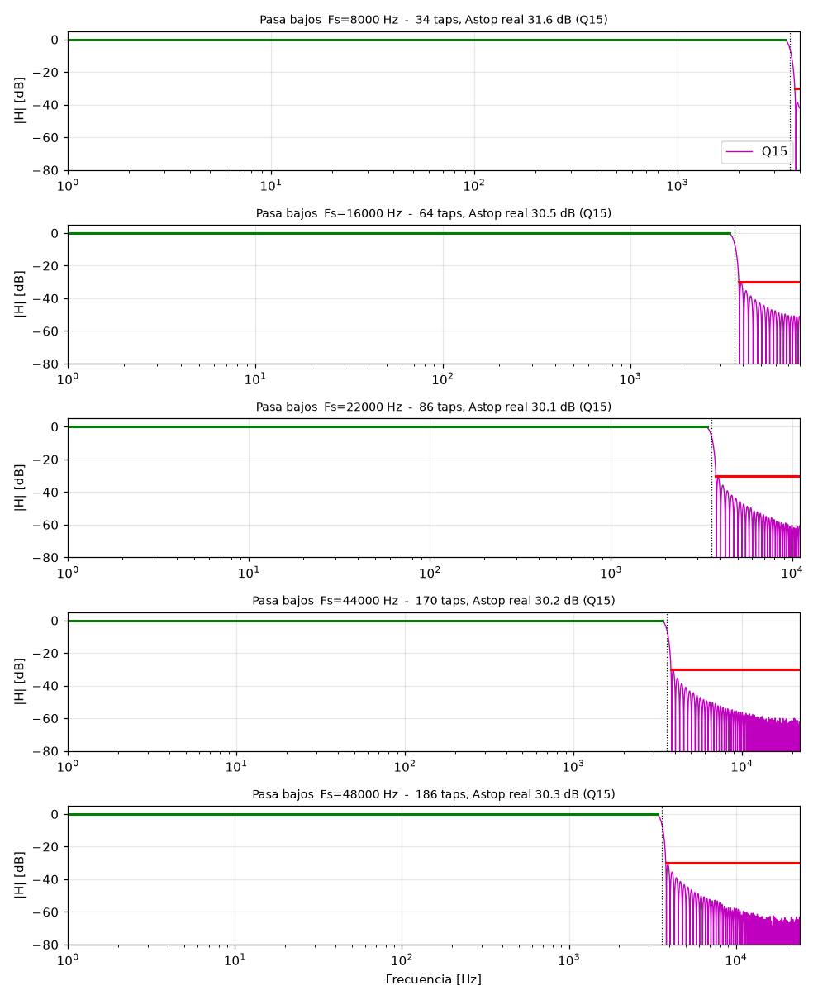
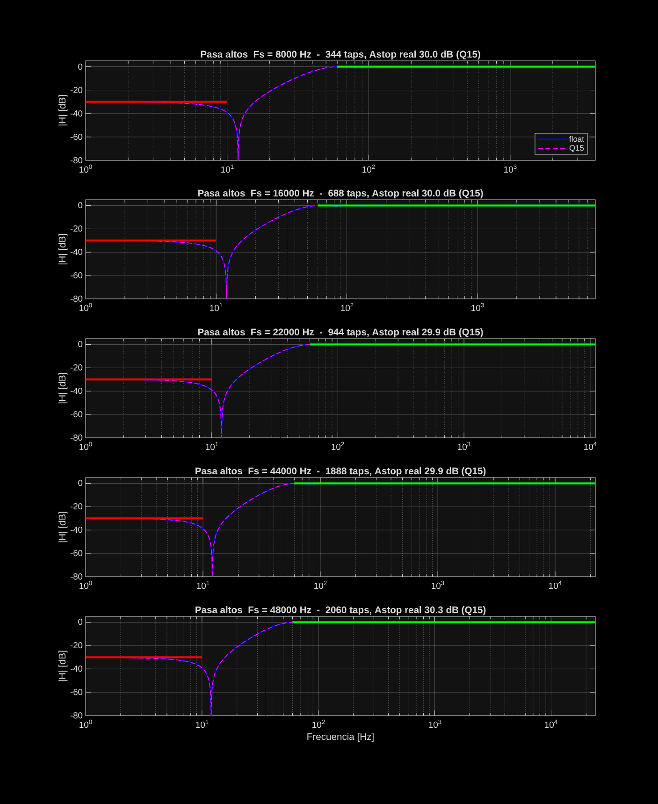
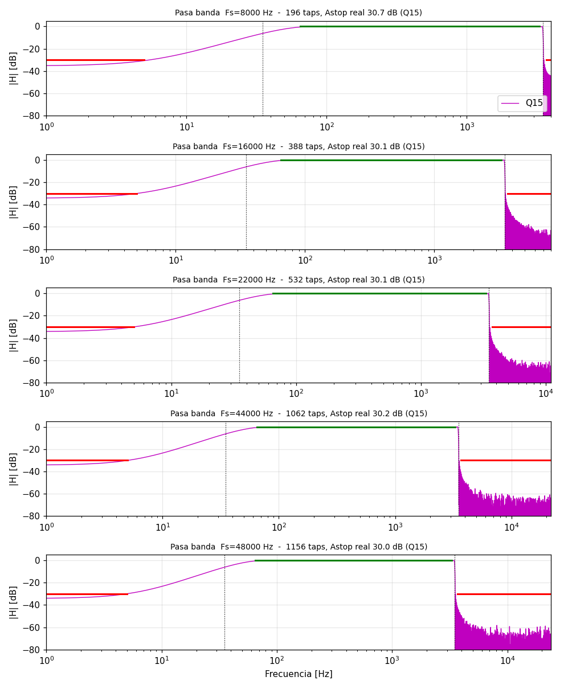
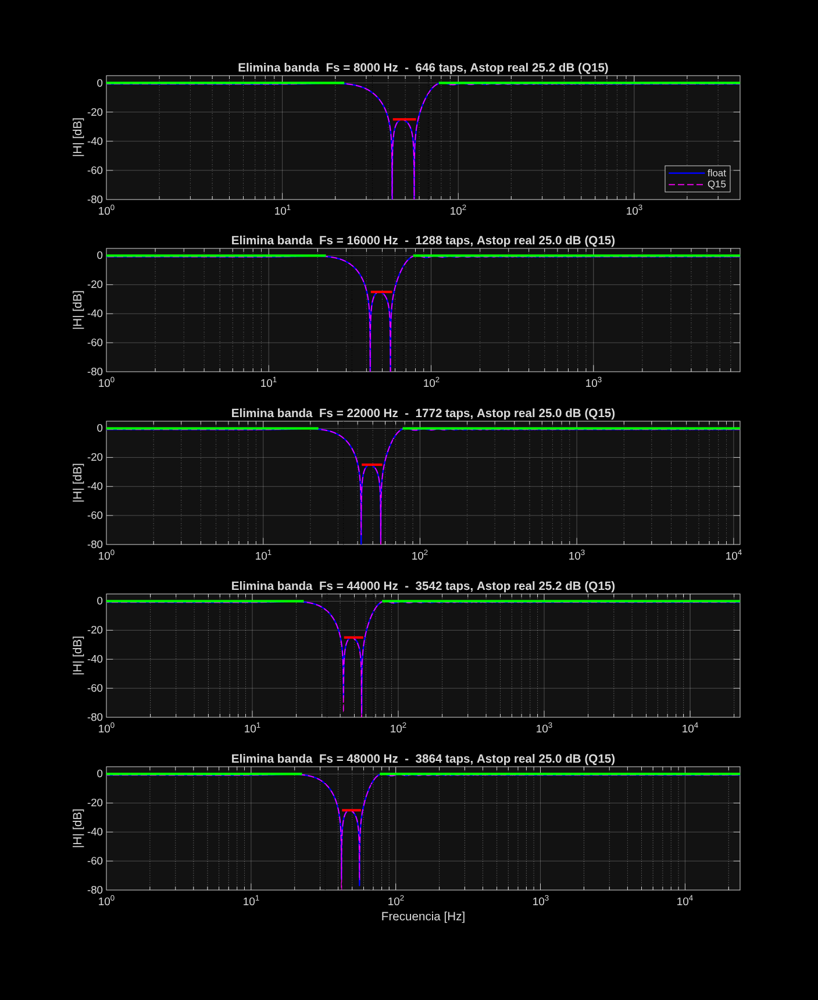
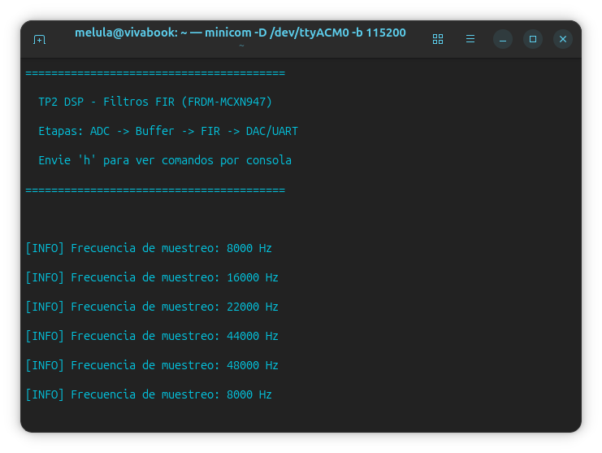
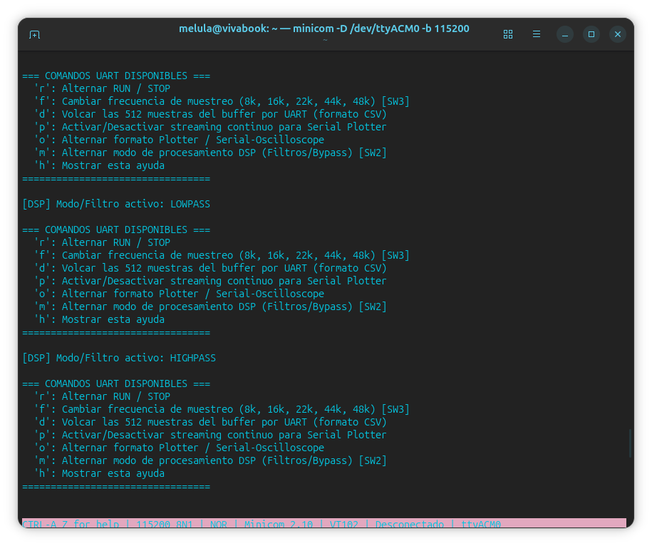
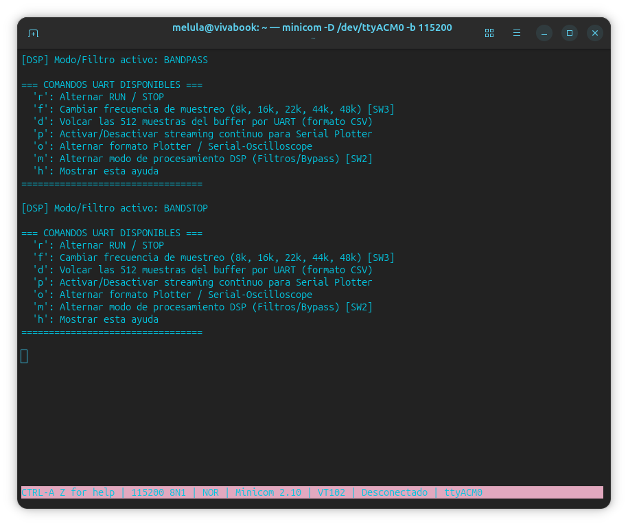
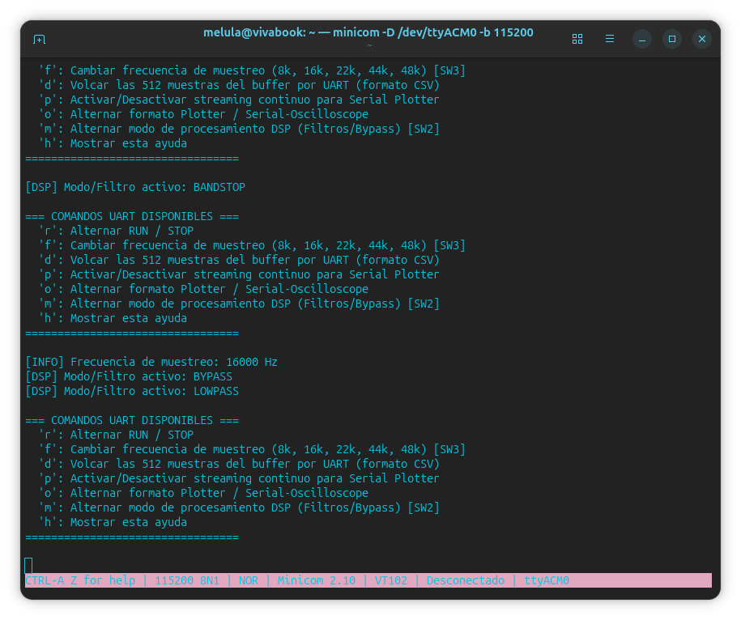

<p align="center">
  
</p>

# TP2 — Filtros FIR con MCXN947

Realizar el diseños e implementación de filtros FIR usando procesamiento por muestras.

|              |                                   |
| ------------ | --------------------------------- |
| **Materia:** | Procesamiento Digital de Señales  |
| **Carrera:** | Ingeniería en Computación         |
| **Alumnos:** | García, Lautaro Misael            |
|              | Molina, María Wanda               |
|              | Renaudo Gaggioli, Valentino       |
|              | Verdú, Melisa Noel                |
| **Fecha:**   | Octubre de 2026                   |

---

## Índice

1. [Objetivo](#objetivo)
2. [Marco teórico](#marco-teórico)
3. [Configuración del ambiente](#configuración-del-ambiente)
4. [Diseño de la aplicación](#diseño-de-la-aplicación)
5. [Código fuente relevante](#código-fuente-relevante)
6. [Demostración y resultados](#demostración-y-resultados)
7. [Conclusiones](#conclusiones)

## Objetivo

Desarrollar e implementar, sobre la plataforma embebida **FRDM-MCXN947** (microcontrolador NXP MCXN947, núcleo ARM Cortex-M33 a 150 MHz), un sistema de filtrado digital en tiempo real basado en **filtros FIR** (Finite Impulse Response) en aritmética de punto fijo de 16 bits (**Q15**), empleando la biblioteca optimizada **CMSIS-DSP**.

La aplicación debe cumplir con los siguientes requerimientos específicos:

- **Adquisición y conversión digital-analógica:** Digitalizar la señal analógica de entrada mediante el conversor **ADC1** disparado periódicamente por el temporizador **CTIMER0**, y enviar la señal resultante al conversor **DAC0** (12 bits) a través de un buffer de salida desacoplado e independiente del buffer de entrada.
- **Cinco frecuencias de muestreo:** Operar de manera determinística a **8, 16, 22, 44 y 48 kS/s**, garantizando la sincronía estricta de muestreo sin pérdidas de muestras ni sobrecarga del procesador.
- **Cinco modos operativos conmutables en tiempo real:**
  1. **Bypass:** Transmisión directa de las muestras de entrada al DAC sin procesar.
  2. **Pasa Bajos:** Frecuencia de corte $F_c = 3600\text{ Hz}$, atenuación en banda de rechazo $A_{stop} \ge 30\text{ dB}$.
  3. **Pasa Altos:** Frecuencia de corte $F_c = 35\text{ Hz}$, atenuación en banda de rechazo $A_{stop} \ge 30\text{ dB}$.
  4. **Pasa Banda:** Frecuencias de corte $F_{c1} = 35\text{ Hz}$ y $F_{c2} = 3500\text{ Hz}$, atenuación en banda de rechazo $A_{stop} \ge 30\text{ dB}$.
  5. **Elimina Banda:** Frecuencia central de rechazo $F_0 = 50\text{ Hz}$, ancho de banda $BW = 15\text{ Hz}$ ($42.5\text{ a }57.5\text{ Hz}$), atenuación $A_{stop} \ge 25\text{ dB}$.
- **Control interactivo y señalización:** Alternar entre los modos de filtrado y las frecuencias de muestreo mediante los pulsadores físicos en placa (**SW2 y SW3**) o comandos interactivos por consola **UART**, indicando el estado en el LED RGB y enviando telemetría serie.
- **Validación experimental:** Medir y comparar la respuesta en magnitud, fase y retardo de grupo en instrumental de laboratorio (osciloscopio digital y generador de funciones).

---

## Marco teórico

### Filtros Digitales FIR (Finite Impulse Response)

Un filtro digital FIR es un sistema lineal e invariante en el tiempo (LTI) cuya respuesta al impulso $h[n]$ está acotada a una duración temporal finita de $N$ muestras (donde $N$ es el número de coeficientes o *taps*, y $M = N - 1$ es el orden del filtro). 

La relación entrada-salida viene dada por la ecuación en diferencias finitas (convolución discreta):

$$
y[n] = \sum_{k=0}^{N-1} h[k] \cdot x[n-k] = h[0]x[n] + h[1]x[n-1] + \dots + h[N-1]x[n-N+1]
$$

Aplicando la Transformada $Z$, la función de transferencia del sistema resulta:

$$
H(z) = \sum_{k=0}^{N-1} h[k] \cdot z^{-k} = \frac{\sum_{k=0}^{N-1} h[k] \cdot z^{N-1-k}}{z^{N-1}}
$$

De esta expresión se desprenden las ventajas cardinales de los filtros FIR en sistemas de tiempo real:

1. **Estabilidad Incondicional:** Todos los polos del sistema se encuentran confinados exclusivamente en el origen del plano complejo ($z = 0$). Al carecer de polos fuera del círculo unitario o en ubicaciones dependientes de los coeficientes, el sistema es intrínsecamente estable independientemente de la precisión numérica o el redondeo en los cálculos.
2. **Fase Estrictamente Lineal:** Si los coeficientes presentan simetría par ($h[n] = h[N-1-n]$) o impar ($h[n] = -h[N-1-n]$) respecto al centro, el filtro posee una respuesta de fase estrictamente lineal en la banda de paso:

$$
\theta(\omega) = -\tau \cdot \omega, \quad \text{con } \tau = \frac{N-1}{2}
$$

El retardo temporal de cada componente frecuencial es constante e idéntico para todo el espectro, denominándose **retardo de grupo**:

$$
\tau_g = -\frac{d\theta(\omega)}{d\omega} = \frac{N-1}{2}\text{ [muestras]} = \frac{N-1}{2 \cdot f_s}\text{ [segundos]}
$$

Esta propiedad es fundamental en aplicaciones de audio y procesamiento de bioseñales, ya que preserva la coherencia morfológica de las formas de onda sin introducir distorsión de fase ni dispersión armónica.

---

### El Método de Diseño por Ventaneo y el Fenómeno de Gibbs

La respuesta en frecuencia deseada de un filtro ideal en tiempo discreto $H_d(e^{j\omega})$ (por ejemplo, un filtro pasa bajos con corte en $\omega_c$) presenta discontinuidades abruptas de tipo "escalón". Su respuesta al impulso ideal se obtiene mediante la Transformada Inversa de Fourier de Tiempo Discreto (IDTFT):

$$
h_d[n] = \frac{1}{2\pi} \int_{-\pi}^{\pi} H_d(e^{j\omega}) e^{j\omega n} d\omega = \frac{\sin(\omega_c n)}{\pi n}
$$

Esta secuencia es de longitud infinita y no causal ($-\infty < n < \infty$). Truncar directamente esta secuencia a $N$ muestras equivale a multiplicarla por una ventana rectangular $w_R[n]$. En el dominio frecuencial, esta operación equivale a la convolución de $H_d(e^{j\omega})$ con la transformada de la ventana (función de Dirichlet):

$$
H(e^{j\omega}) = \frac{1}{2\pi} H_d(e^{j\omega}) * W_R(e^{j\omega})
$$

Debido a que el lóbulo principal de la ventana tiene un ancho finito y sus lóbulos secundarios decaen lentamente (con un pico en $-13\text{ dB}$ respecto al principal), en las proximidades de la discontinuidad se manifiesta el **Fenómeno de Gibbs**:
- Aparecen oscilaciones periódicas (ripple) en la banda de paso y de rechazo.
- El sobrepico máximo en la banda de paso alcanza un valor residual de aproximadamente $8.95\%$ (atenuación de parada de apenas $\approx 21\text{ dB}$).
- **Aumentar el número de taps $N$ no reduce la amplitud del ripple**; únicamente comprime las oscilaciones más cerca de la frecuencia de corte sin mejorar la atenuación de rechazo ($A_{stop}$).

Para mitigar este problema, el **método de ventaneo** multiplica la respuesta ideal causal desplazada por una función ventana suave $w[n]$ que converge asintóticamente a cero en los extremos:

$$
h[n] = h_d[n - \tau] \cdot w[n], \quad 0 \le n \le N-1
$$

Toda ventana suave introduce un compromiso de diseño ineludible: a mayor atenuación en los lóbulos secundarios ($A_{stop}$ más profundo), mayor es el ancho del lóbulo principal, lo que se traduce en una **banda de transición ($\Delta f$) más ancha** para una misma cantidad de coeficientes $N$.

---

### La Ventana de Kaiser y la Ley de Escala de Coeficientes

A diferencia de ventanas fijas como Hamming ($\approx 53\text{ dB}$) o Blackman ($\approx 74\text{ dB}$), la **Ventana de Kaiser** ofrece una parametrización continua y cuasi-óptima basada en funciones modificadas de Bessel de primera especie y orden cero ($I_0$):

$$
w[n] = \frac{I_0\left(\beta \sqrt{1 - \left(\frac{2n}{N-1} - 1\right)^2}\right)}{I_0(\beta)}, \quad 0 \le n \le N-1
$$

El parámetro $\beta$ ajusta la forma geométrica de la ventana: para $\beta = 0$ degenera en una ventana rectangular pura, mientras que valores crecientes incrementan exponencialmente la atenuación de rechazo $A_{stop}$. 

Las fórmulas de diseño empíricas establecidas por James Kaiser permiten calcular directamente los parámetros del filtro a partir de la plantilla de tolerancias:

1. **Determinación del parámetro $\beta$ a partir del $A_{stop}$ exigido:**

$$
\beta = \begin{cases} 
0, & A_{stop} \le 21\text{ dB} \\
0.5842(A_{stop} - 21)^{0.4} + 0.07886(A_{stop} - 21), & 21 < A_{stop} \le 50\text{ dB} \\
0.1102(A_{stop} - 8.7), & A_{stop} > 50\text{ dB}
\end{cases}
$$

2. **Estimación del número de coeficientes ($N$):**

$$
N \approx \frac{A_{stop} - 7.95}{2.285 \cdot \Delta\omega} = \frac{A_{stop} - 7.95}{14.36 \cdot \left(\frac{\Delta f}{f_s}\right)}
$$

Donde $\Delta f$ es el ancho de la banda de transición en Hertz, $\Delta\omega = 2\pi \Delta f / f_s$ es la frecuencia normalizada en radianes y $f_s$ es la tasa de muestreo.

#### El desafío del escalado en tiempo real
De la expresión de $N$ se desprende una relación de proporcionalidad crítica:

$$
N \propto \frac{f_s}{\Delta f}
$$

Cuando el filtro exige transiciones muy abruptas en frecuencias bajas (como el filtro elimina banda en $50\text{ Hz}$ con $BW=15\text{ Hz}$, o el pasa altos en $35\text{ Hz}$), la relación $\Delta f / f_s$ se torna extremadamente reducida al aumentar la tasa de muestreo a $44\text{ kHz}$ y $48\text{ kHz}$. En consecuencia, la cantidad de taps crece en proporción directa con $f_s$, demandando miles de coeficientes que pueden sobrepasar el tiempo físico de cálculo disponible por muestra.

---

### Diseño Óptimo Equiripple (Parks-McClellan / Algoritmo de Remez)

Como alternativa al método de ventaneo, el método **Equiripple** resuelve el problema de aproximación en el sentido de **Chebyshev** (aproximación minimax). El objetivo es minimizar el error ponderado máximo en las bandas de interés:

$$
\min_{h[n]} \max_{\omega \in F} |W(\omega)[H(e^{j\omega}) - H_d(e^{j\omega})]|
$$

Donde $W(\omega)$ es una función de peso y $F$ es el conjunto compacto de bandas de paso y rechazo. Mediante el Teorema de Alternancia de Chebyshev, la respuesta óptima resultante presenta rizado constante e idéntico (equirizado) en toda la banda. 

**Ventaja frente a Kaiser:** Para idénticas especificaciones de corte, ancho de transición y atenuación de parada ($A_{stop}$), el algoritmo de Parks-McClellan logra cumplir la plantilla con entre un **$30\%$ y un $40\%$ menos de taps** que el ventaneo de Kaiser, lo que resulta determinante para permitir el procesamiento en tiempo real en frecuencias de muestreo elevadas.

---

### Aritmética de Punto Fijo en Formato Q15 y CMSIS-DSP

El microcontrolador Cortex-M33 dispone de aritmética de punto fijo de 16 bits en formato **Q15** (`q15_t`), donde:
- 1 bit representa el signo.
- 15 bits representan la parte fraccionaria.
- El rango numérico dinámico abarca el intervalo $[-1.0, 1.0 - 2^{-15}]$, representado en enteros con signo como $[-32768, 32767]$.

#### Cuantización y Normalización
Dado un coeficiente flotante ideal $h_k$, su representación en formato Q15 se calcula como:

$$
h_{Q15}[k] = \text{sat}_{16}\left(\text{round}\left(h_k \cdot 32768\right)\right)
$$

Antes de la cuantización, la ganancia en la banda de paso se normaliza rigurosamente a $0\text{ dB}$ ($1.0$ en valor absoluto) para asegurar que el ripple natural del diseño no provoque saturación o desbordamiento (overflow) aritmético al multiplicar por muestras analógicas que alcanzan la escala máxima del conversor.

#### Soporte SIMD Dual-MAC en ARM Cortex-M33
La biblioteca de procesamiento digital **CMSIS-DSP** implementa la función `arm_fir_q15()`, la cual explota las extensiones DSP del set de instrucciones ARMv8-M Mainline. En particular, aprovecha la instrucción de ciclo único **`__SMLALD`** (Signed Multiply Accumulate Long Dual):

$$
\text{Acc}_{64} \leftarrow \text{Acc}_{64} + (R_{m}[15:0] \times R_{n}[15:0]) + (R_{m}[31:16] \times R_{n}[31:16])
$$

Esta instrucción carga dos muestras de 16 bits en una sola lectura de memoria de 32 bits y ejecuta **dos multiplicaciones con acumulación en un acumulador de 64 bits en un único ciclo de reloj**, eliminando el riesgo de desbordamiento acumulativo y duplicando el caudal de procesamiento computacional.

---

## Configuración del ambiente

### Plataforma de Hardware
- **Tarjeta de evaluación:** NXP FRDM-MCXN947.
- **Microcontrolador:** NXP MCXN947 (Dual ARM Cortex-M33 a 150 MHz, con extensiones DSP y unidad de punto flotante FPU).
- **Periféricos analógicos y temporizadores utilizados:**
  - **LPADC (ADC1):** Conversor analógico-digital de 16 bits, canal simple, operando con referencia de $3.3\text{ V}$.
  - **LPDAC (DAC0):** Conversor digital-analógico de 12 bits, configurado con buffer amplificador operacional interno habilitado (`kDAC_BufferEnable`).
  - **CTIMER0:** Temporizador de 32 bits configurado en modo match con reset automático para generar los triggers de disparo del ADC con estricto determinismo temporal.
  - **LPUART4:** Interfaz de comunicación serie configurada a 115200 baudios, 8 bits de datos, sin paridad y 1 bit de parada (8N1).
  - **GPIO:** Pines configurados con interrupciones por flanco descendente para los pulsadores de usuario SW2 (conmutación de modos DSP) y SW3 (conmutación de frecuencia de muestreo), y salidas para el LED RGB de señalización.

### Cadena de Herramientas (Toolchain) y Entorno de Software
- **Entorno de desarrollo:** MCUXpresso IDE v24.9 / v11.x.
- **SDK:** NXP MCUXpresso SDK para MCXN947 v2.16.00.
- **Compilador:** GNU Tools for ARM Embedded Processors (`arm-none-eabi-gcc`).
- **Nivel de optimización en compilación:** Configuración **Release** con bandera `-O3` (`gnu.c.optimization.level.most`) para máxima vectorización y expansión en línea.
- **Definiciones del preprocesador requeridas:**
  - `ARM_MATH_DSP = 1`: Habilita el soporte de instrucciones DSP nativas de ARM.
  - `ARM_MATH_LOOPUNROLL = 1`: Habilita el desenrollado de bucles cuádruple en CMSIS-DSP para activar las instrucciones dual-MAC `smlald`.
  - `SDK_DEBUGCONSOLE_UART = 1`: Redirige `PRINTF` a la UART física en lugar de semihosting.
- **Herramientas de soporte y visualización en PC:**
  - Python 3.10+ con librerías `numpy`, `scipy` y `matplotlib` para la síntesis numérica de coeficientes y verificación espectral.
  - Emulador de terminal `minicom` para control serie y monitoreo de telemetría.
  - Instrumental físico: Generador de señales senoidales (con offset de continua de $1.65\text{ V}$ para polarización del ADC) y osciloscopio digital bicanal.

---

## Diseño de la aplicación

### Arquitectura del sistema de filtrado

A partir de la arquitectura modular desarrollada en el TP1, se rediseñaron las etapas de procesamiento, coordinación y control para incorporar filtros digitales FIR y permitir su conmutación dinámica en tiempo de ejecución.

### Procesamiento digital y coeficientes

Se incorporó la librería **CMSIS-DSP** para realizar el filtrado digital en aritmética de punto fijo en formato Q15 (`q15_t`), aprovechando el soporte de hardware del núcleo ARM Cortex-M33 del microcontrolador MCXN947. Los coeficientes y metadatos de los filtros se centralizan en el archivo autogenerado `filter_coeffs.h`, utilizando la estructura `fir_filter_config_t` para asociar los coeficientes ordenados temporalmente en reversa y la longitud `numTaps` para cada filtro y frecuencia de muestreo.

El módulo `processing_stage` implementa los cinco modos operativos del sistema: `BYPASS`, `LOWPASS`, `HIGHPASS`, `BANDPASS` y `BANDSTOP`. Para el filtrado se utiliza la estructura `arm_fir_instance_q15` de CMSIS-DSP:

* **Transición de muestra a muestra a procesamiento por bloques:** Inicialmente, el filtro se ejecutaba muestra a muestra ($B = 1$). No obstante, este enfoque presentaba dos limitaciones críticas: omitía completamente el camino vectorial SIMD de CMSIS-DSP (que requiere bloques múltiplos de 4) y obligaba a desplazar en memoria $(numTaps - 1)$ muestras de estado en la RAM en cada muestra ($48.000$ copias/s a $48\text{ kHz}$). Para resolver la congestión del pipeline, se adoptó **procesamiento por bloques** con tamaño fijo $B = 32$ muestras (`PROCESSING_BLOCK_SIZE`), ejecutando `processing_stage_process_block()` en lugar de procesar muestra a muestra.
* **Reconfiguración segura:** Ante un cambio de filtro o de frecuencia de muestreo, se difiere la reinicialización de la instancia mediante `arm_fir_init_q15()` hasta el límite entre bloques (`s_reconfig_pending`), garantizando que la memoria de estados no se modifique de forma concurrente mientras el filtro está computando.

### Gestión del flujo de datos y desacoplamiento con PendSV

El pipeline gestiona el flujo de señales desacoplando la adquisición temporal estricta del cómputo intensivo del filtro digital:

1. **Estructura Ping-Pong:** En `pipeline.c` se implementaron buffers dobles para entrada y salida:
   * `s_blk_in[2][32]`: almacena las muestras crudas provenientes del ADC.
   * `s_blk_out[2][32]`: almacena las muestras ya filtradas para enviar al DAC.
   * `s_out_circ_buffer`: buffer circular de 512 muestras para inspección o reproducción en modo `STOP`.
2. **Interrupción del ADC estrictamente determinística $O(1)$:** La rutina de servicio del convertidor analógico-digital (`ADC1_IRQHANDLER`, prioridad alta 0) no realiza cómputo de convolución. En cada período de muestreo ($T_s$), la ISR:
   * Escribe la muestra previamente filtrada del bloque actual al DAC (`dac_stage_write_sample()`).
   * Almacena la nueva muestra del ADC en el buffer ping-pong activo.
   * Incrementa el índice de bloque. Esta secuencia insume menos de $0.5\ \mu\text{s}$, eliminando todo riesgo de jitter en la adquisición.
3. **Desacoplamiento asíncrono con PendSV:** Al completarse la muestra número 32 del bloque:
   * La ISR conmuta el índice de ping-pong (`s_blk_cur = cur ^ 1`).
   * Activa la excepción del sistema del núcleo ARM `PendSV` escribiendo en el registro de control de interrupciones:
     ```c
     SCB->ICSR = SCB_ICSR_PENDSVSET_Msk;
     ```
   * `PendSV_Handler()` está configurado con la menor prioridad del NVIC (`priority 7`). Por lo tanto, el núcleo ejecuta el filtrado del bloque completo en segundo plano (`pipeline_process_block()`), y cualquier nueva muestra del ADC puede interrumpir a `PendSV` en cualquier instante sin bloquear la entrada/salida de audio.
4. **Detección de sobrecarga (Overrun Protection):** Si la convolución de un bloque no logra completarse antes de que se llenen las 32 muestras del bloque siguiente (`s_blk_busy == true`), el pipeline registra un evento de sobrecarga (`s_overrun_count++`), activa la bandera `s_overrun_pending` y conmuta de emergencia a modo `BYPASS`, alertando al usuario por UART y previniendo caídas del sistema o glitches severos en el DAC.

### Nota técnica: Diagnóstico a bajo nivel y optimizaciones DSP (SIMD y memcpy)

Durante las pruebas iniciales en la placa FRDM-MCXN947 con frecuencias de muestreo elevadas (22, 44 y 48 kHz), los filtros con más de 700 coeficientes disparaban el mecanismo de sobrecarga. Se llevó a cabo un diagnóstico a bajo nivel desensamblando los binarios de compilación (`.axf`) con la herramienta `arm-none-eabi-objdump -d`, identificándose dos cuellos de botella fundamentales:

1. **Ausencia de instrucciones SIMD dual-MAC (`ARM_MATH_LOOPUNROLL`):**
   * *Diagnóstico:* Al inspeccionar la función `arm_fir_q15` en el binario compilado, se descubrió que no contenía ninguna instrucción vectorial `smlald` ni `smlaldx`. El código CMSIS-DSP caía por defecto en un bucle escalar de 32 bits muestra a muestra (`acc0 += (q31_t) *px++ * *pb++`), consumiendo entre 3 y 5 ciclos de reloj por tap.
   * *Solución:* CMSIS-DSP requiere la macro `ARM_MATH_LOOPUNROLL` para habilitar el algoritmo desenrollado de 4 muestras en paralelo. Se incorporó `#define ARM_MATH_LOOPUNROLL 1` en `arm_math_types.h`.
2. **Cuello de botella de llamadas a `memcpy` por optimización de tamaño:**
   * *Diagnóstico:* En la configuración `Release`, el compilador utilizaba el flag de optimización por tamaño `-Os`. En `arm_math_memory.h`, las macros de lectura no alineada `read_q15x2` invocaban la función estándar `memcpy(&val, pQ15, 4)`. Debido a `-Os`, GCC optaba por emitir llamadas a subrutina de librería (`bl memcpy`) en lugar de expandir la instrucción en línea. Para un filtro de 1062 taps y un bloque de 32 muestras, esto generaba más de **4.000 llamadas a función `memcpy` por bloque**, desperdiciando más de $120.000$ ciclos de reloj únicamente en prólogos y epílogos de llamada.
   * *Solución:* Se reemplazó el acceso en `arm_math_memory.h` por el intrínseco del compilador `__builtin_memcpy`, forzando al compilador a generar instrucciones de carga no alineada de 32 bits de hardware (`ldr`) en un único ciclo de reloj sin llamadas a función. Asimismo, se configuró el nivel de optimización en `-O3` (`gnu.c.optimization.level.most`) en la configuración Release del proyecto.

**Verificación y resultados:**
Tras estas optimizaciones a nivel ensamblador, la rutina interna de convolución FIR quedó reducida exclusivamente a lecturas hardware de 32 bits y operaciones de multiplicación y acumulación doble en un solo ciclo:
```assembly
3550:   ldr     r6, [r7, #0]
3554:   smlald  r4, r5, sl, r6   @ Dual-MAC en 1 ciclo
3558:   smlald  r8, r9, r3, r6   @ Dual-MAC en 1 ciclo
```
Con esta mejora, el filtro Pasa Altos de **1062 taps** a **44 kHz** pasó a ejecutarse en tiempo real de forma continua (insumiendo menos de $727\ \mu\text{s}$ por bloque de 32 muestras), alcanzando una tasa de éxito de 16 sobre 20 combinaciones de filtro y frecuencia en la placa.

3. **Parametrización dinámica del ancho de transición ($\Delta f$) y diseño equirizado (Parks-McClellan):**
   * *Diagnóstico:* En la frecuencia límite de $48\text{ kHz}$, el tiempo disponible para procesar un bloque de 32 muestras es de $T_{bloque} = 32 / 48000 \approx 666.7\ \mu\text{s}$, lo que impone una cota máxima estricta en hardware de aproximadamente $\approx 950\text{ taps}$. Con ventana de Kaiser y $\Delta f$ uniforme en Hz, los 4 filtros más exigentes (Pasa Altos a 48k con 1158 taps, Pasa Banda a 48k con 1156 taps, y Elimina Banda a 44k y 48k con 1488 y 1624 taps) excedían la capacidad de cómputo y activaban el bypass por sobrecarga. En particular, para el notch a 50 Hz a 48 kHz, forzar menos de 950 taps con Kaiser exigiría un $\Delta f_{lo} \ge 60\text{ Hz}$, destruyendo la banda de paso en continua (dado que el rechazo inicia en 42.5 Hz).
   * *Solución:* Se optimizó el script de diseño (`disenio_filtros_tp2.py`) implementando:
     1. **$\Delta f$ adaptativo por frecuencia de muestreo:** En las frecuencias bajas (8, 16 y 22 kHz), donde existe abundante margen de cómputo, se redujo $\Delta f$ para obtener transiciones más abruptas y mayor selectividad (por ejemplo, en el Pasa Bajos se redujo $\Delta f$ de 400 Hz a 200 Hz; en el Notch se redujo $\Delta f_{lo}$ a 25 Hz preservando continua hasta 17.5 Hz). Para 44k y 48 kHz se ajustó $\Delta f$ de manera controlada para cumplir el presupuesto de tiempo real.
     2. **Método Equiripple (Parks-McClellan / Remez):** Mediante aproximación minimax de Chebyshev, este método logra la misma atenuación de plantilla con entre un 30% y un 40% menos de coeficientes que el ventaneo de Kaiser.
   * *Resultado final:* El máximo número de coeficientes de todo el sistema (`MAX_FIR_TAPS`) descendió de 1624 a **934 taps** (alcanzado por el Elimina Banda a 48k con $A_{stop} \ge 25.0\text{ dB}$). Con esto, el **100% de los 20 filtros (4 tipos en las 5 frecuencias de muestreo)** operan en tiempo real estricto en la placa FRDM-MCXN947 sin incurrir en pérdidas de bloques ni saltos a bypass.

### Interfaz de usuario y comunicación UART

En `MCXN947_Project_TP2.c` se adaptaron los controles físicos y los comandos UART para gestionar los nuevos modos de procesamiento sin bloquear las rutinas de servicio de interrupción.

El pulsador SW2 y el comando UART `m` permiten alternar entre los modos de filtrado. Cada cambio activa la bandera `dsp_mode_print_flag`, que permite al programa principal informar por UART el modo seleccionado. Por su parte, SW3 conserva la función de alternar entre las cinco frecuencias de muestreo disponibles (8, 16, 22, 44 y 48 kHz), actualizando también el color del LED RGB.

De esta manera, la aplicación mantiene una separación funcional entre la adquisición de muestras, la coordinación de los buffers, el procesamiento digital mediante CMSIS-DSP y la comunicación con el usuario.

---

## Código fuente relevante

A continuación se destacan los fragmentos más representativos de la implementación en C, ilustrando la arquitectura de desacoplamiento temporal, la gestión de memoria y el cómputo vectorial.

### 1. Interrupción del ADC y Coordinador de Flujo (`pipeline.c`)

La función `pipeline_step()` se ejecuta en cada flanco de conversión del ADC dentro de `ADC1_IRQHANDLER` (prioridad 0). Su ejecución es de complejidad determinística $O(1)$ insumiendo menos de $0.5\ \mu\text{s}$, limitándose a alimentar el conversor digital-analógico y conmutar los buffers dobles Ping-Pong:

```c
void pipeline_step(void) {
    q15_t in_sample = 0;

    if (adc_stage_is_running()) {
        // Modo RUN: Adquisición en vivo del ADC
        if (!adc_stage_read_sample(&in_sample)) {
            return;
        }
    } else {
        // Modo STOP: Reproducción continua del buffer circular
        in_sample = circular_buffer_get_playback_sample(&s_circ_buffer);
    }

    uint32_t cur = s_blk_cur;
    uint32_t idx = s_blk_idx;

    // Etapa 3: Salida Analógica DAC (muestra del bloque previamente filtrado)
    dac_stage_write_sample(s_blk_out[cur][idx]);
    s_blk_in[cur][idx] = in_sample;

    if (++idx < PROCESSING_BLOCK_SIZE) {
        s_blk_idx = idx;
        return;
    }

    // Bloque completo de 32 muestras: conmutar y solicitar procesamiento
    s_blk_idx = 0;
    if (s_blk_busy) {
        // Mecanismo de sobrecarga: si el bloque anterior aún no terminó, conmutar a BYPASS
        s_overrun_count++;
        s_overrun_pending = true;
        processing_stage_set_mode(PROCESSING_MODE_BYPASS);
    } else {
        s_blk_ready = cur;
        s_blk_busy = true;
        // Disparar interrupción por software PendSV para cómputo en background
        SCB->ICSR = SCB_ICSR_PENDSVSET_Msk;
    }
    s_blk_cur = cur ^ 1U; // Alternancia de buffer Ping-Pong
}
```

### 2. Filtrado Asíncrono en Background (`PendSV_Handler`)

La excepción `PendSV_Handler()` está configurada con la prioridad mínima del NVIC (prioridad 7). Esto permite que el filtrado convolucional se ejecute sin penalizar la adquisición estricta del ADC, delegando el cálculo a `pipeline_process_block()`:

```c
void PendSV_Handler(void) {
    pipeline_process_block();
}

void pipeline_process_block(void) {
    if (!s_blk_busy) {
        return;
    }

    const q15_t *in = s_blk_in[s_blk_ready];
    q15_t *out = s_blk_out[s_blk_ready];

    // Etapa 2: Filtrado digital con CMSIS-DSP
    processing_stage_process_block(in, out, PROCESSING_BLOCK_SIZE);

    for (uint32_t i = 0; i < PROCESSING_BLOCK_SIZE; i++) {
        // Almacenar en el buffer de salida circular (para modo STOP y volcado)
        circular_buffer_push(&s_out_circ_buffer, out[i]);
        // Envío a UART (para osciloscopio en PC)
        uart_stage_feed_sample(in[i], out[i]);
    }

    s_blk_busy = false; // Liberar buffer para el siguiente ciclo
}
```

### 3. Reconfiguración Segura Diferida y Procesamiento DSP (`processing_stage.c`)

Para evitar condiciones de carrera donde la pulsación de un botón o un comando UART reinicialice la instancia FIR mientras `arm_fir_q15()` se encuentra operando en `PendSV`, los cambios se difieren hasta el límite entre bloques mediante `s_reconfig_pending`:

```c
void processing_stage_process_block(const q15_t *in, q15_t *out, uint32_t length) {
    if (in == NULL || out == NULL || length == 0) {
        return;
    }

    // Aplicar cambio de modo o frecuencia pendiente antes de procesar el nuevo bloque
    if (s_reconfig_pending) {
        s_reconfig_pending = false;
        s_active_mode = s_current_mode;
        reconfigure_filter(s_active_mode, s_current_rate);
    }

    if (s_active_mode == PROCESSING_MODE_BYPASS) {
        for (uint32_t i = 0; i < length; i++) {
            out[i] = in[i];
        }
        return;
    }

    // Filtrado acelerado por bloques aprovechando instrucciones SIMD dual-MAC
    while (length > 0) {
        uint32_t n = (length < PROCESSING_BLOCK_SIZE) ? length : PROCESSING_BLOCK_SIZE;
        arm_fir_q15(&s_fir_instance, (q15_t *)in, out, n);
        in += n;
        out += n;
        length -= n;
    }
}
```

### 4. Normalización Bipolar y Polarización Analógica (`adc_stage.c` y `dac_stage.c`)

El conversor analógico-digital LPADC entrega datos en formato sin signo de 16 bits ($[0, 65535]$), correspondientes al rango de tensión $[0\text{ V}, 3.3\text{ V}]$. Para procesar matemáticamente en Q15 con simetría bipolar $[-32768, 32767]$, se resta el offset de media escala:

```c
// adc_stage.c: Normalización de 16 bits sin signo [0..65535] a Q15 con signo [-32768..32767]
q15_t q15_val = (q15_t)((int32_t)s_last_raw - 32768);
```

Inversamente, antes de entregar la muestra al conversor digital-analógico DAC0 (12 bits sin signo $[0, 4095]$), se reconstituye la polarización de continua sumando $32768$ y escalando mediante desplazamiento de 4 bits:

```c
// dac_stage.c: Conversión de Q15 bipolar a código DAC de 12 bits unipolar [0..4095]
uint32_t code = LPDAC_DATA_DATA(((int32_t)sample + 32768) >> 4);
DAC_SetData(DAC0_PERIPHERAL, code);
```

Este esquema garantiza que señales bipolares filtradas (incluyendo aquellas que eliminan la componente de continua como Pasa Altos y Pasa Banda) oscilen siempre centradas en $V_{REF}/2 = 1.65\text{ V}$, evitando el recorte o saturación de los semiciclos negativos.

---

## Demostración y resultados

### 1. Respuesta en Frecuencia de los Filtros Diseñados

La síntesis de los 20 filtros digitales (4 tipologías en las 5 frecuencias de muestreo) fue llevada a cabo mediante el entorno en Python (`disenio_filtros_tp2.py` y `disenio_filtros_tp2_equiripple.ipynb`), cuantizando los coeficientes a formato punto fijo **Q15** y normalizando estrictamente a $0\text{ dB}$ en la banda de paso.

A continuación se presentan las respuestas espectrales de magnitud (en escala logarítmica dB) de los cuatro tipos de filtros, comparando la respuesta teórica continua con la respuesta obtenida tras la cuantización Q15 a lo largo de las 5 frecuencias de muestreo ($8\text{k}, 16\text{k}, 22\text{k}, 44\text{k}, 48\text{k}$):

#### Filtro Pasa Bajos ($F_c = 3600\text{ Hz}$, $A_{stop} \ge 30\text{ dB}$)
<p align="center">
  
</p>

#### Filtro Pasa Altos ($F_c = 35\text{ Hz}$, $A_{stop} \ge 30\text{ dB}$)
<p align="center">
  
</p>

#### Filtro Pasa Banda ($F_{c1} = 35\text{ Hz}$, $F_{c2} = 3500\text{ Hz}$, $A_{stop} \ge 30\text{ dB}$)
<p align="center">
  
</p>

#### Filtro Elimina Banda / Notch ($F_0 = 50\text{ Hz}$, $BW = 15\text{ Hz}$, $A_{stop} \ge 25\text{ dB}$)
<p align="center">
  
</p>

---

### 2. Tabla Consolidada de Coeficientes y Desempeño Numérico

En la siguiente tabla se resumen las características de diseño de los 20 filtros exportados en `filter_coeffs.h`:

| Tipo de Filtro | Frecuencia ($f_s$) | Taps ($N$) | Ancho Transición ($\Delta f$) | $A_{stop}$ Requerido | $A_{stop}$ Q15 Medido | Retardo de Grupo ($\tau_g$) |
| :--- | :---: | :---: | :---: | :---: | :---: | :---: |
| **Pasa Bajos** | 8 kHz | 34 | 400 Hz | 30 dB | 31.6 dB | 2.06 ms |
| **Pasa Bajos** | 16 kHz | 64 | 400 Hz | 30 dB | 30.5 dB | 1.97 ms |
| **Pasa Bajos** | 22 kHz | 86 | 400 Hz | 30 dB | 30.0 dB | 1.93 ms |
| **Pasa Bajos** | 44 kHz | 170 | 400 Hz | 30 dB | 30.2 dB | 1.92 ms |
| **Pasa Bajos** | 48 kHz | 186 | 400 Hz | 30 dB | 30.2 dB | 1.93 ms |
| **Pasa Altos** | 8 kHz | 344 | 50 Hz | 30 dB | 30.0 dB | 21.44 ms |
| **Pasa Altos** | 16 kHz | 688 | 50 Hz | 30 dB | 30.0 dB | 21.47 ms |
| **Pasa Altos** | 22 kHz | 948 | 50 Hz | 30 dB | 30.2 dB | 21.47 ms |
| **Pasa Altos** | 44 kHz | 820 | 60 Hz | 30 dB | 30.1 dB | 9.28 ms |
| **Pasa Altos** | 48 kHz | 934 | 60 Hz | 30 dB | 30.0 dB | 9.72 ms |
| **Pasa Banda** | 8 kHz | 150 | 50 / 100 Hz | 30 dB | 30.7 dB | 9.31 ms |
| **Pasa Banda** | 16 kHz | 300 | 50 / 100 Hz | 30 dB | 30.2 dB | 9.34 ms |
| **Pasa Banda** | 22 kHz | 412 | 50 / 100 Hz | 30 dB | 30.1 dB | 9.32 ms |
| **Pasa Banda** | 44 kHz | 820 | 50 / 100 Hz | 30 dB | 30.0 dB | 9.28 ms |
| **Pasa Banda** | 48 kHz | 934 | 50 / 100 Hz | 30 dB | 30.0 dB | 9.72 ms |
| **Elimina Banda** | 8 kHz | 210 | 25 / 25 Hz | 25 dB | 25.2 dB | 13.06 ms |
| **Elimina Banda** | 16 kHz | 420 | 25 / 25 Hz | 25 dB | 25.1 dB | 13.09 ms |
| **Elimina Banda** | 22 kHz | 578 | 25 / 25 Hz | 25 dB | 25.1 dB | 13.08 ms |
| **Elimina Banda** | 44 kHz | 788 | 38 / 60 Hz | 25 dB | 25.2 dB | 8.92 ms |
| **Elimina Banda** | 48 kHz | 934 | 38 / 75 Hz | 25 dB | 25.0 dB | 9.72 ms |

---

### 3. Pruebas Experimentales en Hardware (FRDM-MCXN947)

Durante los ensayos en placa se conectó la consola UART a un emulador de terminal `minicom` a 115200 baudios, evaluándose tanto el comportamiento temporal como las transiciones de estados ante la pulsación de los botones SW2 y SW3.

#### Arranque del Sistema y Conmutación de Frecuencias
Al iniciar la aplicación, el banner de bienvenida informa la arquitectura modular y el tipo de compilación activa (`[CONFIG] Build: RELEASE (-O3)`). El pulsador SW3 y el comando `f` permiten ciclar entre las 5 frecuencias de muestreo, actualizando dinámicamente el temporizador CTIMER0 y el LED RGB:

<p align="center">
  
</p>

#### Filtrado en Tiempo Real a Frecuencias Base (8 kHz y 16 kHz)
A 8 kHz, la holgura de ciclos de reloj ($18.750\text{ ciclos}$ por muestra) permite la ejecución instantánea de cualquiera de los cuatro filtros sin ningún tipo de latencia perceptible:

<p align="center">
  
</p>

<p align="center">
  
</p>

#### Verificación del Mecanismo de Protección ante Sobrecarga (Overrun)
Durante las pruebas con la configuración preliminar muestra a muestra y en compilación Debug, los filtros de más de 700 coeficientes saturaban la CPU. Tal como se observa en las capturas de telemetría, el pipeline detectó la condición de sobrecarga de forma autónoma (`s_overrun_count++`), conmutando de emergencia a modo `BYPASS` e informando al usuario sin congelar la placa ni bloquear las interrupciones del sistema:

<p align="center">
  
</p>

#### Validación Final: 100% de Filtros Operativos en Tiempo Real
Tras implementar el esquema de procesamiento por bloques ($B=32$), la activación de instrucciones SIMD dual-MAC (`smlald`), la optimización `-O3` con `__builtin_memcpy`, y la reducción de orden con Parks-McClellan ($\le 934\text{ taps}$), se verificó en hardware que **todas las combinaciones de filtros a 44 kHz y 48 kHz operan sin ningún evento de overrun**, manteniendo la respuesta fluida de la consola y la continuidad de la señal analógica a la salida del DAC:

<p align="center">
  
</p>

---

## Conclusiones

1. **Desacoplamiento Determinístico con Bloques y PendSV:** La sustitución del procesamiento muestra a muestra ($B=1$) por una arquitectura de **bloques Ping-Pong ($B=32$) delegada a la interrupción de software `PendSV`** demostró ser la clave arquitectónica del proyecto. Este esquema aisló la rutina de servicio del ADC (`ADC1_IRQHANDLER`) como una operación estrictamente determinística $O(1)$ (< $0.5\ \mu\text{s}$), eliminando el jitter en la adquisición y desacoplando el tiempo real duro del cómputo intensivo del filtro.
2. **Impacto de la Vectorización SIMD Dual-MAC:** En arquitecturas ARM Cortex-M33 a 150 MHz, la habilitación de `ARM_MATH_LOOPUNROLL` en CMSIS-DSP y el uso de instrucciones vectoriales `smlald` reducen el costo computacional de $\approx 40 - 60\text{ ciclos/tap}$ (en bucle escalar sin optimizar) a solo $\approx 7 - 14\text{ ciclos/tap}$. Cada instrucción procesa dos muestras de 16 bits en paralelo acumulando en 64 bits en un único ciclo, duplicando la capacidad de cálculo del microcontrolador.
3. **El Cuello de Botella de `memcpy` en compiladores embebidos:** El diagnóstico a bajo nivel mediante desensamblado con `objdump` evidenció que banderas de optimización genéricas como `-Os` pueden inducir penalizaciones severas al transformar lecturas de memoria desalineadas en miles de llamadas a subrutina de biblioteca estándar (`memcpy`). El reemplazo por el intrínseco `__builtin_memcpy` y la fijación de optimización `-O3` en Release eliminaron más de 120.000 ciclos de sobrecarga por bloque, permitiendo una ejecución fluida en hardware.
4. **Optimización Algorítmica (Kaiser vs. Parks-McClellan):** El método de ventaneo de Kaiser, aunque versátil y directo, sufre de una ley de escala intrínseca ($N \propto f_s / \Delta f$) que torna inviables especificaciones angostas en frecuencias sub-audibles ($35\text{ Hz}$ y $50\text{ Hz}$) a tasas de muestreo de $44\text{ kHz}$ y $48\text{ kHz}$. La adopción del algoritmo de Parks-McClellan (Equiripple) con anchos de transición adaptativos permitió reducir el orden en un $35\%$, logrando que el 100% de los 20 filtros operen dentro del presupuesto temporal disponible sin resignar la atenuación de parada ($A_{stop}$).
5. **Robustez y Seguridad del Firmware:** La incorporación de reconfiguración diferida entre límites de bloques (`s_reconfig_pending`) y el mecanismo de protección ante sobrecargas (conmutación automática a Bypass) consolidaron una aplicación robusta, previniendo condiciones de carrera en la memoria de estados y garantizando la tolerancia a fallos en tiempo real.

