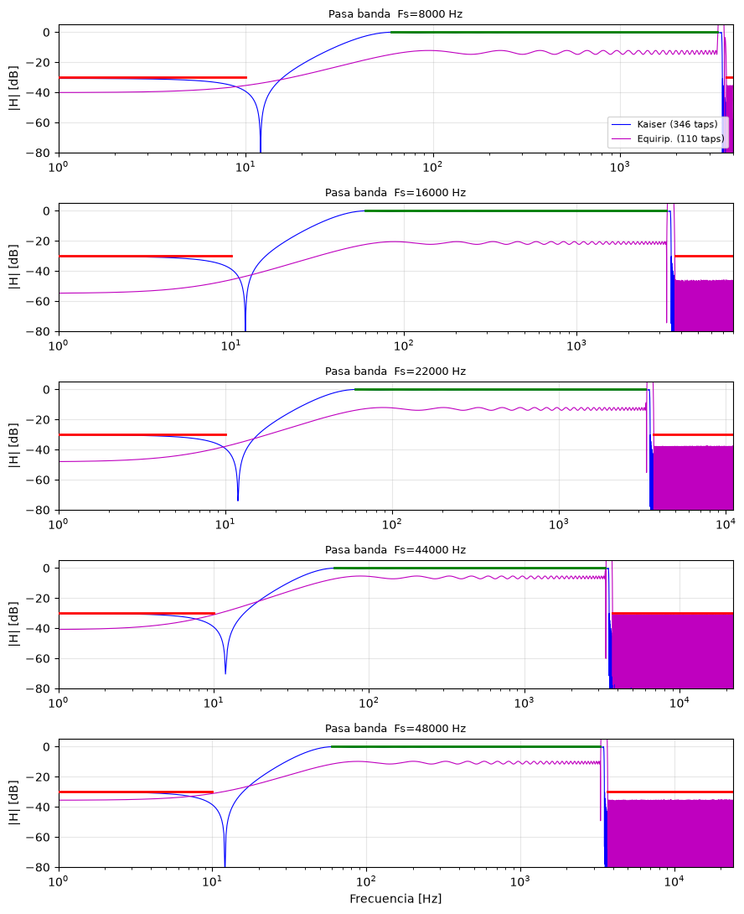
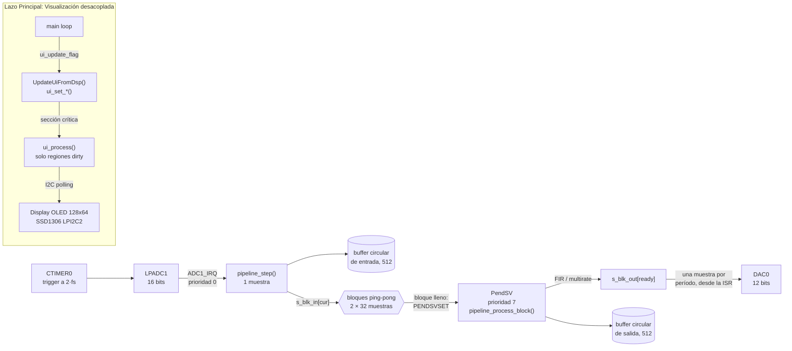
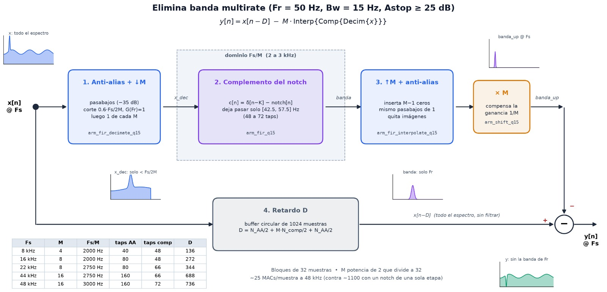
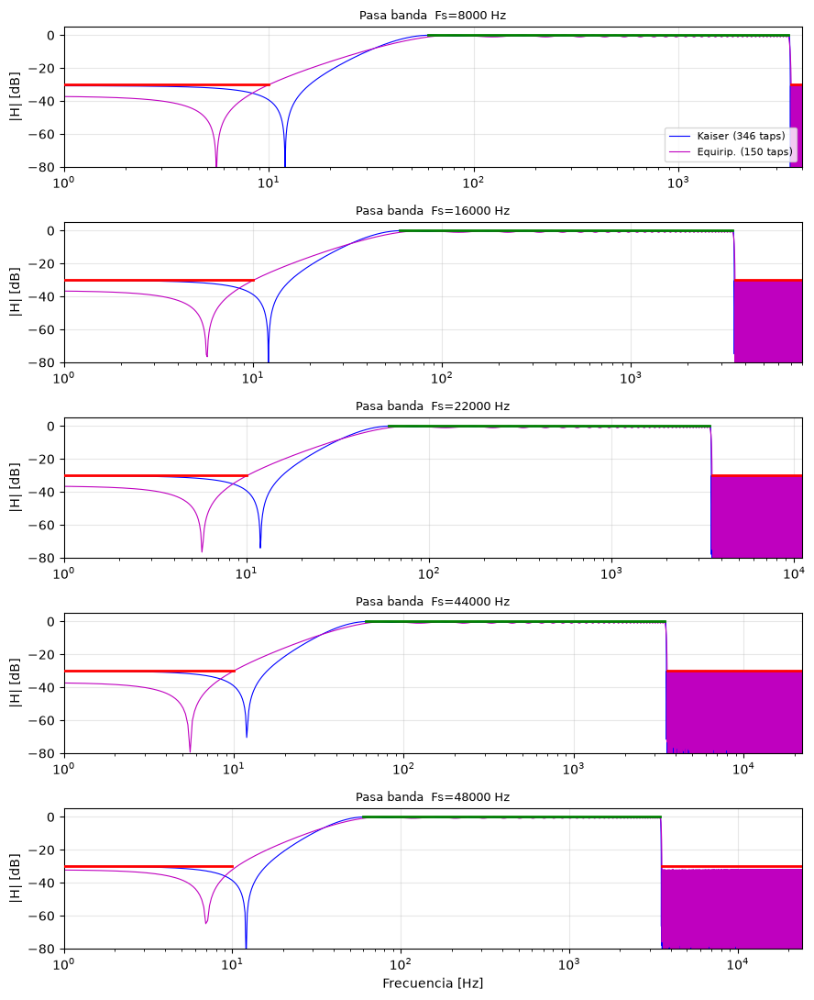
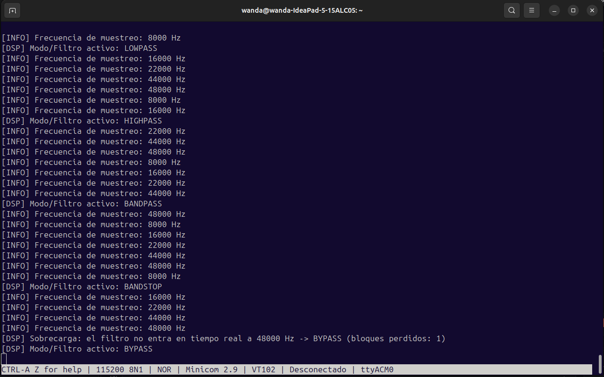
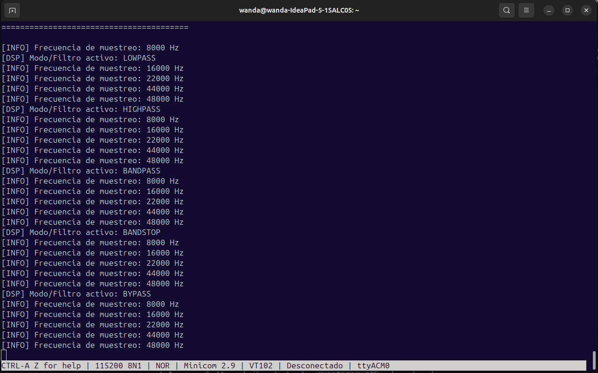

<p align="center">
  
</p>

# TP2 — Filtros FIR con MCXN947

Diseño e implementación de filtros FIR en tiempo real sobre la placa FRDM-MCXN947.

|              |                                   |
| ------------ | --------------------------------- |
| **Materia:** | Procesamiento Digital de Señales  |
| **Carrera:** | Ingeniería en Computación         |
| **Alumnos:** | García, Lautaro Misael            |
|              | Molina, María Wanda               |
|              | Renaudo Gaggioli, Valentino       |
|              | Verdú, Melisa Noel                |
| **Fecha:**   | Noviembre de 2026                 |

---

## Índice

1. [Objetivo](#1-objetivo)
2. [Marco teórico](#2-marco-teórico)
3. [Configuración del ambiente](#3-configuración-del-ambiente)
4. [Diseño de la aplicación](#4-diseño-de-la-aplicación)
5. [Diseño de los filtros](#5-diseño-de-los-filtros)
6. [Código fuente relevante](#6-código-fuente-relevante)
7. [Evolución del rendimiento](#7-evolución-del-rendimiento)
8. [Demostración y resultados](#8-demostración-y-resultados)
9. [Limitaciones conocidas](#9-limitaciones-conocidas)
10. [Conclusiones](#10-conclusiones)
11. [Anexo: regenerar los coeficientes](#11-anexo-regenerar-los-coeficientes)

---

## 1. Objetivo

Filtrar en tiempo real, sobre la **FRDM-MCXN947** (Cortex-M33 a 150 MHz), la señal que adquiere la cadena ADC → buffer → DAC del TP1, con filtros FIR en punto fijo **Q15** implementados con **CMSIS-DSP**. La consigna pide:

- Trabajar a **8, 16, 22, 44 y 48 kHz** de muestreo, con un buffer de 512 muestras.
- Elegir con una tecla de la placa entre **aplicar un filtro o hacer bypass**, escribiendo el resultado en un **buffer de salida distinto del de entrada**, desde el cual se alimenta el **DAC**.
- Cuatro filtros:

| Filtro | Especificación de la consigna |
| --- | --- |
| Pasa bajos | $F_c = 3600$ Hz, $A_{stop} = 30$ dB |
| Pasa altos | $F_c = 35$ Hz, $A_{stop} = 30$ dB |
| Pasa banda | $F_{c1} = 35$ Hz, $F_{c2} = 3500$ Hz, $A_{stop} = 30$ dB |
| Elimina banda | $F_r = 50$ Hz, $BW = 15$ Hz, $A_{stop} = 25$ dB |

- Visualizar el resultado con un osciloscopio y compararlo con el diseño.

**Interpretación de la especificación.** La consigna no fija el ancho de transición ni el rizado de la banda de paso, así que se adoptó:

- $F_c$ es el punto de **−6 dB**, con la banda de transición $\Delta f$ centrada en él.
- En el elimina banda, la banda **[42.5, 57.5] Hz** ($F_r \pm BW/2$) es la que debe atenuarse al menos 25 dB.
- Rizado de banda de paso de aproximadamente **1 dB pico a pico**.

**Procesamiento por bloques.** La consigna habla de filtrar "por muestras". El firmware filtra de a **bloques de 32 muestras** porque, con los órdenes que exigen los cortes de 35 y 50 Hz, el filtrado muestra a muestra no entra en tiempo real (ver [§7](#7-evolución-del-rendimiento)). La adquisición y la salida siguen siendo muestra a muestra, al ritmo exacto del muestreo; lo que se agrupa es solo el cálculo.

---

## 2. Marco teórico

### 2.1 Filtros FIR y fase lineal

Un filtro FIR de $N$ coeficientes (orden $N-1$) calcula

$$
y[n] = \sum_{k=0}^{N-1} h[k]\,x[n-k], \qquad H(z) = \sum_{k=0}^{N-1} h[k]\,z^{-k}
$$

- **Estabilidad.** Todos sus polos están en $z = 0$, así que es estable para cualquier valor de los coeficientes, incluso cuantizados.
- **Fase lineal.** Si los coeficientes son simétricos, $h[k] = h[N-1-k]$, la respuesta es $H(e^{j\omega}) = A(\omega)\,e^{-j\omega(N-1)/2}$ con $A(\omega)$ real. La fase es lineal en todo el eje de frecuencias (con saltos de $\pi$ donde $A(\omega)$ cambia de signo, que no afectan el retardo). Con simetría impar aparece además un término constante de $\pi/2$. Todos los filtros de este trabajo son simétricos (tipo I).
- **Retardo de grupo.** Es constante:

$$
\tau_g = -\frac{d\theta}{d\omega} = \frac{N-1}{2}\ \text{muestras} = \frac{N-1}{2 f_s}\ \text{segundos}
$$

  Por eso todas las componentes de la banda de paso salen con el mismo retraso y la forma de onda no se deforma.

### 2.2 Diseño por ventana y ventana de Kaiser

El filtro ideal $h_d[n] = \frac{\sin(\omega_c n)}{\pi n}$ es infinito y no causal. Truncarlo a $N$ muestras (ventana rectangular) produce el **fenómeno de Gibbs**:

- un sobrepico de aproximadamente 9 % junto a la discontinuidad;
- una atenuación de banda de rechazo de solo unos 21 dB, que **no mejora al aumentar $N$**: el rizado solo se comprime hacia el corte.

Multiplicar $h_d[n - (N-1)/2]$ por una ventana que decrece suavemente hacia los extremos baja los lóbulos laterales, a costa de ensanchar la transición. Hamming llega a unos 53 dB y Blackman a unos 74 dB. La **ventana de Kaiser** permite elegir la atenuación de forma continua:

$$
w[n] = \frac{I_0\!\left(\beta\sqrt{1-\left(\frac{2n}{N-1}-1\right)^2}\right)}{I_0(\beta)}, \qquad 0 \le n \le N-1
$$

$$
\beta = \begin{cases}
0, & A \le 21 \\
0.5842(A-21)^{0.4} + 0.07886(A-21), & 21 < A \le 50 \\
0.1102(A-8.7), & A > 50
\end{cases}
\qquad
N \approx \frac{A - 7.95}{2.285\,\Delta\omega} + 1, \quad \Delta\omega = \frac{2\pi\,\Delta f}{f_s}
$$

Con $\beta = 0$ la ventana es rectangular. Al subir $\beta$ crece la atenuación y se ensancha la transición.

La consecuencia central para este TP es que **$N \propto f_s / \Delta f$**: con un $\Delta f$ fijo en Hz, la cantidad de coeficientes crece en proporción a la frecuencia de muestreo. En [§5.1](#51-elección-del-método-de-diseño) se ve por qué esto llevó a descartar Kaiser.

### 2.3 Diseño equirizado (Parks-McClellan)

El algoritmo de Remez busca el filtro que minimiza el error ponderado máximo (criterio minimax o de Chebyshev):

$$
\min_{h}\ \max_{\omega \in F}\ \left|W(\omega)\left[A(\omega) - D(\omega)\right]\right|
$$

- $F$ son las bandas de paso y de rechazo; las bandas de transición no se restringen.
- $W$ son los pesos: se usó $1/\delta_p$ en paso y $1/\delta_s$ en rechazo.
- El resultado tiene rizado constante dentro de cada banda (teorema de alternancia).

Como reparte el error de manera uniforme en vez de concentrarlo junto al corte, y permite fijar por separado el rizado de cada banda, cumple la misma plantilla con menos coeficientes que Kaiser (ver [§5.3](#53-comparación-kaiser-vs-equirizado)).

**Anomalía de banda de transición.** Como Remez no restringe las transiciones, cuando una es mucho más ancha que la que fija el orden, la respuesta puede subir libremente en ella. En el pasa banda con $\Delta f = [50, 400]$ Hz apareció un pico de +27 a +44 dB cerca de 3.5 kHz. Ese pico hizo que algunos coeficientes superaran 1, la cuantización reescaló todo el filtro y la banda de paso quedó entre 5 y 21 dB por debajo. Por eso el pasa banda usa $\Delta f = [50, 100]$ Hz, y las funciones de diseño rechazan cualquier filtro con ganancia mayor a +0.5 dB en cualquier punto del espectro (`pico_total_db`).

La figura muestra la versión con el problema (equiripple de 110 taps a 8 kHz, en magenta, frente a Kaiser en azul). El pico de la transición superior se sale de la escala y la banda de paso del equiripple queda entre 5 y 20 dB por debajo de los 0 dB exigidos (línea verde):

<p align="center">
  
</p>

### 2.4 Procesamiento multirate

- **Diezmado por $M$:** filtro antialias pasa bajos seguido de quedarse con una muestra de cada $M$. La nueva tasa es $f_s/M$.
- **Interpolación por $M$:** se insertan $M-1$ ceros entre muestras y se filtra con un pasa bajos que elimina las imágenes espectrales. Rellenar con ceros divide la ganancia por $M$, que hay que compensar.

La ventaja para el elimina banda es que el número de taps depende de $\Delta f / f_s$. A $f_s/M$ el mismo ancho absoluto de 15 Hz es una fracción $M$ veces mayor de la nueva tasa, y el filtro necesario es $M$ veces más corto. A cambio, el sistema completo deja de ser estrictamente LTI: es **periódicamente variante**, y el antialias tiene que atenuar lo suficiente para que los productos de alias sean despreciables.

### 2.5 Punto fijo Q15 y CMSIS-DSP

- **Formato Q15** (`q15_t`): 1 bit de signo y 15 fraccionarios. Rango $[-1,\ 1-2^{-15}]$, representado como $[-32768, 32767]$.
- **Cuantización de coeficientes:** $h_{Q15}[k] = \mathrm{sat}_{16}\!\left(\mathrm{round}(32768\,h[k])\right)$.
- **Acumulación:** `arm_fir_q15`, `arm_fir_decimate_q15` y `arm_fir_interpolate_q15` acumulan los productos 1.15 × 1.15 en un acumulador de **64 bits** (formato 34.30). Por eso la suma no puede desbordar, cualquiera sea $N$.
- **Saturación de la salida:** la salida se obtiene como $\mathrm{SSAT}_{16}(acc \gg 15)$. Si el resultado excede el rango Q15, **se satura**; no se produce desborde con cambio de signo.
- **Riesgo de saturación:** la ganancia máxima posible de un FIR es $\sum|h[k]|$, que en estos filtros vale entre 1.9 y 2.9. Una entrada de escala completa con la forma de onda "adecuada" podría saturar, aunque la ganancia en la banda de paso esté normalizada a 0 dB (como se hizo, con pico de 0 dB y rizado hacia abajo). En la práctica se trabaja con señales por debajo de la escala completa del ADC.
- **SIMD en el Cortex-M33:** el núcleo implementa la extensión DSP de ARMv8-M. En su camino rápido, `arm_fir_q15` calcula 4 salidas por iteración y usa `SMLALD`, que hace dos multiplicaciones 16×16 y las suma a un acumulador de 64 bits en una sola instrucción. Cada carga de 32 bits (`LDR`, instrucción aparte) trae dos coeficientes o dos muestras. Ese camino se compila solo si está definida `ARM_MATH_LOOPUNROLL` (ver [§7](#7-evolución-del-rendimiento)).
- **Orden de los coeficientes:** CMSIS espera los coeficientes **invertidos en el tiempo** (`pCoeffs[k]` $= h[N-1-k]$). Para filtros simétricos da lo mismo, pero importa en un caso: `arm_fir_init_q15` exige $N$ par, así que a los diseños de longitud impar se les agrega un 0 al final del vector exportado. Ese 0 queda adelante en el filtro real, y el retardo efectivo es $N/2$ muestras en lugar de $(N-1)/2$.

---

## 3. Configuración del ambiente

### 3.1 Hardware y conexiones

| Elemento | Configuración |
| --- | --- |
| Placa / MCU | FRDM-MCXN947, MCXN947 (Cortex-M33 core 0, DSP + FPU) |
| Reloj | `BOARD_BootClockPLL150M`: núcleo y CTIMER0 a **150 MHz** (PLL0); ADC1 y DAC0 desde FRO_HF |
| Entrada analógica | **ADC1**, canal A23 → pin **P1_23 (J9[23])**. Resolución 16 bits, referencia VREFH. La señal debe ir montada sobre una continua de VREFH/2 (≈ 1.65 V) |
| Salida analógica | **DAC0** (12 bits), pin **P4_2 (J1[4])**, referencia VREFH, buffer de salida (op-amp) habilitado para manejar la punta del osciloscopio |
| Disparo del ADC | **CTIMER0**, match 3 en modo *toggle* (ver 3.2) |
| Consola | UART de debug de la placa (LPUART4 por el MCU-Link, `/dev/ttyACM0`), 115200 8N1 |
| Pulsadores | **SW2** (PIO0_23 → `GPIO0_INT_0`): cambia la frecuencia de muestreo. **SW3** (PIO0_6 → `GPIO0_INT_1`): cambia el filtro. Flanco descendente |
| LED RGB | Indica la $f_s$: 8k rojo, 16k verde, 22k azul, 44k amarillo, 48k magenta |
| Display OLED | Módulo OLED 0.96" SSD1306 (128×64 píxeles, panel bicolor amarillo/azul) vía **LPI2C2**: SDA en **P1_8 (J2[18])**, SCL en **P1_9 (J2[20])**, VCC 3.3 V y GND. Muestra modo activo, gráfico de respuesta, cantidad de taps, $f_s$, $f_c$ y $BW$ |

### 3.2 Entorno de software y herramientas

El proyecto se desarrolló íntegramente sobre **MCUXpresso IDE 25.6** con el **SDK MCXN947 26.06.00** y la cadena de herramientas **Arm GNU Toolchain 14.2** (`arm-none-eabi-gcc`).

Los aspectos centrales de la configuración de software incluyen:
- **Optimización `-O3` en Release:** Para cumplir con los plazos de tiempo real a 44 y 48 kHz, fue indispensable compilar con `-O3`. Esta opción habilita el desenrollado de bucles y la expansión en línea de funciones críticas, reduciendo sustancialmente los ciclos de ejecución por muestra en comparación con los modos Debug (`-O0`) y Release por defecto (`-Os`).
- **Instrucciones SIMD en CMSIS-DSP:** Se definió la macro `ARM_MATH_LOOPUNROLL` en los tipos de CMSIS-DSP. Esto permite que la función de filtrado `arm_fir_q15` utilice la instrucción dual-MAC `SMLALD` del Cortex-M33, procesando dos muestras Q15 por instrucción en lugar de caer en el bucle escalar estándar.
- **Acceso eficiente a memoria:** Se empleó `__builtin_memcpy` para las lecturas de muestras contiguas de 32 bits, asegurando que el compilador emita instrucciones simples de carga (`LDR`) sin generar llamadas a función.
- **Consola de depuración sin bloqueo:** Se configuró `SDK_DEBUGCONSOLE_UART` sobre la UART de debug (`/dev/ttyACM0` a 115200 8N1). Esto evita el uso de semihosting, el cual detiene el núcleo en cada impresión y corrompe la temporización del ADC.
- **Diseño y verificación de filtros:** Se utilizó Python 3 (`scipy.signal` y `numpy`) para calcular los coeficientes mediante el algoritmo equirizado de Parks-McClellan (`remez`) y exportar directamente los archivos de cabecera en punto fijo Q15, garantizando que el diseño simulado coincida con el binario compilado.

---

## 4. Diseño de la aplicación

### 4.1 Arquitectura

Se mantuvo la arquitectura modular del TP1 y se agregó la etapa de procesamiento:

| Módulo | Responsabilidad |
| --- | --- |
| `adc_stage` | CTIMER0 + LPADC. Normaliza a Q15, guarda cada muestra en el buffer circular de **entrada** y maneja RUN/STOP y la $f_s$ |
| `pipeline` | Coordina las etapas: bloques ping-pong, disparo de PendSV, detección de sobrecarga y buffer circular de **salida** |
| `processing_stage` | Los 5 modos (BYPASS, LOWPASS, HIGHPASS, BANDPASS, BANDSTOP) y la reconfiguración diferida de los filtros CMSIS-DSP |
| `dac_stage` | Conversión de Q15 a código de 12 bits y escritura en DAC0 |
| `uart_stage` | Lectura no bloqueante de comandos, *streaming* para graficar en la PC y volcado de buffers |
| `ui` | Interfaz gráfica sobre OLED (estado visual, layout en tiles, polilíneas de filtros y refresco parcial) |
| `display_port` | Backend de comunicación I2C con el display (LPI2C2) y callbacks de tiempo para la biblioteca U8g2 |
| `filter_coeffs.h`, `filter_coeffs_multirate.h` | Coeficientes generados por el script de Python (no se editan a mano) |



### 4.2 Flujo de datos por bloques y esquema de doble buffer

Para procesar filtros FIR de cientos de coeficientes en tiempo real sin interferir con la adquisición, el firmware separa estrictamente la adquisición periódica del cálculo del filtro mediante un esquema de doble búfer (*ping-pong*) de 32 muestras:

1. **Adquisición y salida periódica (Interrupción del ADC, máxima prioridad):**
   - En cada período de muestreo exacto ($T_s = 1/f_s$), la rutina de interrupción del ADC lee una muestra analógica recién convertida (o la toma del búfer de reproducción en modo STOP).
   - A continuación, envía al conversor digital-analógico (DAC) la muestra de salida correspondiente que ya fue calculada y filtrada previamente.
   - Almacena la nueva muestra de entrada en el bloque activo actual (`s_blk_in`).
   - La rutina de interrupción no realiza ninguna operación de filtrado: su tiempo de ejecución es fijo, mínimo y completamente independiente del filtro seleccionado.

2. **Conmutación y disparo del procesamiento:**
   - Una vez que se completan las 32 muestras del bloque, la rutina de adquisición conmuta al búfer alternativo para seguir recibiendo muestras en el período siguiente sin demoras.
   - Inmediatamente solicita la ejecución de una interrupción por software de baja prioridad (**PendSV**), entregándole el bloque de 32 muestras que acaba de completarse.

3. **Filtrado en segundo plano (PendSV, mínima prioridad):**
   - La rutina de PendSV ejecuta el algoritmo de filtrado sobre las 32 muestras recibidas en un único paso, aprovechando las funciones optimizadas de CMSIS-DSP y las instrucciones SIMD del procesador.
   - Guarda el bloque filtrado resultante en el búfer de salida para que la rutina del ADC lo reproduzca muestra a muestra durante el siguiente ciclo, y actualiza el búfer circular de salida y el flujo de datos hacia la PC.
   - Al tener la prioridad más baja del sistema, cualquier nueva interrupción del ADC puede interrumpir a PendSV instantáneamente. De esta manera, el filtrado se ejecuta aprovechando todo el tiempo de CPU remanente entre muestras, sin provocar fluctuaciones (*jitter*) ni pérdidas en la adquisición analógica.

**Latencia del sistema:**
Debido a la estructura de doble búfer de 32 muestras (un bloque en llenado y otro en procesamiento/reproducción), la señal sufre una latencia estructural fija de exactamente **64 muestras** ($2 \times 32$), equivalente a 8 ms a 8 kHz y a 1.33 ms a 48 kHz. A este valor se añade el retardo de grupo propio de cada filtro FIR.

### 4.3 Sobrecarga (overrun)

Si al completar un bloque el anterior todavía está en PendSV (`s_blk_busy == true`), el filtro no entra en tiempo real a esa $f_s$. Entonces la ISR:

- incrementa `s_overrun_count` y activa `s_overrun_pending`;
- pide el modo BYPASS;
- no entrega a PendSV el bloque recién completado, que se pierde, y pasa igual al otro par de buffers.

Ese otro par es el que PendSV todavía está filtrando, así que durante ese bloque la ISR y PendSV comparten buffers y la salida puede tener un salto (*glitch*). Es aceptable porque solo ocurre al momento de la sobrecarga, y a partir del bloque siguiente el modo ya es BYPASS.

El lazo principal informa por UART `[DSP] Sobrecarga: ... -> BYPASS (bloques perdidos: n)`. El sistema sigue respondiendo y el usuario puede volver a elegir filtro o frecuencia.

### 4.4 Reconfiguración diferida

Los cambios de filtro o de $f_s$ llegan desde las interrupciones de los pulsadores, desde la consola o desde la ISR del ADC (cuando hay sobrecarga). Los *setters* solo registran el pedido (`s_current_mode`, `s_current_rate`, `s_reconfig_pending = true`). La reinicialización de las instancias CMSIS-DSP (`arm_fir_init_q15`, `arm_fir_decimate_init_q15`, `arm_fir_interpolate_init_q15`) y el borrado de sus estados se hace **al comenzar el bloque siguiente, dentro de PendSV**. De esta forma nunca se modifica un estado mientras se está filtrando con él.

### 4.5 Prioridades de interrupción

El MCXN947 implementa 3 bits de prioridad (0 = la más alta):

| Fuente | Prioridad | Motivo |
| --- | --- | --- |
| `ADC1_IRQn` | 0 (valor por defecto) | El muestreo y la salida al DAC no pueden demorarse |
| `GPIO0_INT_0/1` (SW2/SW3) | 0 (valor por defecto) | No se configuró. Sus rutinas son cortas (cambian una variable y, en SW2, reprograman CTIMER0), así que pueden demorar la ISR del ADC solo unos microsegundos |
| PendSV | 7 (configurada en `pipeline_init`) | El filtrado se ejecuta con todo el tiempo libre que queda y cualquier interrupción lo puede desalojar |
| Lazo principal | — | Consola y refresco de pantalla OLED, sin plazos estrictos |

### 4.6 Interfaz gráfica OLED (U8g2)

Para visualizar en tiempo real el estado del sistema sin alterar la ejecución de la señal, se incorporó una pantalla OLED monocromática de 128×64 píxeles (controlador SSD1306) comunicada mediante el periférico **LPI2C2** (bus estándar a 100 kHz).

#### Desacoplamiento y modelo de concurrencia
La biblioteca gráfica utilizada es **U8g2** en modo *full buffer* (1024 bytes de framebuffer en RAM). Las operaciones sobre el bus I2C son bloqueantes por sondeo (*polling*). Si se transmitieran datos al display desde una ISR (como el ADC) o dentro de PendSV, se producirían pérdidas masivas de muestras (*overrun*).

Por este motivo, se diseñó una estricta separación en tres capas:
1. **Aplicación DSP (`MCXN947_Project_TP2.c`):** desconoce la existencia del display, coordenadas y comandos I2C. Al detectar cambios de frecuencia, pulsadores o sobrecarga, invoca funciones de notificación de alto nivel (`ui_set_sampling_frequency`, `ui_set_filter_type`, `ui_set_filter_taps`, etc.).
2. **Módulo UI (`ui.c` / `ui.h`):** mantiene dos estructuras de estado (`s_pending` y `s_shown`). Las funciones públicas `ui_set_*()` solo actualizan `s_pending` y levantan una máscara de banderas *dirty* dentro de una sección crítica atómica (`DisableGlobalIRQ()` / `EnableGlobalIRQ()`), por lo que su ejecución insume apenas unos nanosegundos y puede invocarse con total seguridad desde cualquier contexto.
3. **Lazo principal (`ui_process()`):** se llama únicamente desde el `while(1)` de `main`. Consume las banderas *dirty* y transmite al controlador únicamente las regiones de pantalla que hayan variado. De esta forma, si el ADC1 o PendSV necesitan ejecutarse, desalojan inmediatamente al lazo principal sin ningún bloqueo.

#### Distribución de pantalla y refresco por tiles
El panel físico empleado es del tipo bicolor de 0.96", donde las primeras 16 filas son amarillas y las 48 restantes son azules. La interfaz se adaptó para respetar esta frontera física y optimizar la legibilidad:

```
  x:  0..............47 | 48......................127
  y0  +----------------------------------------------+
      |               NOMBRE DEL FILTRO              |  HEADER (amarillo, 16x2 tiles)
  y16 +------------------+---------------------------+
      |     Gráfico      |  Fs:  48 kHz              |  FS (azul, 10x2 tiles)
      |  de respuesta    |  Fc:  3.6 kHz             |  FC (azul, 10x2 tiles)
  y48 |   [ 140 TAPS ]   |  BW:  --                  |  BW (azul, 10x2 tiles)
  y63 +------------------+---------------------------+
         TAPS (6x2 tiles)
```

- **Encabezado (`HEADER`, $y = 0..15$):** aprovecha la franja amarilla para mostrar en texto destacado y centrado el nombre del filtro (`BYPASS`, `LOWPASS`, `HIGHPASS`, `BANDPASS`, `BANDSTOP`).
- **Gráfico de respuesta (`GRAPH`, $x = 0..47, y = 16..47$):** dibuja ejes y curvas de respuesta en frecuencia esquemáticas mediante polilíneas ligeras (cero costo de almacenamiento de bitmaps en flash).
- **Indicador de coeficientes (`TAPS`, $x = 0..47, y = 48..63$):** recuadro en video inverso con el texto `"<N> TAPS"` (o `"-- TAPS"` en bypass). Al cambiar de $f_s$, los taps se actualizan inmediatamente para reflejar la complejidad computacional del filtro activo.
- **Columna de parámetros ($x = 48..127$):** tres filas fijas alineadas para $F_s$, $F_c$ y $BW$.

#### Granularidad de actualización parcial
U8g2 organiza la pantalla en *tiles* de 8×8 píxeles. La primitiva `u8g2_UpdateDisplayArea(tx, ty, tw, th)` permite transmitir una ventana rectangular enviando únicamente las páginas y columnas de tiles correspondientes.

Gracias a esto:
- Si solo cambia la frecuencia de muestreo $F_s$, el firmware transmite únicamente las tiles de `REGION_FS` (160 bytes) y `REGION_TAPS` (96 bytes), en lugar de reescribir los 1024 bytes de la pantalla completa.
- Si cambia el tipo de filtro, se refrescan `REGION_HEADER`, `REGION_GRAPH` y `REGION_TAPS`.
- Si ningún parámetro cambia, `ui_process()` retorna de inmediato sin consumir ciclos de CPU ni transferir un solo byte por I2C.
- Se verificó formalmente mediante un test en PC (`TP2/tests/ui_host/`) contra un simulador de memoria GDRAM que tras 3000 transiciones aleatorias de parámetros, la pantalla parcial resultante es bit a bit idéntica a una reconstrucción completa.

### 4.7 Interfaz de usuario (pulsadores y comandos UART)

| Entrada | Acción |
| --- | --- |
| **SW2** o `f` | Siguiente $f_s$ (8 → 16 → 22 → 44 → 48 kHz); actualiza el LED |
| **SW3** o `m` | Siguiente modo: BYPASS → LOWPASS → HIGHPASS → BANDPASS → BANDSTOP |
| `r` | Alterna RUN (adquisición) / STOP (reproduce en bucle el buffer de entrada, filtrado con el modo activo) |
| `d` | Vuelca las 512 muestras del buffer de **entrada** en CSV, en el orden en que están en memoria (no necesariamente cronológico) |
| `p` / `o` | Activa el *streaming* (pares entrada,salida, 1 de cada 32 muestras) para graficar en la PC / cambia su formato |
| `h` | Ayuda |

**Buffers de entrada y de salida.** La consigna pide que el DAC se alimente desde un buffer de salida distinto del de entrada:

- el DAC lee de `s_blk_out`, que es distinto de `s_blk_in`;
- además, PendSV guarda las mismas muestras filtradas en un buffer circular de salida de 512 muestras (`s_out_circ_buffer`), independiente del de entrada (`s_circ_buffer`). Por ahora ningún comando lo vuelca: `d` muestra solo la entrada.

---

## 5. Diseño de los filtros

Los coeficientes se calculan con las funciones de [`disenio_filtros_tp2.py`](./filtros/disenio_filtros_tp2.py), invocadas desde el notebook equiripple (pasa bajos, pasa altos y pasa banda) y desde el propio script (elimina banda multirate). Esas funciones:

- busca el menor $N$ que cumple $A_{stop}$ **sobre los coeficientes ya cuantizados a Q15**;
- normaliza el pico de la banda de paso a 0 dB;
- rechaza diseños con picos en las transiciones;
- escribe los headers que compila el firmware.

### 5.1 Elección del método de diseño

En resumen, todos los coeficientes del firmware se calculan con **equiripple (Parks-McClellan)**. El pasa bajos, el pasa altos y el pasa banda son un único FIR cada uno. El elimina banda usa además una **estructura multirate** ([§5.4](#54-elimina-banda-multirate)), cuyos filtros internos también son equirizados. **Kaiser** fue el método inicial y se descartó; en este informe queda solo como referencia de comparación.

**1. Por qué se empezó con Kaiser.** Es el método del ventaneo visto en la materia. Tiene fórmulas cerradas para $\beta$ y para estimar $N$ a partir de $A_{stop}$ y $\Delta f$, y garantiza fase lineal. Con él se generaron los primeros 20 filtros (4 tipos × 5 frecuencias).

**2. El problema: no entraba en tiempo real.** Como $N \propto f_s/\Delta f$ y los cortes en 35 y 50 Hz exigen transiciones de pocas decenas de Hz, los filtros crecían con la frecuencia de muestreo:

| Filtro (Kaiser) | 8 kHz | 48 kHz |
| --- | --- | --- |
| Pasa altos ($\Delta f = 50$ Hz) | 344 taps | 2052 taps |
| Pasa banda ($\Delta f = 50/100$ Hz) | 346 taps | 2064 taps |
| Elimina banda ($\Delta f = 20$ Hz) | 646 taps | 3864 taps |

A 48 kHz hay 100 000 ciclos por bloque de 32 muestras. Con el costo medido de unos 3 ciclos por coeficiente y muestra ([§7](#7-evolución-del-rendimiento)), entran como máximo **unos 950 taps**. Los filtros de Kaiser pedían el doble o más, aun con todas las optimizaciones de firmware (bloques, SIMD, `-O3`).

**3. Lo que se probó antes de cambiar de método.** Se ensancharon las transiciones solo donde hacía falta, con un presupuesto de CPU por filtro ([CAMBIOS_DISENIO_FILTROS.md](./filtros/CAMBIOS_DISENIO_FILTROS.md)). No alcanzó:

- El pasa altos y el pasa banda tienen el corte en 35 Hz. Una transición centrada en el corte no puede superar unos 60 Hz sin cruzar 0 Hz, y con 60 Hz Kaiser todavía pedía unos 1160 taps a 48 kHz.
- El elimina banda tiene que atenuar 25 dB en una banda de solo 15 Hz: ensanchar sus transiciones apenas lo acortaba.

Así, el pasa altos, el pasa banda y el elimina banda a 44 y 48 kHz quedaban como **no viables** con Kaiser.

**4. Por qué equiripple.** Para la misma plantilla ($F_c$, $\Delta f$, $A_{stop}$), Parks-McClellan necesita entre **54 y 57 % menos taps** en el pasa altos y el pasa banda, y entre 18 y 25 % menos en el pasa bajos ([§5.3](#53-comparación-kaiser-vs-equirizado)). Hay dos razones:

- Reparte el error de forma pareja en toda la banda, en lugar de concentrarlo junto al corte.
- Permite fijar por separado el rizado de cada banda. Kaiser obliga a que el rizado de paso sea igual al de rechazo (±0.27 dB para 30 dB). Con equiripple se aceptó alrededor de **1 dB de rizado en la banda de paso**, algo que la consigna no restringe.

Con eso el pasa altos y el pasa banda a 48 kHz bajaron a 954 y 956 taps, dentro del presupuesto, sin relajar el $A_{stop}$ ni mover los cortes.

**5. Lo que se resignó.**

- La banda de paso tiene ~1 dB de rizado en lugar de ±0.27 dB.
- No hay fórmula cerrada para $N$: el script lo busca iterando hasta cumplir $A_{stop}$ en Q15.
- Hay que vigilar la anomalía de banda de transición ([§2.3](#23-diseño-equirizado-parks-mcclellan)). Por ella la transición superior del pasa banda es de 100 Hz y no de 400 Hz.

**6. Por qué el elimina banda necesitó además el multirate.** Aun con equiripple y la transición ensanchada a 40 Hz, el notch de una etapa requería **1092 taps a 48 kHz**, y en la placa produjo sobrecarga ([§8.2](#82-pruebas-en-placa)). Ningún método de diseño de una sola etapa resuelve una banda de 15 Hz a 48 kHz dentro del presupuesto. Por eso se cambió la estructura: se procesa la banda de 50 Hz a $f_s/M$ (2–3 kHz), donde el filtro es unas 15 veces más corto.

### 5.2 Pasa bajos, pasa altos y pasa banda (una etapa, equirizados)

Plantillas usadas ($F_c$ a −6 dB, transición centrada):

| Filtro | Banda de paso | Banda de rechazo | $\Delta f$ |
| --- | --- | --- | --- |
| Pasa bajos | 0 – 3400 Hz | ≥ 3800 Hz, ≥ 30 dB | 400 Hz |
| Pasa altos | ≥ 60 Hz | 0 – 10 Hz, ≥ 30 dB | 50 Hz |
| Pasa banda | 60 – 3450 Hz | 0 – 10 Hz y ≥ 3550 Hz, ≥ 30 dB | 50 / 100 Hz |

Resultado, en Q15, tal como está en `filter_coeffs.h`:

| Filtro | $f_s$ | Taps | $A_{stop}$ Q15 | Rizado de paso | $\sum\|h\|$ |
| --- | --- | --- | --- | --- | --- |
| Pasa bajos | 8k / 16k / 22k / 44k / 48k | 28 / 48 / 66 / 128 / 140 | 31.6 / 30.1 / 30.5 / 30.1 / 30.2 dB | 0.9 – 1.1 dB | 1.9 – 2.0 |
| Pasa altos | 8k / 16k / 22k / 44k / 48k | 150 / 296 / 408 / 806 / 954 | 30.2 / 30.1 / 30.0 / 30.0 / 32.1 dB | 0.9 – 1.2 dB | 1.9 – 2.0 |
| Pasa banda | 8k / 16k / 22k / 44k / 48k | 150 / 300 / 412 / 820 / 956 | 30.0 / 30.2 / 30.1 / 30.0 / 31.8 dB | 0.9 – 1.1 dB | 2.8 – 2.9 |

`filter_coeffs.h` también incluye un elimina banda de una sola etapa (`fir_config_bs`, hasta 1092 taps a 48 kHz), de la versión anterior al multirate. El firmware ya no lo usa, pero sigue definiendo `MAX_FIR_TAPS = 1092`, que dimensiona el buffer de estado (`numTaps + blockSize` muestras). El filtro más largo que realmente se usa es el pasa banda de 956 taps.

### 5.3 Comparación Kaiser vs. equirizado

Datos en los que se apoya la decisión de [§5.1](#51-elección-del-método-de-diseño). Con la misma plantilla ($F_c$, $\Delta f$, $A_{stop}$), la búsqueda automática da:

| Filtro | 8k | 16k | 22k | 44k | 48k | Reducción |
| --- | --- | --- | --- | --- | --- | --- |
| Pasa bajos (Kaiser → equirizado) | 34 → 28 | 64 → 48 | 86 → 66 | 170 → 128 | 186 → 140 | 18 – 25 % |
| Pasa altos | 344 → 150 | 688 → 296 | 948 → 408 | 1890 → 806 | 2052 → 954 | 54 – 57 % |
| Pasa banda | 346 → 150 | 690 → 300 | 946 → 412 | 1890 → 820 | 2064 → 956 | 54 – 57 % |

Como se explica en [§5.1](#51-elección-del-método-de-diseño), parte de esta reducción viene de aceptar más rizado en la banda de paso ($\delta_p \ne \delta_s$), así que la comparación no es del todo pareja. Aun así, a 48 kHz el pasa altos y el pasa banda quedan cerca del límite de cómputo (ver [§8.3](#83-carga-de-cpu)).

### 5.4 Elimina banda multirate

Por lo explicado en [§5.1](#51-elección-del-método-de-diseño), el modo BANDSTOP usa una estructura multirate (`process_bandstop_multirate` en `processing_stage.c`):

$$
y[n] = x[n-D] - M\cdot \mathrm{Interp}_M\!\Big(c * \mathrm{Decim}_M(x)\Big)[n]
$$

<p align="center">
  
</p>

- **Rama de la banda (arriba en la figura).** Diezma la señal, la filtra a $f_s/M$ con el **complemento** del notch, $c[n] = \delta[n-K] - \text{notch}[n]$, que deja pasar **solo** la banda de 50 Hz, y la vuelve a llevar a $f_s$. `arm_fir_interpolate_q15` no compensa la ganancia $1/M$ del relleno con ceros, así que se multiplica por $M$ con un desplazamiento de $\log_2 M$ bits ($M$ es potencia de 2).
- **Rama directa (abajo en la figura).** Es una línea de retardo de $D$ muestras: la señal completa, sin diezmar.
- **Resta.** Restar la banda de 50 Hz, alineada en el tiempo, a la señal completa deja $y \approx \text{notch} * x$ cerca de $F_r$ e $y \approx x[n-D]$ en el resto del espectro. Las frecuencias altas nunca pasan por el diezmado, así que la salida conserva todo el ancho de banda.
- **Retardo $D$.** Se calcula con las convenciones de CMSIS (coeficientes invertidos y decimador que produce la salida $m$ en el instante $n = mM$):

$$
D = \frac{N_{AA}}{2} + M\,\frac{N_{comp}}{2} + \frac{N_{AA}}{2}
$$

- **Parámetros de diseño:**
  - $M$ potencia de 2 que divida a 32, con $f_s/M$ entre 2 y 3 kHz;
  - antialias equirizado con corte al 60 % de la Nyquist diezmada, transición del 30 %, 35 dB, $N$ múltiplo de $M$ y ganancia exactamente 1 en 50 Hz;
  - notch equirizado a $f_s/M$ con $\Delta f = 40$ Hz y 26 dB (1 dB de margen);
  - el mismo antialias se usa para diezmar y para interpolar.

| $f_s$ | $M$ | $f_s/M$ | Taps antialias | Taps complemento | $D$ | MAC por bloque | Notch de una etapa (taps × 32) |
| --- | --- | --- | --- | --- | --- | --- | --- |
| 8k | 4 | 2000 Hz | 40 | 48 | 136 | 1024 | 186 × 32 = 5 952 |
| 16k | 8 | 2000 Hz | 80 | 48 | 272 | 832 | 368 × 32 = 11 776 |
| 22k | 8 | 2750 Hz | 80 | 66 | 344 | 904 | 506 × 32 = 16 192 |
| 44k | 16 | 2750 Hz | 160 | 66 | 688 | 772 | 1002 × 32 = 32 064 |
| 48k | 16 | 3000 Hz | 160 | 72 | 736 | 784 | 1092 × 32 = 34 944 |

Los MAC por bloque son la suma de diezmado ($32/M$ salidas × $N_{AA}$), complemento ($32/M \times N_{comp}$) e interpolación polifásica ($32 \times N_{AA}/M$). A 48 kHz el costo baja unas 45 veces respecto del notch de una etapa.

**Respuesta de la cadena completa**, simulada en Python con los coeficientes Q15 exportados y la misma aritmética de índices que CMSIS (`simular_bandstop_multirate`):

| $f_s$ | 42.5 Hz | 50 Hz | 57.5 Hz | 20 Hz | 35 Hz | 65 Hz | 100 Hz | 1 kHz |
| --- | --- | --- | --- | --- | --- | --- | --- | --- |
| 8k | −26.5 | −33.1 | −31.7 | −4.7 | −14.7 | −17.3 | −0.7 | 0.0 dB |
| 16k | −26.4 | −31.1 | −29.9 | −4.7 | −14.8 | −17.0 | −0.7 | 0.0 dB |
| 22k | −26.5 | −31.1 | −30.2 | −4.7 | −14.8 | −17.0 | −0.7 | 0.0 dB |
| 44k | −25.6 | −28.5 | −28.2 | −4.7 | −14.7 | −16.9 | −0.7 | 0.0 dB |
| 48k | −25.6 | −28.6 | −28.2 | −4.6 | −14.7 | −16.9 | −0.6 | 0.0 dB |

- **Cumplimiento:** la banda [42.5, 57.5] Hz queda atenuada al menos 25.6 dB en las cinco frecuencias, así que la consigna se cumple.
- **Ancho real del notch:** como la transición es de 40 Hz a cada lado, el notch es mucho más ancho que 15 Hz a −3 dB. La atenuación supera 3 dB entre **15.5 y 87.5 Hz** y 6 dB entre **23.5 y 79.5 Hz**.
- **Alias:** un tono en $f_s/M - F_r$ (que al diezmar caería justo sobre 50 Hz) cambia menos de 0.01 dB, así que el antialias alcanza.

**Limitaciones:**

1. El sistema es periódicamente variante, no un único FIR LTI. Mientras el antialias sea suficiente, en la práctica se comporta como uno.
2. La rama que se resta pierde $\log_2 M$ bits de resolución por el desplazamiento: hasta 4 bits a 44 y 48 kHz. Su ruido de cuantización queda alrededor de −66 dBFS, del mismo orden que el del DAC de 12 bits.

### 5.5 Retardo y latencia total

Retardo de grupo del filtro (con la convención $N/2$ de [§2.5](#25-punto-fijo-q15-y-cmsis-dsp)) y latencia total entrada → DAC, que suma los $2B = 64$ muestras del ping-pong:

| Filtro | 8k | 16k | 22k | 44k | 48k |
| --- | --- | --- | --- | --- | --- |
| Pasa bajos | 1.75 → 9.75 ms | 1.50 → 5.50 ms | 1.50 → 4.41 ms | 1.45 → 2.91 ms | 1.46 → 2.79 ms |
| Pasa altos | 9.38 → 17.38 ms | 9.25 → 13.25 ms | 9.27 → 12.18 ms | 9.16 → 10.61 ms | 9.94 → 11.27 ms |
| Pasa banda | 9.38 → 17.38 ms | 9.38 → 13.38 ms | 9.36 → 12.27 ms | 9.32 → 10.77 ms | 9.96 → 11.29 ms |
| Elimina banda ($D$) | 17.00 → 25.00 ms | 17.00 → 21.00 ms | 15.64 → 18.55 ms | 15.64 → 17.09 ms | 15.33 → 16.67 ms |
| BYPASS | 8.00 ms | 4.00 ms | 2.91 ms | 1.45 ms | 1.33 ms |

El retardo de grupo depende de $\Delta f$ y casi no depende de $f_s$, porque $N \propto f_s/\Delta f$. Esto es lo que se ve en el osciloscopio como un corrimiento entre la entrada y la salida.

---

## 6. Código fuente relevante

### 6.1 ISR del ADC: una muestra por período (`pipeline.c`)

```c
void pipeline_step(void) {
    q15_t in_sample = 0;

    if (adc_stage_is_running()) {
        // Modo RUN: Adquisición en vivo del ADC
        if (!adc_stage_read_sample(&in_sample)) {
            return;
        }
    } else {
        // Modo STOP: Reproducción continua del buffer circular
        in_sample = circular_buffer_get_playback_sample(&s_circ_buffer);
    }

    uint32_t cur = s_blk_cur;
    uint32_t idx = s_blk_idx;

    // Etapa 3: Salida Analógica DAC
    dac_stage_write_sample(s_blk_out[cur][idx]);
    s_blk_in[cur][idx] = in_sample;

    if (++idx < PROCESSING_BLOCK_SIZE) {
        s_blk_idx = idx;
        return;
    }

    // Bloque completo: pasa a filtrarse y la ISR sigue con el otro par de buffers
    s_blk_idx = 0;
    if (s_blk_busy) {
        // El bloque anterior todavía no terminó de filtrarse: el filtro no entra en tiempo
        // real a esta Fs. Se pasa a bypass para que el resto del sistema (UART) siga vivo.
        s_overrun_count++;
        s_overrun_pending = true;
        processing_stage_set_mode(PROCESSING_MODE_BYPASS);
    } else {
        s_blk_ready = cur;
        s_blk_busy = true;
        SCB->ICSR = SCB_ICSR_PENDSVSET_Msk;
    }
    s_blk_cur = cur ^ 1U;
}
```

### 6.2 Filtrado en PendSV (`pipeline.c`)

```c
void PendSV_Handler(void) {          // MCXN947_Project_TP2.c
  pipeline_process_block();
}

void pipeline_process_block(void) {
    if (!s_blk_busy) {
        return;
    }

    const q15_t *in = s_blk_in[s_blk_ready];
    q15_t *out = s_blk_out[s_blk_ready];

    // Etapa 2: Procesamiento DSP
    processing_stage_process_block(in, out, PROCESSING_BLOCK_SIZE);

    for (uint32_t i = 0; i < PROCESSING_BLOCK_SIZE; i++) {
        circular_buffer_push(&s_out_circ_buffer, out[i]);   // buffer de salida (512)
        uart_stage_feed_sample(in[i], out[i]);              // streaming a la PC
    }

    s_blk_busy = false;
}
```

### 6.3 Reconfiguración diferida y selección del camino (`processing_stage.c`)

```c
void processing_stage_process_block(const q15_t *in, q15_t *out, uint32_t length) {
    if (in == NULL || out == NULL || length == 0) {
        return;
    }

    // Aplicar el cambio de modo/frecuencia pendiente antes de filtrar el bloque
    if (s_reconfig_pending) {
        s_reconfig_pending = false;
        s_active_mode = s_current_mode;
        reconfigure_filter(s_active_mode, s_current_rate);
    }

    if (s_active_mode == PROCESSING_MODE_BYPASS) {
        for (uint32_t i = 0; i < length; i++) {
            out[i] = in[i];
        }
        return;
    }

    if (s_active_mode == PROCESSING_MODE_BANDSTOP) {
        // Elimina banda: camino multirate
        while (length > 0) {
            uint32_t n = (length < PROCESSING_BLOCK_SIZE) ? length : PROCESSING_BLOCK_SIZE;
            process_bandstop_multirate(in, out, n);
            in += n;
            out += n;
            length -= n;
        }
        return;
    }

    // LOWPASS / HIGHPASS / BANDPASS: FIR de una etapa (arm_fir_q15, SIMD)
    while (length > 0) {
        uint32_t n = (length < PROCESSING_BLOCK_SIZE) ? length : PROCESSING_BLOCK_SIZE;
        arm_fir_q15(&s_fir_instance, (q15_t *)in, out, n);
        in += n;
        out += n;
        length -= n;
    }
}
```

### 6.4 Elimina banda multirate (`processing_stage.c`)

```c
static void process_bandstop_multirate(const q15_t *in, q15_t *out, uint32_t n) {
    // (si n != PROCESSING_BLOCK_SIZE se copia la entrada sin filtrar)
    const bandstop_multirate_config_t *cfg = s_bs_active_cfg;
    uint32_t n_dec = PROCESSING_BLOCK_SIZE / cfg->M;

    // 1) Decimar (incluye el anti-alias)
    arm_fir_decimate_q15(&s_bs_dec_inst, (q15_t *)in, s_bs_xdec, PROCESSING_BLOCK_SIZE);

    // 2) Quedarse solo con la banda de Fr (complemento del notch), a Fs/M
    arm_fir_q15(&s_bs_comp_inst, s_bs_xdec, s_bs_banda, n_dec);

    // 3) Interpolar de vuelta a Fs y compensar la ganancia 1/M del interpolador
    arm_fir_interpolate_q15(&s_bs_interp_inst, s_bs_banda, s_bs_banda_up, n_dec);
    arm_shift_q15(s_bs_banda_up, cfg->log2M, s_bs_banda_up, PROCESSING_BLOCK_SIZE);

    // 4) y[n] = x[n-D] - banda de Fr (D = retardo de la rama de abajo)
    for (uint32_t i = 0; i < PROCESSING_BLOCK_SIZE; i++) {
        s_bs_delay_buf[s_bs_delay_write] = in[i];
        uint32_t read_idx = (s_bs_delay_write - cfg->delaySamples) & (BS_MR_DELAY_BUF_SIZE - 1U);
        q15_t x_delayed = s_bs_delay_buf[read_idx];
        s_bs_delay_write = (s_bs_delay_write + 1U) & (BS_MR_DELAY_BUF_SIZE - 1U);
        out[i] = (q15_t)__SSAT((q31_t)x_delayed - (q31_t)s_bs_banda_up[i], 16);
    }
}
```

La línea de retardo es un buffer circular de 1024 muestras con máscara (potencia de 2). Una directiva `#error` verifica en compilación que sea mayor que el $D$ más grande (736).

### 6.5 Módulo de interfaz gráfica y refresco parcial (`ui.c`)

```c
// Actualización selectiva en ui_process() según qué parámetros cambiaron
void ui_process(void) {
    if (!s_enabled) return;

    // Copia atómica del estado pendiente
    uint32_t primask = DisableGlobalIRQ();
    ui_state_t want = s_pending;
    uint8_t dirty = s_dirty;
    s_dirty = 0;
    EnableGlobalIRQ(primask);

    if (dirty == 0u) return;

    if ((dirty & UI_DIRTY_FILTER) != 0u && (want.filter != s_shown.filter)) {
        s_shown.filter = want.filter;
        draw_header(s_shown.filter);
        flush_region(&REGION_HEADER);
        draw_filter_graph(s_shown.filter);
        flush_region(&REGION_GRAPH);
    }
    if ((dirty & UI_DIRTY_TAPS) != 0u && (want.taps != s_shown.taps)) {
        s_shown.taps = want.taps;
        draw_taps(s_shown.taps);
        flush_region(&REGION_TAPS);
    }
    if ((dirty & UI_DIRTY_FS) != 0u && (want.fs_hz != s_shown.fs_hz)) {
        s_shown.fs_hz = want.fs_hz;
        draw_param(&REGION_FS, "Fs:", s_shown.fs_hz);
        flush_region(&REGION_FS);
    }
    // (Fc y BW se tratan análogamente)
}
```

---

## 7. Evolución del rendimiento

El sistema llegó al estado actual en varias iteraciones, registradas en [`filtros/PRUEBAS_PLACA.md`](./filtros/PRUEBAS_PLACA.md) y [`filtros/CAMBIOS_DISENIO_FILTROS.md`](./filtros/CAMBIOS_DISENIO_FILTROS.md). Los costos por tap de las etapas 1 a 3 son **estimaciones** obtenidas a partir de qué combinaciones entraban o no en tiempo real, no mediciones directas.

| Etapa | Situación | Resultado en placa |
| --- | --- | --- |
| 1 | Kaiser con $\Delta f$ fijo (hasta 3864 taps), filtrado muestra a muestra dentro de la ISR, build **Debug `-O0`** | El pasa bajos cortaba en ~1.2 kHz a 44 kHz: la placa procesaba a unos 14.7 kHz efectivos. Estimado: ~40–60 ciclos por tap |
| 2 | Release **`-Os`**, muestra a muestra | ~12 ciclos por tap más 800–1450 ciclos fijos por muestra. A 48 kHz no entraba ni el pasa bajos. Al saturarse, la placa se bloqueaba sin aviso |
| 3 | **Bloques de 32 + PendSV**, `-Os` | ~7–14 ciclos por tap. Entraban todos los pasa bajos, pasa altos y pasa banda hasta 16 kHz, y el elimina banda solo a 8 kHz. La sobrecarga se detecta y pasa a BYPASS |
| 4 | Diagnóstico con `arm-none-eabi-objdump -d` | `arm_fir_q15` no tenía ninguna instrucción `smlald`: sin `ARM_MATH_LOOPUNROLL` CMSIS compila el bucle escalar. Además, con `-Os` cada lectura de 32 bits del bucle interno (`read_q15x2` → `memcpy`) era una llamada `bl memcpy` |
| 5 | `ARM_MATH_LOOPUNROLL` + `__builtin_memcpy` en `arm_math_memory.h` + `-O3` | El bucle interno queda en `ldr` + `smlald`. En el binario actual (Release) `arm_fir_q15` tiene 12 instrucciones `smlald` y ninguna llamada a `memcpy` |
| 6 | Diseño equirizado + elimina banda multirate | Máximo de 956 taps (pasa banda a 48 kHz). El elimina banda usa ≤ 1024 MAC por bloque |

**Costo actual estimado.** En la corrida de [§8.2](#82-pruebas-en-placa), hecha con las optimizaciones de la etapa 5 y antes de pasar el elimina banda a multirate:

- el pasa altos de 954 taps a 48 kHz (30 528 MAC por bloque, 100 000 ciclos disponibles) funcionó sin sobrecarga;
- el elimina banda de una etapa de 1092 taps (34 944 MAC) sí la produjo ([§8.2](#82-pruebas-en-placa)).

De ahí se deduce un costo de entre **2.9 y 3.3 ciclos por coeficiente y muestra**, incluido todo el trabajo auxiliar de CMSIS. Para confirmarlo hace falta medirlo ([§8.3](#83-carga-de-cpu)).

Ese valor es mayor que el teórico de `SMLALD` (dos MAC por instrucción). Lo más probable es que influyan:

- la copia del estado ($N-1$ muestras por bloque);
- la lectura de los coeficientes desde flash, con estados de espera a 150 MHz.

Copiar los coeficientes del filtro activo a RAM al reconfigurarlo es una mejora posible que no se implementó.

---

## 8. Demostración y resultados

### 8.1 Respuesta en frecuencia de los filtros

La respuesta en frecuencia teórica y en punto fijo Q15 de cada uno de los filtros implementados se encuentra detallada en las tablas de [§5.2](#52-pasa-bajos-pasa-altos-y-pasa-banda-una-etapa-equirizados) y [§5.4](#54-elimina-banda-multirate).

Las curvas completas de magnitud, fase, rizado y atenuación para todas las frecuencias de muestreo ($8$, $16$, $22$, $44$ y $48\text{ kHz}$) pueden consultarse y reproducirse interactivamente en la notebook de diseño: [`disenio_filtros_tp2_equiripple.ipynb`](./filtros/disenio_filtros_tp2_equiripple.ipynb).

A modo de ejemplo comparativo del impacto del método de diseño sobre el orden del filtro, la siguiente gráfica ilustra la respuesta en frecuencia del filtro **pasa banda** diseñado con el algoritmo equirizado (Parks-McClellan, en magenta; 150 taps a 8 kHz) frente al diseño clásico por ventana de Kaiser (en azul; 346 taps a 8 kHz) bajo las mismas especificaciones de plantilla:

<p align="center">
  
</p>

Con menos de la mitad de coeficientes, el diseño equirizado cumple holgadamente con los $-30\text{ dB}$ requeridos en la banda de rechazo, haciendo viable su ejecución en tiempo real en el microcontrolador.

### 8.2 Pruebas en placa

**Detección de sobrecarga.** Con el elimina banda implementado en una sola etapa (1092 taps a 48 kHz), el filtrado excedía el tiempo disponible por bloque ($100\,000$ ciclos). El sistema de supervisión del pipeline detectó el retraso, conmutó automáticamente a modo BYPASS y notificó el suceso por la consola serie, garantizando la estabilidad operativa del microcontrolador:

<p align="center">
  
</p>

**Recorrido completo sin sobrecarga.** Tras incorporar la arquitectura multirate para el filtro elimina banda y optimizar los anchos de transición, se verificó el funcionamiento secuencial de los cuatro filtros en todas las frecuencias de muestreo ($8$, $16$, $22$, $44$ y $48\text{ kHz}$) sin registrar eventos de sobrecarga:

<p align="center">
  
</p>

### 8.3 Carga de CPU estimada

El firmware no mide internamente el tiempo de cómputo; detecta únicamente cuándo un bloque no logra completarse dentro de su plazo temporal. A partir de los ciclos disponibles por bloque ($32 \times 150\,\text{MHz}/f_s$) y del costo aproximado de ~3 ciclos por MAC, la carga de CPU teórica para cada caso se distribuye de la siguiente forma:

| Filtro | 8k (600 000 ciclos) | 16k (300 000 ciclos) | 22k (218 182 ciclos) | 44k (109 091 ciclos) | 48k (100 000 ciclos) |
| --- | --- | --- | --- | --- | --- |
| Pasa bajos | < 1 % | ~2 % | ~3 % | ~11 % | ~13 % |
| Pasa altos | ~2 % | ~9 % | ~18 % | ~71 % | ~92 % |
| Pasa banda | ~2 % | ~10 % | ~18 % | ~72 % | ~92 % |
| Elimina banda (multirate) | < 1 % | < 1 % | ~1 % | ~2 % | ~2 % |

---

## 9. Limitaciones conocidas

Durante la revisión y validación del firmware se identificaron los siguientes aspectos técnicos a considerar:

1. **Gestión de sobrecarga en recepción UART:** `uart_stage_try_getchar()` no despeja la bandera de desbordamiento por hardware (*overrun*) del periférico LPUART. Si se transmiten ráfagas continuas de datos hacia la placa sin ser procesadas por el lazo principal, la recepción de comandos puede deshabilitarse hasta reiniciar el dispositivo.
2. **Transición transitoria durante sobrecarga:** Si un filtro excede el tiempo real, la conmutación a BYPASS en ese bloque puntual comparte búferes entre PendSV y la ISR del ADC, pudiendo generar una discontinuidad en la señal de salida antes de normalizarse.
3. **Búfer circular de salida:** El búfer circular `s_out_circ_buffer` almacena las muestras filtradas en RAM, pero actualmente no cuenta con un comando por consola dedicado para su descarga directa (a diferencia del búfer de entrada mediante el comando `d`).
4. **Dimensionamiento estático de memoria:** El arreglo de estado del filtro CMSIS-DSP reserva espacio en base al valor `MAX_FIR_TAPS` (1092 coeficientes), lo que asigna unos 270 bytes de RAM adicionales que no son aprovechados tras la adopción del esquema multirate.

## 10. Conclusiones

1. **La arquitectura desacoplada por bloques fue fundamental para el éxito del proyecto:**
   - La rutina de interrupción del ADC se limitó estrictamente a la transferencia periódica de muestras individuales, manteniendo una latencia determinista e independiente del filtro activo.
   - El cómputo pesado de los filtros se delegó a la interrupción de baja prioridad PendSV agrupando bloques de 32 muestras, lo que permitió aprovechar al máximo el tiempo ocioso del procesador sin introducir fluctuaciones (*jitter*) en la señal.
   - El costo asumido por esta arquitectura es una latencia fija y controlada de 64 muestras entre la entrada analógica y la salida al DAC.
   - La inclusión de un mecanismo de detección de sobrecarga (*overrun*) asegura que, ante cualquier contingencia temporal, el sistema degrade de forma segura a modo BYPASS en lugar de bloquear el microcontrolador.

2. **La optimización a nivel de hardware y compilador fue tan decisiva como el diseño matemático:**
   - El empleo de la instrucción dual-MAC `SMLALD` mediante `ARM_MATH_LOOPUNROLL` en CMSIS-DSP, junto con el nivel de optimización `-O3`, redujo drásticamente los ciclos requeridos por coeficiente.
   - Sin estas configuraciones específicas de bajo nivel, los filtros de frecuencias bajas (pasa altos y pasa banda a 48 kHz) no habrían sido computacionalmente viables en tiempo real.

3. **La selección del método de diseño determinó la viabilidad del sistema:**
   - El método equirizado de Parks-McClellan redujo a menos de la mitad la cantidad de coeficientes necesarios frente al método de ventana de Kaiser para cumplir la misma atenuación de banda de rechazo ($-30\text{ dB}$).
   - Para el filtro elimina banda a altas frecuencias de muestreo (44 y 48 kHz), la aproximación de una sola etapa resultaba inviable. La descomposición multirate (diezmado, filtrado a frecuencia reducida e interpolación) permitió cumplir los requisitos de atenuación con una reducción de aproximadamente 45 veces en la cantidad de operaciones.

4. **Integración de interfaz gráfica no intrusiva:**
   - La incorporación del display OLED mediante refresco parcial por *tiles* permitió monitorizar en tiempo real los parámetros del sistema (frecuencia, tipo de filtro, frecuencias de corte y número exacto de taps) sin consumir tiempo crítico de las rutinas de interrupción ni comprometer el procesamiento de señal.

---

## 11. Anexo: regenerar los coeficientes

```bash
cd TP2/filtros
python -m venv .venv && . .venv/bin/activate
pip install -r requirements.txt
```

- **Pasa bajos, pasa altos y pasa banda** (`filter_coeffs.h`): ejecutar el notebook [`disenio_filtros_tp2_equiripple.ipynb`](./filtros/disenio_filtros_tp2_equiripple.ipynb) hasta la celda de exportación, que llama a `exportar_header` con los diseños equirizados. Ese header incluye además el elimina banda de una etapa con $\Delta f = 40$ Hz, que el firmware no usa.
- **Elimina banda multirate** (`filter_coeffs_multirate.h`):

  ```bash
  python disenio_filtros_tp2.py multirate
  ```

  Antes de exportar verifica que la cadena completa cumpla los 25 dB.

> **Atención:** `python disenio_filtros_tp2.py` sin argumentos, el notebook de Kaiser y el script de MATLAB escriben `filter_coeffs.h` con los diseños de Kaiser y reemplazan los coeficientes del firmware.
