# Señal interna para probar la FFT sin generador externo

Integrado en `MCXN947_Project_TP3` (arranca en fuente **ADC** por defecto para no alterar el comportamiento normal de la placa).

## Qué se hizo

El firmware del TP3 incorpora un generador interno (`signal_gen.c` / `signal_gen.h`) para probar la cadena de adquisición y la FFT sin un generador de señales externo. Hay tres fuentes, que se eligen por UART con `g` (o desde la GUI):

| Fuente | Qué entra a la ventana de N muestras | Hace falta |
| --- | --- | --- |
| **ADC** | La señal del generador externo (por defecto al encender) | Generador en J9[23] |
| **DAC LOOPBACK** | La señal generada sale por el DAC0, vuelve por un cable y la lee el ADC | Cable de **J1[4]** (P4_2, DAC0_OUT) a **J9[23]** (P1_23, ADC1_A23) |
| **SINTÉTICA** | La señal generada se escribe directo en la ventana (loopback digital, sin DAC ni ADC) | Nada |

En DAC LOOPBACK y en SINTÉTICA el DAC saca la señal generada, así que siempre se puede ver en el osciloscopio en J1[4].

### Generador de señal (`signal_gen.c`)

- **Acumulador de fase de 32 bits (DDS):** avanza `f / Fs · 2³²` por muestra, de modo que la señal mantiene su frecuencia en Hz al cambiar `Fs`.
- **Amplitud:** `0,8` de la escala completa q15 (`−1,94 dBFS`), para no recortar contra los rieles del DAC ni del ADC en `DAC LOOPBACK`.
- **Formas de onda (`k`):** `SENO`, `CUADRADA`, `TRIANGULAR` y `SIERRA`.
- **Frecuencia configurable (`1 .. 50000 Hz`):**
  - `w` recorre los presets útiles para los ensayos a `Fs = 8 kHz`, `N = 1024`:
    - `250 Hz`: ver la señal en el tiempo (32 muestras por período)
    - `1000 Hz`: cae justo en un bin con cualquier N (sin fuga)
    - `1004 Hz`: con `N = 1024` cae a mitad de camino entre dos bins (fuga máxima)
    - `3000 Hz`: cerca de `Fs/2`
    - `5000 Hz`: por encima de `Fs/2` (aliasing a 8 kHz)
  - `+` / `-`: ajuste fino de `+1` / `-1 Hz`.
  - `]` / `[`: ajuste de `+10` / `-10 Hz`.
  - `<frecuencia>+Enter`: fija cualquier frecuencia entera en Hz (también desde el campo `Hz` en `TP3/tools/fft_gui.py`).

### Interfaz en la PC (`TP3/tools/fft_gui.py`)

La misma interfaz gráfica del TP3 recibe las tramas binarias (`FFT` y `BYPASS`) sin cambiar el protocolo e incluye el panel **Generador de Señal Interna (UART)** para cambiar fuente, forma de onda, presets, pasos finos o fijar una frecuencia arbitraria en Hz.

## Fenómenos observados con la fuente SINTÉTICA

Con la fuente SINTÉTICA la señal es un seno ideal en q15. Todo lo que aparece en el espectro además del tono sale del muestreo, del tamaño de la ventana o de la aritmética de la FFT, no de la parte analógica.

Las capturas están en `images/ejemplo_senal_interna/`. En el título de cada una el plotter muestra N, Fs, Δf, el bin del pico y una frecuencia "estimada", que interpola entre los bins vecinos.

### 1. Muestreo coherente: sin fuga

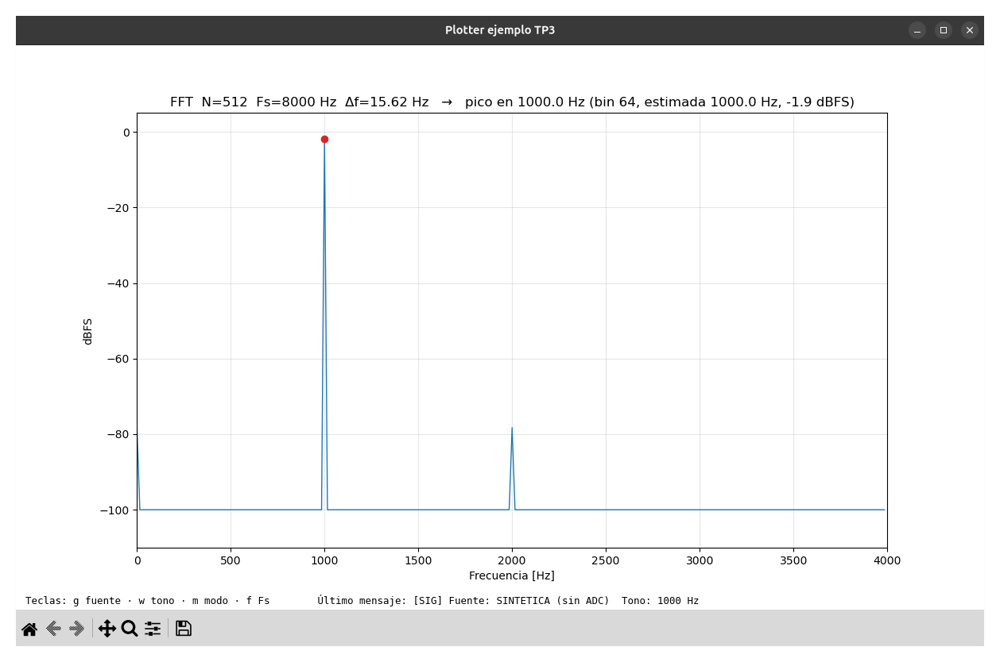

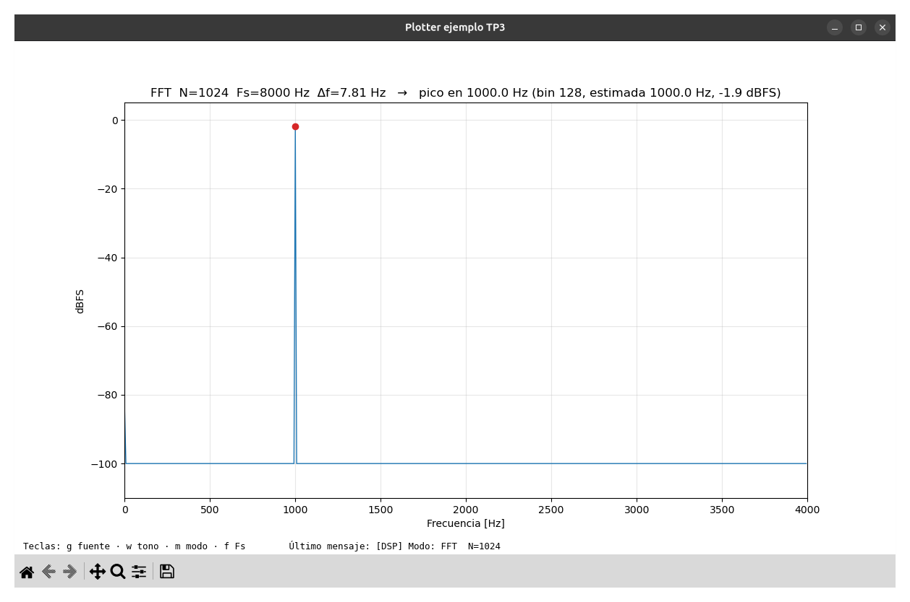

**1000 Hz a Fs = 8 kHz:** con N = 512 el pico queda en el bin 64, y con N = 1024 en el bin 128. En los dos casos está exactamente en 1000 Hz, a **−1,9 dBFS**, y ningún bin vecino se levanta.

Cuando f/Δf es entero (1000 / 15,625 = 64 y 1000 / 7,8125 = 128), la ventana contiene un número entero de ciclos y la FFT no tiene nada que "cortar".

### 2. Piso de cálculo de la FFT en q15 (≈ −78 dB)

En la captura con N = 512 aparece un piquito en **2000 Hz a −78 dB**, y casi todas las capturas tienen otro en **0 Hz**. El resto está en −100 dB, que es el valor fijo que el firmware le asigna a los bins que dan exactamente 0 (`PROCESSING_DB_FLOOR_X100`), porque log(0) no existe.

- **Qué es:** −78,3 dB es **un solo LSB** de la magnitud de salida (`mag = 1` en `mag_to_db_x100`). Es el valor distinto de cero más chico que puede mostrar el firmware. Dos LSB dan −72,2 dB.
- **De dónde sale:** `arm_cfft_q15` divide el resultado por N para no desbordar. Lo hace con desplazamientos a la derecha en cada etapa, y cada desplazamiento redondea siempre hacia abajo. Ese error chico y siempre del mismo signo aparece en DC y en armónicos del tono.
- **No viene del seno de entrada:** se verificó con numpy que redondear el seno a q15 no produce componente en 2000 Hz (da −310 dB). Un seno tiene simetría impar, así que su error de redondeo solo tiene armónicos impares.
- **Por qué se concentra en pocos bins:** a 1000 Hz y 8 kHz hay exactamente 8 muestras por período, así que el error se repite igual en cada período. Un error periódico de 1000 Hz solo puede tener energía en múltiplos de 1000 Hz.
- **Por qué aparece en unas capturas y en otras no:** cada ventana empieza en una fase distinta del tono, y eso cambia el patrón de redondeo. Con 1000 Hz y N = 512 salió un LSB en 2000 Hz; con N = 1024 no salió nada. A este nivel, que un bin dé 1 o 0 LSB es casi una lotería.

### 3. Aliasing

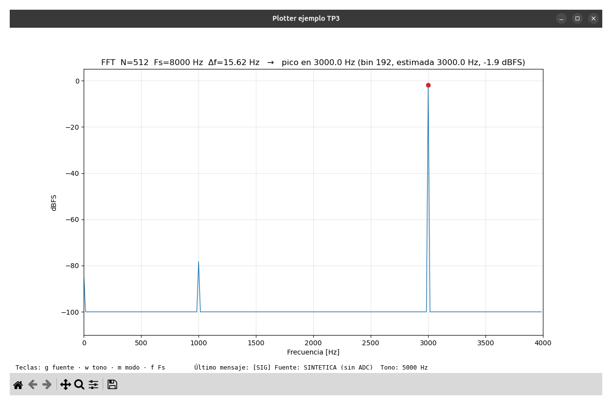

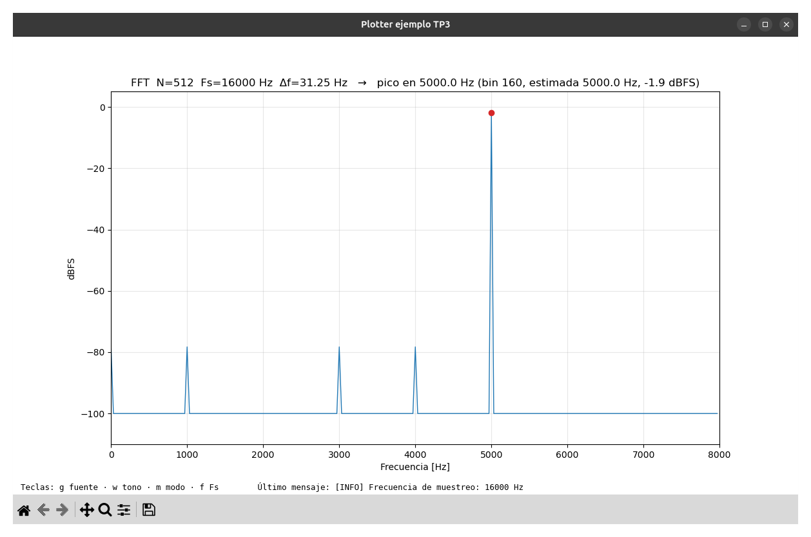

| Configuración | Dónde aparece el pico |
| --- | --- |
| 5000 Hz, Fs = 8 kHz | **3000 Hz** (8000 − 5000), bin 192, −1,9 dBFS |
| 5000 Hz, Fs = 16 kHz | 5000 Hz (bin 160), porque está por debajo de Fs/2 = 8000 Hz |

Los piquitos de 1 LSB también caen en lugares fijos:
- **Por qué en múltiplos de 1000 Hz:**
  - a 8 kHz, 5000/8000 = 5/8: la señal se repite cada 8 muestras;
  - a 16 kHz, 5000/16000 = 5/16: se repite cada 16 muestras.

  Un error que se repite cada M muestras solo tiene energía en múltiplos de Fs/M, que en los dos casos da 1000 Hz.
- **Qué son:** armónicos del error de cálculo que se pasan de Fs/2 y se reflejan. A 16 kHz, por ejemplo, el 3.º armónico de 5000 Hz (15 000 Hz) se refleja en 1000 Hz, y el 4.º (20 000 Hz) en 4000 Hz.
- **Cuáles aparecen:** varía de una ventana a otra. En esta captura salieron 1000, 3000 y 4000 Hz; en otra anterior, 1000, 2000, 3000 y 6000 Hz.

> **Cuidado al interpretarlo:** con el tono generado en la placa, el aliasing ocurre **al calcular el seno**, no en el ADC. A Fs = 8 kHz, calcular un seno de 5000 Hz da los mismos números que uno de 3000 Hz, así que el DAC ya saca 3000 Hz. Para mostrar el aliasing **del ADC** hace falta una señal analógica por encima de Fs/2, o sea el generador externo (captura E1, pendiente).

### 4. Fuga espectral (spectral leakage)

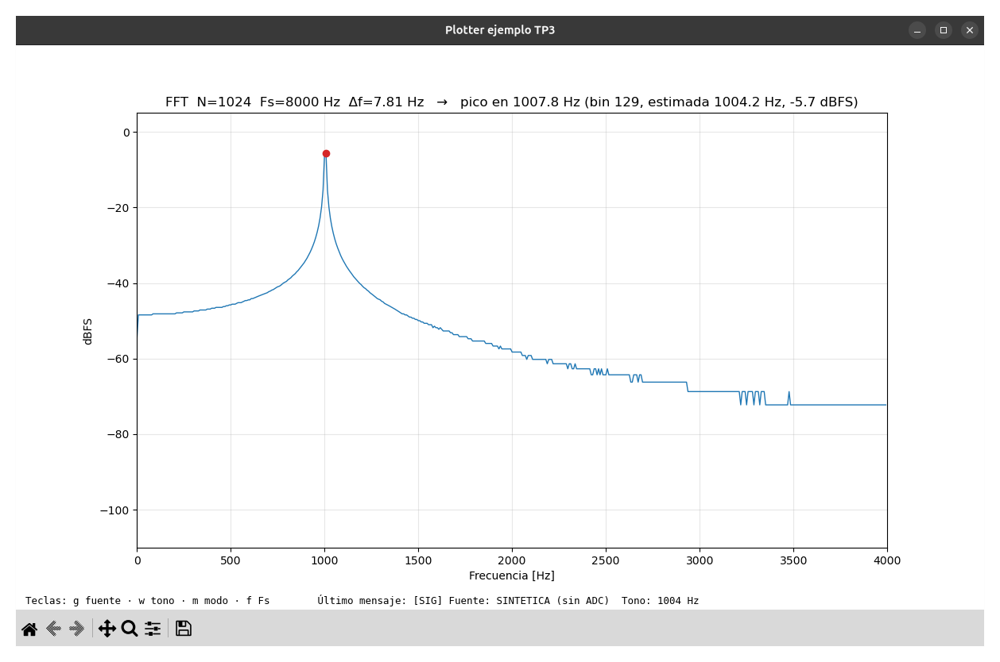

**1004 Hz, Fs = 8 kHz, N = 1024 (comparar con 1000 Hz y la misma N, arriba):** con solo 4 Hz de diferencia, el pico se ensancha en una "pollera" que baja de −48 dB cerca de 0 Hz a −72 dB cerca de 4 kHz.
- 1004 Hz cae en el bin **128,5**, justo entre dos bins: es el peor caso.
- El pico más alto queda en el bin 129 = 1007,8 Hz, y baja a **−5,7 dBFS**: pierde 3,8 dB respecto del caso coherente. Esa pérdida por caer entre bins se llama *scalloping loss*.
- La frecuencia estimada por interpolación da **1004,2 Hz**, muy cerca de la real.

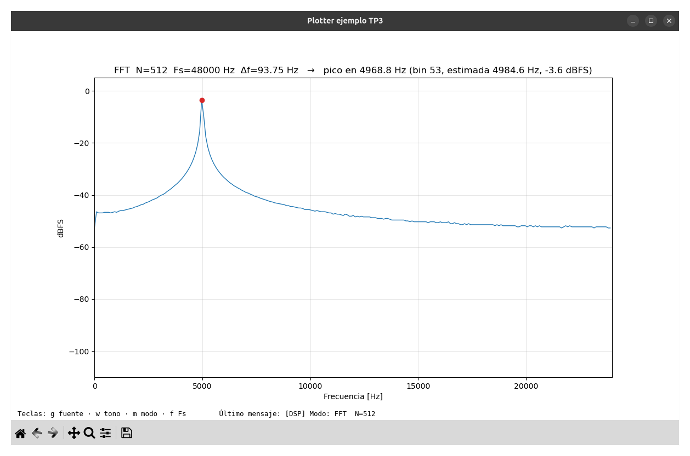

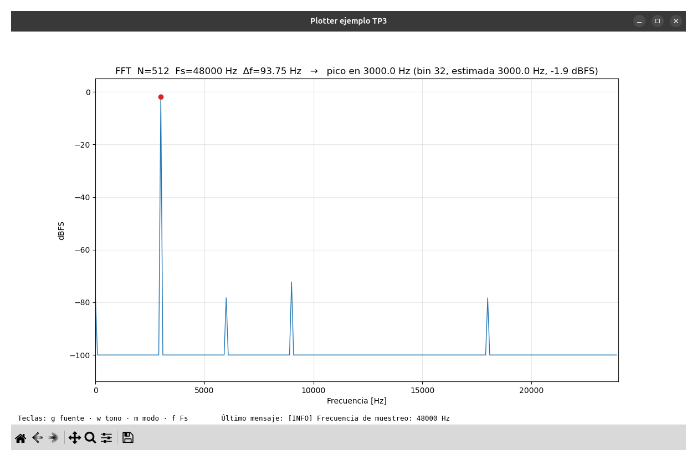

**5000 Hz contra 3000 Hz, los dos a Fs = 48 kHz y N = 512:**
- **5000 Hz** cae en el bin **53,33** (Δf = 93,75 Hz). El pico queda en el bin 53 = 4968,8 Hz, a **−3,6 dBFS**, y lejos del pico aparece un piso de **−47 a −53 dB** que parece ruido blanco. No es ruido, es fuga: coincide con la simulación en la PC (pico a −3,6 dBFS, lejos entre −38 y −53 dB).
- **3000 Hz** cae en el bin 32 exacto. El piso desaparece y el pico vuelve a −1,9 dBFS. Solo quedan piquitos de 1 o 2 LSB en 6000, 9000 y 18 000 Hz, que son múltiplos de 3000 Hz (fenómeno 2).
- **La frecuencia estimada es menos precisa con 5000 Hz:** da **4984,6 Hz**. La interpolación del plotter supone una forma de pico que no es exactamente la de la ventana rectangular. Igual se acerca más que el bin solo (4968,8 Hz).

**Por qué pasa:** cuando la ventana no contiene un número entero de ciclos, el seno queda cortado en los bordes. Como el firmware no aplica ninguna ventana (usa la rectangular), ese corte reparte la energía del tono por todo el espectro, y decae muy lento al alejarse del pico.

**Cómo se reduce:** con una ventana como Hann antes de la FFT, la fuga lejos del pico cae mucho más rápido, a cambio de un pico más ancho. El código actual no aplica ventana.

## Fenómenos observados con DAC LOOPBACK

En loopback la muestra recorre todo el camino: generador digital → DAC de 12 bits → cable de J1[4] a J9[23] → ADC de 16 bits → ventana. Lo que aparece **solo en loopback**, y no con la fuente SINTÉTICA en la misma configuración, viene del DAC, del ADC o de la placa.

### Señal en el tiempo

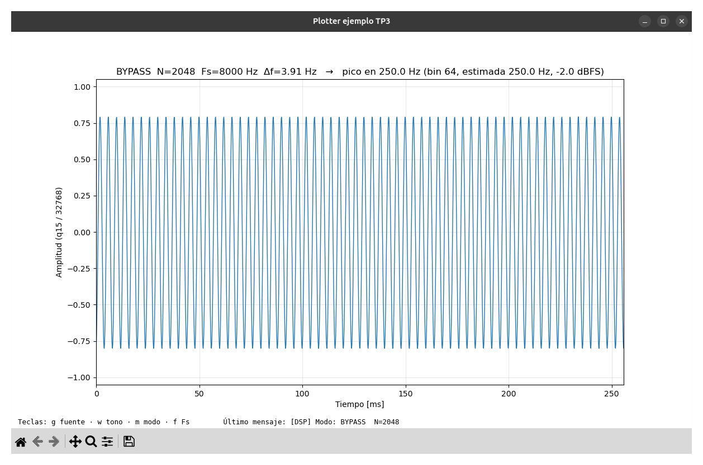

En BYPASS se ven los 64 ciclos de 250 Hz de la ventana (N = 2048, 256 ms), con amplitud ±0,8 y sin recortes ni saltos. El pico del espectro calculado en la PC da 250 Hz exactos (bin 64), a −2,0 dBFS.

### 1000 Hz a 8 kHz: comparación con la fuente SINTÉTICA

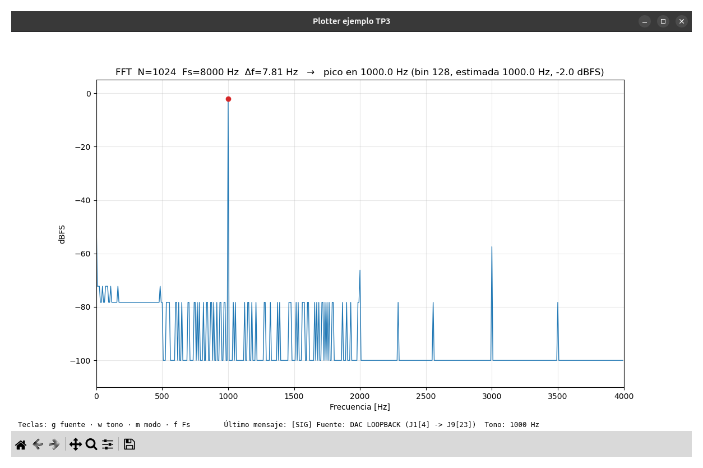

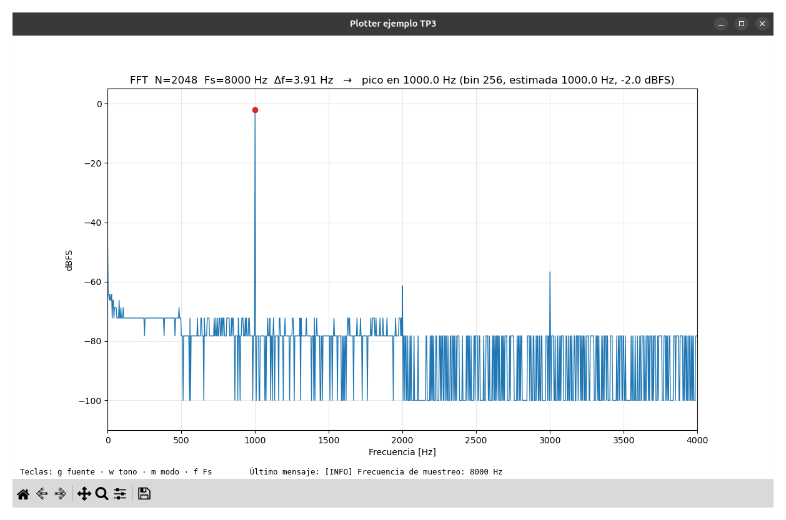

La referencia es la captura SINTÉTICA de 1000 Hz con N = 1024 del fenómeno 1: pico a −1,9 dBFS y todo lo demás en −100 dB.

| Qué se ve en loopback | Valor | Causa probable |
| --- | --- | --- |
| El pico en la misma frecuencia, en el mismo bin | 1000 Hz, bin 128 (N = 1024) y bin 256 (N = 2048) | La frecuencia la fija el reloj de muestreo, que es el mismo para el DAC y el ADC |
| El nivel del pico, casi igual | **−2,0 dBFS** contra −1,9 | Las escalas del DAC y del ADC coinciden dentro de ~0,1 dB (un 1 %) |
| **3.er armónico** (3000 Hz) | **−57 dB** en las dos capturas, unos 55 dB por debajo del tono | Distorsión real del DAC y del ADC. Que domine el 3.º sobre el 2.º indica una distorsión simétrica, como una compresión cerca de los extremos de la excursión (0,33 V y 2,97 V) |
| **2.º armónico** (2000 Hz) | **−66 dB** con N = 1024 y **−61 dB** con N = 2048 | Distorsión real, más chica. A este nivel cada LSB pesa varios dB (4 LSB contra 7 LSB), así que la diferencia entre capturas puede ser variación de una ventana a otra |
| Pico en 0 Hz | Unos −58 dB | El punto medio del DAC y el del ADC no coinciden exacto, y el firmware no le resta la media a la ventana |
| Ruido en lugar del piso plano | Muchos bins en −72 y −78 dB (2 y 1 LSB) | Ruido de cuantización del DAC de 12 bits más el ruido del ADC y de la placa. Está justo en el límite que puede mostrar la FFT en q15 |
| Más ruido por debajo de unos 500 Hz | Bins pegados en −72 dB | Posible ruido de baja frecuencia: deriva del offset, ruido de la alimentación por USB, o interferencia captada por el cable suelto. No se investigó |

**El piso no baja al pasar de N = 1024 a N = 2048, aunque se esperaba que bajara.** Con más N, el ruido se reparte en más bins y cada bin debería tener menos. Pero `arm_cfft_q15` divide por N y redondea en cada etapa, y con N = 2048 hay más etapas, así que también suma más error de cálculo. Además, el ruido real ya está en 1 o 2 LSB, que es la resolución de la salida. Con la FFT en q15 no se gana nada visible aumentando N; haría falta una FFT de más precisión (q31 o float) para ver la ganancia.

### 3000 Hz a 48 kHz: ¿llega la interrupción a tiempo?

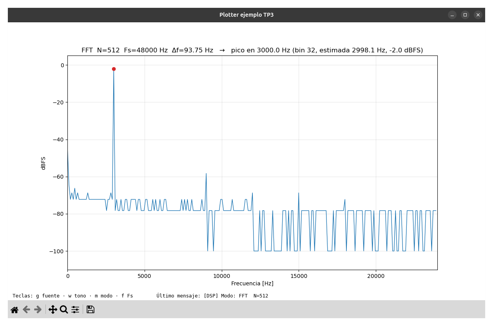

La referencia es la captura SINTÉTICA de 3000 Hz a 48 kHz del fenómeno 4.

- **Pico:** en 3000 Hz (bin 32) a −2,0 dBFS, igual que a 8 kHz. La estimada da 2998,1 Hz porque los dos bins vecinos tienen ruido distinto (1 y 2 LSB) y la interpolación se corre un poco hacia un lado.
- **Armónicos:** el 3.º (9000 Hz) a **−58 dB**, prácticamente igual que a 8 kHz. Además el 4.º (12 000 Hz) y el 5.º (15 000 Hz) a −69 dB, y el 6.º (18 000 Hz) a −72 dB. El 2.º (6000 Hz) no se distingue del ruido.
- **Pico en 0 Hz:** más alto que a 8 kHz, unos **−45 dB**. No se investigó la causa. Puede ser deriva del offset entre una captura y otra, o un efecto del muestreo más rápido en la entrada del ADC. Para saberlo, habría que repetir una captura a 8 kHz justo después de esta.
- **Sin señales de muestras perdidas.** Si la interrupción no llegara a tiempo, el DAC se actualizaría con retraso o se saltearían muestras. Se vería un piso de ruido mucho más alto y repartido, o espurios fuera de los armónicos, y no aparece nada de eso. El ruido queda en 1 o 2 LSB, igual que a 8 kHz. Hay que anotar si esta captura se hizo con el build Debug o Release.

### Qué confirma la comparación

| Fenómeno | SINTÉTICA | DAC LOOPBACK | Viene de |
| --- | --- | --- | --- |
| Frecuencia y bin del pico | ✓ | ✓, idéntico | El muestreo |
| Nivel del pico | −1,9 dBFS | −2,0 dBFS | Ganancia DAC + ADC (≈ 1 %) |
| Piquitos de 1 LSB en múltiplos del tono | ✓ | Tapados por el ruido | La aritmética de la FFT en q15 |
| 3.er armónico en −57 dB | ✗ | ✓ | La parte analógica (DAC, ADC) |
| Pico en 0 Hz de −58 a −45 dB | ✗ (solo 1 LSB) | ✓ | Offset entre DAC y ADC |
| Ruido de 1–2 LSB repartido | ✗ | ✓ | Cuantización del DAC, ruido del ADC y de la placa |
| Fuga cuando el tono cae entre bins | ✓ | Se espera igual | La ventana rectangular, no la parte analógica |

**Para seguir, si hace falta:**
- **Confirmar que el 3.er armónico viene de la compresión en los extremos:** bajar `SIGNAL_GEN_AMPLITUDE` de 0,8 a 0,5 en `signal_gen.h`. Si es eso, el 3.er armónico tendría que bajar bastante más que el tono.

## Capturas

Todas en `images/ejemplo_senal_interna/`.

| Fuente | Archivo | Configuración |
| --- | --- | --- |
| SINTÉTICA | `sint_1000_fs8k_n512.png` | 1000 Hz, 8 kHz, FFT 512 |
| SINTÉTICA | `sint_1000_fs8k_n1024.png` | 1000 Hz, 8 kHz, FFT 1024 |
| SINTÉTICA | `sint_1004_fs8k_n1024_fuga.png` | 1004 Hz, 8 kHz, FFT 1024 |
| SINTÉTICA | `sint_5000_fs8k_alias.png` | 5000 Hz, 8 kHz, FFT 512 |
| SINTÉTICA | `sint_5000_fs16k.png` | 5000 Hz, 16 kHz, FFT 512 |
| SINTÉTICA | `sint_5000_fs48k_fuga.png` | 5000 Hz, 48 kHz, FFT 512 |
| SINTÉTICA | `sint_3000_fs48k_coherente.png` | 3000 Hz, 48 kHz, FFT 512 |
| DAC LOOPBACK | `loop_250_bypass.png` | 250 Hz, 8 kHz, BYPASS (N = 2048) |
| DAC LOOPBACK | `loop_1000_fs8k_n1024.png` | 1000 Hz, 8 kHz, FFT 1024 |
| DAC LOOPBACK | `loop_1000_fs8k_n2048.png` | 1000 Hz, 8 kHz, FFT 2048 |
| DAC LOOPBACK | `loop_3000_fs48k.png` | 3000 Hz, 48 kHz, FFT 512 |

**Pendientes, opcionales:**
- `sint_250_bypass.png`: 250 Hz, 8 kHz, BYPASS, con zoom a 0–20 ms para ver el período de 4 ms.
- Con el generador externo (fuente ADC):
  - **E1:** 5000 Hz, 8 kHz, FFT 512. Es el aliasing **del ADC** de verdad, y se compara con `sint_5000_fs8k_alias.png`.
  - **E2:** 1000 Hz, 8 kHz, FFT 1024. Se compara con `loop_1000_fs8k_n1024.png`: la misma cadena de ADC con otra fuente.
