<p align="center">
  
</p>

# TP3 — Transformada Rápida de Fourier (FFT) con MCXN947

Análisis espectral en tiempo real mediante FFT en punto fijo Q15 sobre la placa FRDM-MCXN947, transmisión binaria por UART y visualización interactiva en PC.

|              |                                   |
| ------------ | --------------------------------- |
| **Materia:** | Procesamiento Digital de Señales  |
| **Carrera:** | Ingeniería en Computación         |
| **Alumnos:** | García, Lautaro Misael            |
|              | Molina, María Wanda               |
|              | Renaudo Gaggioli, Valentino       |
|              | Verdú, Melisa Noel                |
| **Fecha:**   | Noviembre de 2026                 |

---

## Índice

1. [Objetivo](#1-objetivo)
2. [Marco teórico](#2-marco-teórico)
3. [Configuración del ambiente](#3-configuración-del-ambiente)
4. [Diseño de la aplicación](#4-diseño-de-la-aplicación)
5. [Código fuente relevante](#5-código-fuente-relevante)
6. [Herramientas de análisis y simulación en PC (GUI y Notebook)](#6-herramientas-de-análisis-y-simulación-en-pc-gui-y-notebook)
7. [Demostración y resultados](#7-demostración-y-resultados)
8. [Limitaciones conocidas](#8-limitaciones-conocidas)
9. [Conclusiones](#9-conclusiones)
10. [Anexo: compilación y ejecución de las herramientas entregadas](#10-anexo-compilación-y-ejecución-de-las-herramientas-entregadas)

---

## 1. Objetivo

Desarrollar sobre la placa de evaluación **FRDM-MCXN947** (MCU MCXN947, núcleo Cortex-M33 a 150 MHz) una aplicación de análisis espectral en tiempo real sobre la cadena de adquisición del TP1, cumpliendo los siguientes requisitos:

- Calcular la **Transformada Rápida de Fourier (FFT)** en punto fijo **Q15** mediante **CMSIS-DSP** sobre ventanas de **$N \in \{512, 1024, 2048\}$ muestras**, operando a las cinco frecuencias de muestreo seleccionables: **8, 16, 22, 44 y 48 kHz**.
- Conmutar mediante un pulsador de la placa (**SW3**) entre el modo **BYPASS** ($N = 512$ fijo) y el cálculo de la **FFT** ($512 \rightarrow 1024 \rightarrow 2048$), depositando el resultado en un **buffer de salida distinto del buffer de entrada**.
- Transmitir el buffer de salida hacia la PC a través del puerto serie (**LPUART4** a **921 600 baudios**) y graficar el espectro resultante en tiempo real.
- Analizar e interpretar los fenómenos espectrales observados al modificar la frecuencia de muestreo $f_s$ y el tamaño de ventana $N$.

### Entregables del proyecto

Junto con este informe se entregan los siguientes artefactos en la carpeta `TP3/`:

1. **Código fuente del firmware** ([`MCXN947_Project_TP3/`](./MCXN947_Project_TP3/)): proyecto completo de MCUXpresso IDE con adquisición por hardware (`CTIMER0` + `LPADC1`), doble buffer de ventanas, procesamiento FFT/Bypass con CMSIS-DSP, interfaz OLED I2C, protocolo UART binario no bloqueante y un generador interno de señal configurable ([`signal_gen.c`](./MCXN947_Project_TP3/source/signal_gen.c)).
2. **Interfaz gráfica en Python y suite de pruebas** ([`tools/fft_gui.py`](./tools/fft_gui.py)): analizador espectral interactivo con soporte de tramas `FFT` y `BYPASS`, control remoto completo del firmware y del generador interno, medición por cursor, promediado exponencial, *Max-Hold*, validación cruzada PC vs. placa y exportación CSV/PNG; acompañado de un simulador de placa sin hardware ([`tests/fake_board.py`](./tests/fake_board.py)) y pruebas unitarias del decodificador de tramas ([`tests/test_frame_parser.py`](./tests/test_frame_parser.py)).
3. **Cuaderno interactivo de Jupyter** ([`notebooks/fft_ventanas_y_fenomenos.ipynb`](./notebooks/fft_ventanas_y_fenomenos.ipynb)): estudio reproducible sobre resolución espectral, muestreo coherente, fuga espectral, comparación cuantitativa de ventanas (Rectangular, Hann, Hamming y Blackman), *aliasing*, piso aritmético de la FFT en Q15 y contraste directo contra las capturas experimentales de la placa.

---

## 2. Marco teórico

### 2.1 Transformada Discreta de Fourier (DFT) y algoritmo FFT

Dada una secuencia finita de $N$ muestras $x[0], x[1], \dots, x[N-1]$, su Transformada Discreta de Fourier (DFT) se define como:

$$
X[k] = \sum_{n=0}^{N-1} x[n]\,e^{-j\frac{2\pi}{N}kn}, \qquad k = 0, 1, \dots, N-1
$$

El cálculo directo de los $N$ coeficientes $X[k]$ requiere $\mathcal{O}(N^2)$ operaciones complejas. El algoritmo de la **Transformada Rápida de Fourier (FFT)** explotando la periodicidad y simetría de los factores de giro $W_N^{kn} = e^{-j\frac{2\pi}{N}kn}$ factoriza el problema en etapas de base 2 o base 4 (cuando $N = 2^m$), reduciendo la complejidad computacional a $\mathcal{O}(N \log_2 N)$ y haciendo viable su ejecución en tiempo real dentro de un microcontrolador.

Como la señal adquirida por el ADC es puramente **real**, el espectro satisface simetría hermítica:

$$
X[N - k] = X^*[k] \implies |X[N - k]| = |X[k]|
$$

Por ello, toda la información espectral única entre $0$ y la frecuencia de Nyquist $f_s / 2$ se encuentra contenida en los primeros **$N/2$ bins** ($k = 0, 1, \dots, \frac{N}{2} - 1$), donde el índice $k$ corresponde a la frecuencia:

$$
f_k = k \cdot \frac{f_s}{N}
$$

### 2.2 Resolución en frecuencia y duración de la ventana

Al muestrear a tasa $f_s$ y tomar una ventana de $N$ muestras, la separación frecuencial entre bins consecutivos (**resolución espectral** $\Delta f$) y el tiempo de observación (**duración de la ventana** $T_w$) quedan ligados de forma recíproca:

$$
\Delta f = \frac{f_s}{N}, \qquad T_w = \frac{N}{f_s} = \frac{1}{\Delta f}
$$

Para discriminar dos componentes espectrales cercanas (aumentar la resolución disminuyendo $\Delta f$) es necesario observar la señal durante un intervalo temporal $T_w$ mayor, ya sea **incrementando $N$** (mayor costo de cálculo, memoria y latencia) o **reduciendo $f_s$** (menor ancho de banda observable sin *aliasing*). La tabla siguiente resume las 15 combinaciones soportadas por el sistema:

| $f_s$ | $\Delta f$ ($N=512$) | $\Delta f$ ($N=1024$) | $\Delta f$ ($N=2048$) | $T_w$ ($N=512$) | $T_w$ ($N=1024$) | $T_w$ ($N=2048$) |
| --- | :---: | :---: | :---: | :---: | :---: | :---: |
| **8 kHz** | 15,63 Hz | 7,81 Hz | 3,91 Hz | 64,0 ms | 128,0 ms | 256,0 ms |
| **16 kHz** | 31,25 Hz | 15,63 Hz | 7,81 Hz | 32,0 ms | 64,0 ms | 128,0 ms |
| **22 kHz** | 42,97 Hz | 21,48 Hz | 10,74 Hz | 23,3 ms | 46,5 ms | 93,1 ms |
| **44 kHz** | 85,94 Hz | 42,97 Hz | 21,48 Hz | 11,6 ms | 23,3 ms | 46,5 ms |
| **48 kHz** | 93,75 Hz | 46,88 Hz | 23,44 Hz | 10,7 ms | 21,3 ms | 42,7 ms |

### 2.3 Muestreo coherente, fuga espectral (*spectral leakage*) y funciones de ventana

Tomar un bloque finito de $N$ muestras equivale a multiplicar la señal infinita por una **ventana rectangular** $w[n] = 1$ para $0 \le n < N$. En el dominio de la frecuencia, esto corresponde a convolucionar el espectro verdadero con la transformada de la ventana (el núcleo de Dirichlet). Se distinguen dos situaciones:

- **Muestreo coherente ($f_0 / \Delta f = k \in \mathbb{Z}$):** la ventana contiene un número exacto de ciclos del tono senoidal. Los ceros del núcleo de Dirichlet coinciden exactamente con los demás bins $m \ne k$, de modo que toda la energía se concentra en un único bin y no existe fuga.
- **Muestreo no coherente ($f_0 / \Delta f \notin \mathbb{Z}$):** los bordes de la ventana cortan el período en forma abrupta, lo que equivale a una discontinuidad en la extensión periódica implícita de la DFT. La energía del tono se derrama por todo el espectro (**fuga espectral** o *spectral leakage*) a través de los lóbulos laterales de la ventana, y el pico medido cae porque la energía se reparte entre los bins vecinos (**pérdida por festoneado** o *scalloping loss*, máxima cuando el tono cae en $k + 0{,}5$).

El firmware utiliza únicamente **ventana rectangular** (sin multiplicar las muestras por una envolvente previa), mientras que el cuaderno [`notebooks/fft_ventanas_y_fenomenos.ipynb`](./notebooks/fft_ventanas_y_fenomenos.ipynb) evalúa y cuantifica el comportamiento frente a ventanas suavizadas:

| Ventana | Ancho del lóbulo principal | Lóbulo lateral más alto | Pérdida máxima entre bins |
| --- | :---: | :---: | :---: |
| **Rectangular** | 2,0 bins | −13,3 dB | 3,92 dB |
| **Hann** | 4,0 bins | −31,5 dB | 1,42 dB |
| **Hamming** | 4,0 bins | −42,7 dB | 1,75 dB |
| **Blackman** | 6,0 bins | −58,1 dB | 1,10 dB |

Una ventana como **Hann** atenúa los lóbulos laterales de $-13{,}3\text{ dB}$ a $-31{,}5\text{ dB}$ (con decaimiento mucho más rápido lejos del pico) y reduce el *scalloping loss* de $3{,}92\text{ dB}$ a $1{,}42\text{ dB}$, permitiendo detectar tonos débiles cercanos a un tono fuerte; a cambio, duplica el ancho del lóbulo principal (4 bins frente a 2), reduciendo la capacidad de separar dos tonos muy próximos.

### 2.4 FFT en punto fijo Q15 con CMSIS-DSP y escala en dBFS

El firmware calcula el espectro sobre muestras **Q15** (`q15_t` $\in [-32768, 32767]$ representando $[-1, 1 - 2^{-15}]$) empleando `arm_cfft_q15` y `arm_cmplx_mag_q15` de **CMSIS-DSP**:

1. **Vector complejo intercalado:** la ventana real se copia a `s_cfft_buf[2*N]` como `[re0, 0, re1, 0, ...]` porque `arm_cfft_q15` opera *in-place*.
2. **Escalado preventivo de `arm_cfft_q15`:** para evitar desbordamientos en las mariposas, CMSIS-DSP divide por 2 en cada una de las $\log_2 N$ etapas, entregando a la salida la transformada escalada por $1/N$, es decir $X[k]/N$ en Q15.
3. **Magnitud en formato Q2.14:** `arm_cmplx_mag_q15` calcula la magnitud sobre los primeros $N/2$ bins y entrega un entero `q15_t` en formato **2.14** (donde $1{,}0$ equivale a $2^{14} = 16\,384$).
4. **Normalización a dBFS (decibelios respecto de fondo de escala):**
   Un tono real $x[n] = A \cos(2\pi f_0 n / f_s)$ ubicado exactamente en el bin $k > 0$ divide su amplitud en las frecuencias positiva y negativa: $|X[k]| = A \cdot N/2$, por lo que $|X[k]|/N = A/2$. Para que un tono de amplitud máxima ($A = 1{,}0$ en Q15) registre exactamente **$0\text{ dBFS}$** cualquiera sea $N$, la amplitud reconstruida a partir de la salida `mag` en Q2.14 resulta:

$$
A(k) = \begin{cases}
\dfrac{\text{mag}[0]}{16384}, & k = 0 \text{ (componente DC)} \\[8pt]
\dfrac{\text{mag}[k]}{8192}, & 1 \le k < \dfrac{N}{2}
\end{cases}
\qquad\Longrightarrow\qquad
\text{dBFS}(k) = 20 \log_{10}\!\big(A(k)\big)
$$

5. **Piso de representación en Q15:** dado que `mag` es un entero no negativo, el menor valor distinto de cero es $\text{mag} = 1\text{ LSB}$, lo que fija el límite inferior observable en la FFT en punto fijo de 16 bits:

$$
20 \log_{10}\!\left(\frac{1}{8192}\right) \approx -78{,}27\text{ dBFS}, \qquad 20 \log_{10}\!\left(\frac{2}{8192}\right) \approx -72{,}25\text{ dBFS}
$$

Los bins con $\text{mag} = 0$ (donde el logaritmo no está definido) reciben en el firmware el valor fijo `PROCESSING_DB_FLOOR_X100 = -10000` ($-100{,}00\text{ dBFS}$). El firmware transmite cada bin como `int16_t` en centésimas de dB ($\text{dBFS} \times 100$), evitando enviar números de punto flotante por la UART.

---

## 3. Configuración del ambiente

### 3.1 Hardware y conexiones

| Elemento | Configuración |
| --- | --- |
| **Placa / MCU** | `FRDM-MCXN947`, MCXN947 (Cortex-M33 *core 0*, DSP + FPU) |
| **Relojes** | `BOARD_BootClockPLL150M`: núcleo y `CTIMER0` a **150 MHz** (`PLL0`); `ADC1` y `DAC0` desde `FRO_HF` (48 MHz); `LPUART4` y `LPI2C3` desde `FRO` (12 MHz) |
| **Entrada analógica** | `ADC1`, canal A23 en **P1_23 (`J9[23]`)**, resolución **16 bits**, modo *single-ended*, referencia `VREF0` (`VREFH`). La señal externa debe montarse sobre una continua de $\approx 1{,}65\text{ V}$ |
| **Salida analógica** | `DAC0` (12 bits) en **P4_2 (`J1[4]`)**, *op-amp buffer* habilitado para conectar al osciloscopio o realizar puente físico de *loopback* hacia `J9[23]` |
| **Disparo del ADC** | `CTIMER0` canal de *match* 3 en modo *Toggle* conectado por `INPUTMUX0` (`kINPUTMUX_Ctimer0M3ToAdc1Trigger`) al disparo por hardware de `ADC1` |
| **Puerto serie** | `LPUART4` (`LP_FLEXCOMM4` en `P1_8`/`P1_9`, puente USB MCU-Link) a **921 600 baudios, 8N1**, sin control de flujo |
| **Pulsadores** | **SW2** (`PIO0_23` → `GPIO00_IRQn`): cambia $f_s$. **SW3** (`PIO0_6` → `GPIO01_IRQn`): cicla modo y $N$ |
| **LED RGB** | Indica $f_s$: 8 kHz rojo (`P0_10`), 16 kHz verde (`P0_27`), 22 kHz azul (`P1_2`), 44 kHz amarillo, 48 kHz magenta |
| **Display OLED** | SSD1306 0.96" bicolor (128×64 píxeles, dirección 7 bits `0x3C`) vía **`LPI2C3` (`LP_FLEXCOMM3`)** a 100 kHz: SDA en **P1_0 (`J2[17]`)**, SCL en **P1_1 (`J2[15]`)**, VCC 3,3 V y GND |

### 3.2 Análisis de velocidad del puerto serie y justificación de 921 600 baudios

En los TP1 y TP2 la consola UART operaba a `115 200` baudios. En el TP3, para transmitir de forma continua (`c`) cada ventana procesada sin descartar tramas por congestión, el tiempo de transmisión $T_{\text{tx}}$ debe ser menor o igual al tiempo de adquisición de la ventana $T_w = N / f_s$:

$$
T_{\text{tx}} = \frac{\text{Bytes}_{\text{trama}} \times 10\text{ bits/byte}}{\text{Baudrate}} \le \frac{N}{f_s} = T_w
$$

En formato 8N1 cada byte requiere 10 bits en línea. Con la cabecera mínima de 9 bytes (`Sync(2) + Type(1) + N(2) + Fs(4)`), la trama FFT más exigente ($N = 2048, f_s = 48\text{ kHz}$) posee $9 + 2 \times 1024 = 2057\text{ bytes}$ ($20\,570\text{ bits}$) frente a una ventana de $T_w = 2048 / 48\,000 \approx 42{,}67\text{ ms}$:

| Trama | Tamaño total | A 115 200 baudios | A 460 800 baudios | A 921 600 baudios | Ventana $T_w$ a 48 kHz |
| --- | :---: | :---: | :---: | :---: | :---: |
| **FFT 512** | 521 B (5210 bits) | 45,2 ms | 11,3 ms | **5,7 ms** | 10,7 ms |
| **FFT 1024** | 1033 B (10 330 bits) | 89,7 ms | 22,4 ms | **11,2 ms** | 21,3 ms |
| **FFT 2048** | 2057 B (20 570 bits) | 178,6 ms | 44,6 ms | **22,3 ms** | 42,7 ms |
| **BYPASS 512** | 1033 B (10 330 bits) | 89,7 ms | 22,4 ms | 11,2 ms | 10,7 ms |

- A **115 200 baudios**, una trama de FFT 2048 tarda $178{,}6\text{ ms}$ ($4{,}18 \times T_w$), descartando entre 3 y 4 ventanas por cada trama enviada y manteniendo la UART ocupada de forma casi permanente.
- A **460 800 baudios**, tarda $44{,}6\text{ ms} > 42{,}7\text{ ms}$, provocando el descarte de la mitad de las ventanas a 48 kHz.
- A **921 600 baudios**, cada trama FFT tarda aproximadamente la mitad de la ventana ($T_{\text{tx}} \approx 0{,}52 \times T_w$), permitiendo transmitir el **100 % de las ventanas FFT sin pérdidas** a todas las frecuencias de muestreo.

**Viabilidad en hardware (`LPUART4` desde `FRO 12 MHz`):** el reloj configurado para `LP_FLEXCOMM4` es `BOARD_DEBUG_UART_CLK_FREQ = 12000000U` (`board.h`). El divisor del LPUART selecciona $OSR = 13$ y $SBR = 1$:

$$
\text{Baud}_{\text{real}} = \frac{12\,000\,000}{13 \times 1} \approx 923\,076{,}92\text{ baudios} \implies \text{Error} = \frac{923\,076{,}92 - 921\,600}{921\,600} \times 100 \approx +0{,}16\,\%
$$

Este desvío es ampliamente inferior al margen admisible de la norma UART ($\pm 2\,\%$ a $\pm 3\,\%$), por lo que el enlace USB-VCOM del MCU-Link opera de manera estable a **921 600 baudios**.

### 3.3 Entorno de software y herramientas

- **Firmware:** **MCUXpresso IDE 25.6**, **SDK MCXN947 26.06.00**, compilador **Arm GNU Toolchain (`arm-none-eabi-gcc`)** con optimización `-O3` (`gnu.c.optimization.level.most` en Release), **CMSIS-DSP** con `ARM_MATH_LOOPUNROLL = 1`, FPU por hardware para la conversión logarítmica (`log10f`) y biblioteca gráfica **U8g2** en modo *full buffer* (1024 bytes en RAM). Consola de depuración configurada sobre UART (`SDK_DEBUGCONSOLE_UART`) para evitar paradas por *semihosting*.
- **Herramientas en PC:** **Python 3** con `pyserial >= 3.5`, `matplotlib >= 3.7`, `numpy >= 1.24`, `tkinter` y **Jupyter Notebook** (ver [`tools/requirements.txt`](./tools/requirements.txt)).

---

## 4. Diseño de la aplicación

### 4.1 Arquitectura modular

Se conservó y extendió la arquitectura desacoplada por etapas de los trabajos anteriores:

| Módulo | Responsabilidad |
| --- | --- |
| `MCXN947_Project_TP3.c` | Inicialización, `while(1)` (comandos UART, avisos de texto, refresco OLED), `PendSV_Handler`, `ADC1_IRQHANDLER` y manejadores `GPIO0` (SW2/SW3) |
| `pipeline` | Doble buffer ping-pong `s_frame_in[2][2048]`, descriptor `frame_info_t`, disparo de PendSV, detección de sobrecarga, buffer de salida `s_frame_out[2048]` y cálculo de frecuencia pico |
| `adc_stage` | `CTIMER0` + `LPADC1`: lectura y normalización a Q15, control RUN/STOP, tabla de *match* de frecuencias y buffer circular de 512 muestras |
| `processing_stage` | Modo `BYPASS` (`arm_copy_q15`) y modo `FFT` (`arm_cfft_q15` + `arm_cmplx_mag_q15` + `arm_max_q15` + conversión a dBFS × 100) |
| `uart_stage` | Empaquetado y envío no bloqueante de tramas binarias por interrupción, arbitraje de turno de texto con `PRINTF` y recepción por interrupción en buffer circular de 64 B |
| `signal_gen` | Generador DDS interno de 32 bits (`SENO`, `CUADRADA`, `TRIANGULAR`, `SIERRA`) con selector de fuente (`ADC`, `DAC LOOPBACK`, `SINTÉTICA`) |
| `dac_stage` | Conversión Q15 → 12 bits y salida continua por `DAC0` de la señal adquirida o generada |
| `circular_buffer` | Buffer circular de 512 muestras Q15 para reproducción en bucle en modo STOP |
| `ui` / `display_port` | Interfaz OLED SSD1306 por regiones *dirty* alineadas a *tiles* de 8×8 sobre `LPI2C3` |

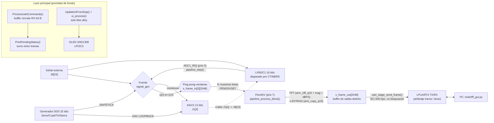

### 4.2 Esquema de ventanas ping-pong, coherencia de metadatos y sobrecarga

El ADC adquiere muestras de forma ininterrumpida a tasa $f_s$ (una muestra cada $20{,}8\text{ }\mu\text{s}$ a 48 kHz), incluso mientras se calcula la FFT. Para evitar que la rutina de interrupción sobreescriba muestras de la ventana que se está transformando, se utilizan dos buffers de 2048 muestras (`s_frame_in[2][2048]` = 8 KB totales):

```
tiempo →     0 ms          128 ms          256 ms          384 ms     (ejemplo N=1024, Fs=8 kHz)
             │               │               │               │
ADC escribe: │ ── en A ────► │ ── en B ────► │ ── en A ────► │ ── en B ──►
             │               │               │               │
FFT lee:     │  (nada aún)   │ A ■■          │ B ■■          │ A ■■
                               ↑               ↑
                               PendSV calcula  PendSV calcula
                               en pocos ms     en pocos ms
```

1. **Separación de prioridades:** `ADC1_IRQHANDLER` corre con prioridad **0** (máxima) y únicamente lee/inyecta una muestra, la repite por el `DAC0` para monitoreo en osciloscopio, la guarda en `s_frame_in[s_cur][idx]` y, al completar $N$ muestras, conmuta `s_cur = cur ^ 1U` y dispara `PendSV` (configurado en `pipeline_init()` a la prioridad mínima **7** del NVIC). De este modo la FFT aprovecha el tiempo libre entre muestras sin introducir *jitter*.
2. **Coherencia de metadatos (`frame_info_t`) y aplicación diferida:** cuando arranca una ventana (`idx == 0`), la ISR aplica el tamaño pendiente `s_pending_n` (protegido por sección crítica junto al modo en `pipeline_next_processing_mode()`) y congela en `s_fill_info` la terna `{fs_hz, n, mode}` real con la que se tomó esa ventana. Así, aunque el usuario presione `SW3` o envíe `m` a mitad de una ventana, la ventana en curso termina íntegra con su configuración original y el cambio se aplica recién en la siguiente.
3. **Descarte limpio al cambiar de fuente o $f_s$:** al cambiar la frecuencia de muestreo (`SW2` / `f`) o cualquier parámetro del generador interno (`g`, `k`, `w`, frecuencia), se reinicia `s_idx = 0` para descartar la ventana parcial y evitar mezclar dos tasas o señales distintas en una misma FFT.
4. **Detección de sobrecarga (*overrun*):** si al completarse una ventana `PendSV` aún no terminó de procesar la anterior (`s_frame_busy == true`), la ventana recién llena se descarta sin cambiar de buffer ni bloquear el muestreo, incrementando `s_overrun_count` y emitiendo el aviso `[DSP] Sobrecarga a <Fs> Hz: ventana descartada` por consola.

### 4.3 Protocolo de trama binaria y comunicación UART bidireccional

#### Trama binaria mínima

La placa transmite el buffer de salida `s_frame_out` como una trama binaria *little-endian* sin delimitadores textuales ni sobrecarga de conversión ASCII:

| Campo | Tipo | Tamaño | Descripción |
| --- | --- | :---: | --- |
| **Sync** | 2 bytes | 2 B | `0xA5 0x5A` |
| **Tipo** | `uint8_t` | 1 B | `0` = `FFT`, `1` = `BYPASS` |
| **N** | `uint16_t` | 2 B | Tamaño de la ventana (`512`, `1024` o `2048`) |
| **Fs** | `uint32_t` | 4 B | Frecuencia de muestreo en Hz (`8000`..`48000`) |
| **Datos** | `int16_t × L` | $2L$ B | **FFT:** magnitud en $\text{dBFS} \times 100$ de los bins $0 \dots N/2 - 1$ ($L = N/2$). **BYPASS:** muestras Q15 ($L = N$) |

La cabecera ocupa exactamente 9 bytes y se serializa byte a byte (`uart_frame_put_u16`, `uart_frame_put_u32`) para evitar rellenos de alineación de compilador. Durante el diseño se evaluó una cabecera extendida (con tipo de ventana, longitud explícita, número de secuencia, bin del pico y CRC), pero se adoptó la **trama mínima** porque el firmware usa siempre ventana rectangular, $L$ se deduce de `Tipo` y `N`, la PC calcula el pico directamente sobre el payload, los descartes los contabiliza el propio firmware (comando `t`) y el enlace USB-VCOM es libre de errores de bit en la práctica (ante una trama truncada el decodificador valida rango de cabecera y resincroniza en el siguiente `0xA5 0x5A`).

#### Arbitraje TX y recepción por interrupción

Un problema resuelto durante el desarrollo fue la pérdida de comandos cuando el flujo binario continuo saturaba la UART: si el lazo principal leía comandos por sondeo solo al terminar de imprimir, el registro receptor del LPUART sufría desbordamiento de hardware (*overrun*) y dejaba de recibir bytes. Para resolverlo:

- **Recepción por interrupción:** `uart_stage_init()` registra un único `lpuart_handle_t` y activa `LPUART_TransferStartRingBuffer()` sobre un buffer circular de 64 bytes (`s_rx_ring`). Cada comando recibido se encola por interrupción aunque esté saliendo una trama binaria, y `ProcessUartCommands()` los consume en cada vuelta del `while(1)` sin bloquear.
- **Arbitraje entre trama binaria y texto (`PRINTF`):** ambos comparten `LPUART4`. PendSV envía tramas por interrupción con `LPUART_TransferSendNonBlocking()` copiando primero la trama a `s_tx_buf[4105]`. Cuando el lazo principal tiene respuestas pendientes, invoca `uart_stage_try_begin_text()`, que levanta `s_text_busy = true` y verifica `!s_tx_busy`. Si una trama está saliendo, queda reservado el turno para bloquear la siguiente trama y el texto se imprime en cuanto termina la actual (esperando como máximo una trama). Además se retiraron las salidas de texto heredadas del TP1/TP2 (`p`, `o`, `d`) para dejar una única salida de datos binaria.

### 4.4 Generador de señal interna configurable (`signal_gen`)

Para realizar ensayos reproducibles y aislar fenómenos puramente digitales/matemáticos de los efectos de la etapa analógica (sin requerir un generador de funciones externo), el firmware integra [`signal_gen.c`](./MCXN947_Project_TP3/source/signal_gen.c):

- **Síntesis Digital Directa (DDS):** acumulador de fase de 32 bits (`s_phase`) con incremento $\Delta\phi = \lfloor (f / f_s) \cdot 2^{32} \rfloor$, manteniendo la frecuencia exacta en Hz al conmutar $f_s$.
- **Amplitud:** fija en `0,8` de fondo de escala (`SIGNAL_GEN_AMPLITUDE_Q15 = 26214`, equivalente a **$-1{,}94\text{ dBFS}$**) para disponer de margen dinámico sin recortar en el lazo DAC–ADC.
- **Cuatro formas de onda (`k`):** `SENO`, `CUADRADA`, `TRIANGULAR` y `SIERRA`, en el rango de `1` a `50 000 Hz`.
- **Tres fuentes seleccionables (`g`):**
  1. `ADC` (arranca por defecto): digitalización de señal externa en `J9[23]`.
  2. `DAC LOOPBACK`: el DDS sale por `DAC0` (`J1[4]`), recorre un puente físico hasta `ADC1_A23` (`J9[23]`) y entra al pipeline por el ADC real.
  3. `SINTÉTICA`: el DDS se inyecta directamente en la ventana digital (sin pasar por DAC ni ADC), permitiendo contrastar el espectro ideal en Q15 frente al lazo físico.

### 4.5 Interfaz gráfica en display OLED (U8g2)

El panel OLED bicolor de 128×64 píxeles (franja superior amarilla de 16 filas y área inferior azul de 48 filas) se divide en cinco regiones alineadas a *tiles* de 8×8 píxeles en [`ui.c`](./MCXN947_Project_TP3/source/ui.c):

```
  x:  0...........55 | 56..........127
  y0  +--------------+---------------+
      |  <MODO>      |       N: <N>  |  MODE (tiles 0,0 7x2) | N (tiles 7,0 9x2)   [Amarillo]
  y16 +--------------+---------------+
      |  Fs:   ...                   |  FS   (tiles 0,2 16x2)                      [Azul]
  y32 |  df:   ...                   |  DF   (tiles 0,4 16x2)                      [Azul]
  y48 |  Pico: ...                   |  PEAK (tiles 0,6 16x2)                      [Azul]
  y63 +------------------------------+
```

Al igual que en el TP2, las funciones `ui_set_*()` solo escriben en `s_pending` y marcan una máscara de bits *dirty* dentro de una sección crítica (`DisableGlobalIRQ()`/`EnableGlobalIRQ()`), mientras que `ui_process()` en el lazo principal transmite por `LPI2C3` únicamente las regiones modificadas mediante `u8g2_UpdateDisplayArea()`.

En modo `FFT`, `pipeline_process_block()` determina el bin de mayor magnitud excluyendo continua (`arm_max_q15(&s_mag[1], ...)`), calcula $f_{\text{pico}} = \text{round}(k_{\text{max}} \cdot f_s / N)$ y actualiza la fila `Pico:` en el display; en modo `BYPASS` o antes de completar la primera ventana, muestra `--`.

> **[PLACEHOLDER 1 — Captura pendiente]:** Fotografía de la placa FRDM-MCXN947 encendida junto al display OLED SSD1306 mostrando en vivo el modo (`FFT`), tamaño de ventana (`N: 1024`), frecuencia de muestreo (`Fs: 8 kHz`), resolución (`df: 7.8 Hz`) y frecuencia de pico (`Pico: 1000 Hz`).  
> *Ruta sugerida:* `./images/oled_placa_fft.jpeg`

### 4.6 Controles de usuario (pulsadores, LED RGB y comandos UART)

Al encender, el firmware inicia en estado **RUN**, **$f_s = 8\text{ kHz}$** (LED rojo), modo **BYPASS**, **$N = 512$** y fuente **ADC**.

| Pulsador / Tecla | Acción |
| --- | --- |
| **SW3** o `m` | Avanza cíclicamente: `BYPASS (N=512)` $\rightarrow$ `FFT 512` $\rightarrow$ `FFT 1024` $\rightarrow$ `FFT 2048` $\rightarrow$ `BYPASS` |
| **SW2** o `f` | Cambia $f_s$: `8 kHz` (rojo) $\rightarrow$ `16 kHz` (verde) $\rightarrow$ `22 kHz` (azul) $\rightarrow$ `44 kHz` (amarillo) $\rightarrow$ `48 kHz` (magenta) |
| `r` | Alterna `RUN` / `STOP` (en `STOP` reproduce en bucle el buffer circular de 512 muestras) |
| `c` | Activa/desactiva el envío continuo de tramas binarias |
| `s` | Solicita el envío de una única trama binaria |
| `g` | Cambia fuente de señal: `ADC` $\rightarrow$ `DAC LOOPBACK` $\rightarrow$ `SINTÉTICA` |
| `k` | Cambia forma de onda interna: `SENO` $\rightarrow$ `CUADRADA` $\rightarrow$ `TRIANGULAR` $\rightarrow$ `SIERRA` |
| `w` | Recorre *presets* de frecuencia: `250`, `1000`, `1004`, `3000`, `5000 Hz` |
| `+` / `-` y `[` / `]` | Ajusta la frecuencia interna en $\pm 1\text{ Hz}$ o $\pm 10\text{ Hz}$ |
| `<Hz>+Enter` | Fija una frecuencia entera arbitraria entre `1` y `50 000 Hz` |
| `t` | Imprime estado y contadores (`tramas enviadas/descartadas`, `comandos perdidos`, `ventanas descartadas` y `[SIG]`) |
| `h` | Imprime la tabla de ayuda por consola |

---

## 5. Código fuente relevante

### 5.1 Doble buffer de ventanas en ISR y procesamiento en PendSV (`pipeline.c`)

En cada período de muestreo, `pipeline_step()` captura los metadatos al iniciar la ventana y conmuta entre los dos buffers al alcanzar $N$ muestras; `pipeline_process_block()` procesa la ventana lista desde PendSV con prioridad mínima y dispara la trama binaria:

```c
void pipeline_step(void) {
    q15_t in_sample = 0;

    if (adc_stage_is_running()) {
        if (!adc_stage_read_sample(&in_sample)) {
            return;
        }
    } else {
        in_sample = circular_buffer_get_playback_sample(&s_circ_buffer);
    }

    signal_source_t source = signal_gen_get_source();
    q15_t sig_sample = 0;
    if (source != SIGNAL_SOURCE_ADC) {
        sig_sample = signal_gen_next_sample(adc_stage_get_sample_rate_hz(adc_stage_get_sample_rate()));
    }
    if ((source == SIGNAL_SOURCE_SYNTH) && adc_stage_is_running()) {
        in_sample = sig_sample;
    }
    dac_stage_write_sample((source == SIGNAL_SOURCE_ADC) ? in_sample : sig_sample);

    uint32_t cur = s_cur;
    uint32_t idx = s_idx;

    if (idx == 0U) {
        s_frame_n = s_fft_size_n[s_pending_n];
        s_fill_info.fs_hz = adc_stage_get_sample_rate_hz(adc_stage_get_sample_rate());
        s_fill_info.n = (uint16_t)s_frame_n;
        s_fill_info.mode = (uint8_t)processing_stage_get_mode();
    }

    s_frame_in[cur][idx] = in_sample;
    if (++idx < s_frame_n) {
        s_idx = idx;
        return;
    }

    s_idx = 0;
    if (s_frame_busy) {
        s_overrun_count++;
        s_overrun_pending = true;
        return;
    }

    s_frame_ready = cur;
    s_ready_info = s_fill_info;
    s_frame_busy = true;
    s_cur = cur ^ 1U;
    SCB->ICSR = SCB_ICSR_PENDSVSET_Msk;
}
```

### 5.2 FFT en Q15, detección de pico y conversión a dBFS (`processing_stage.c`)

El módulo convierte los $N$ valores reales a complejo intercalado, ejecuta `arm_cfft_q15`, obtiene los módulos de $N/2$ bins, busca el pico AC y convierte a centésimas de dBFS usando la FPU del Cortex-M33:

```c
static int16_t mag_to_db_x100(q15_t mag, bool is_dc) {
    if (mag <= 0) {
        return (int16_t)PROCESSING_DB_FLOOR_X100;
    }

    float amplitude = (float)mag / (is_dc ? 16384.0f : 8192.0f);
    float db_x100 = 2000.0f * log10f(amplitude); // 100 x 20 log10(A)

    return (int16_t)(db_x100 + ((db_x100 >= 0.0f) ? 0.5f : -0.5f));
}

static uint32_t process_fft(const q15_t *in, uint32_t n, int16_t *out) {
    const arm_cfft_instance_q15 *inst = cfft_instance_for(n);
    if (inst == NULL) {
        return 0;
    }

    // 1. Ventana real -> complejo intercalado con parte imaginaria 0
    for (uint32_t i = 0; i < n; i++) {
        s_cfft_buf[2U * i]      = in[i];
        s_cfft_buf[2U * i + 1U] = 0;
    }

    // 2. FFT directa (ifftFlag = 0) con salida en orden natural (bitReverseFlag = 1)
    arm_cfft_q15(inst, s_cfft_buf, 0U, 1U);

    // 3. Magnitud de los bins 0 .. N/2 - 1 (formato 2.14)
    uint32_t bins = n / 2U;
    arm_cmplx_mag_q15(s_cfft_buf, s_mag, bins);

    // 4. Bin de mayor magnitud, sin contar el de continua (bin 0)
    q15_t peak_mag = 0;
    uint32_t peak_offset = 0U;
    arm_max_q15(&s_mag[1], bins - 1U, &peak_mag, &peak_offset);
    s_peak_bin = (uint16_t)(1U + peak_offset);

    // 5. dBFS x 100
    for (uint32_t k = 0; k < bins; k++) {
        out[k] = mag_to_db_x100(s_mag[k], k == 0U);
    }

    return bins;
}
```

### 5.3 Trama binaria sin relleno de alineación y arbitraje de texto (`uart_stage.c`)

```c
bool uart_stage_try_begin_text(void) {
    s_text_busy = true;
    return !s_tx_busy;
}

void uart_stage_send_frame(uart_frame_type_t type, uint16_t n, uint32_t fs_hz, const int16_t *payload) {
    if (payload == NULL || n == 0U || n > UART_FRAME_MAX_N) {
        return;
    }
    if (s_tx_busy || s_text_busy) {
        s_frames_dropped++;
        return;
    }

    uint16_t length = (type == UART_FRAME_TYPE_FFT) ? (n / 2U) : n;
    uint32_t offset = 0U;

    s_tx_buf[offset++] = UART_FRAME_SYNC0;
    s_tx_buf[offset++] = UART_FRAME_SYNC1;
    s_tx_buf[offset++] = (uint8_t)type;
    uart_frame_put_u16(s_tx_buf, &offset, n);
    uart_frame_put_u32(s_tx_buf, &offset, fs_hz);
    for (uint16_t i = 0; i < length; i++) {
        uart_frame_put_u16(s_tx_buf, &offset, (uint16_t)payload[i]);
    }

    s_tx_busy = true;
    lpuart_transfer_t xfer = { .data = s_tx_buf, .dataSize = offset };
    if (LPUART_TransferSendNonBlocking((LPUART_Type *)BOARD_DEBUG_UART_BASEADDR, &s_uart_handle, &xfer) != kStatus_Success) {
        s_tx_busy = false;
        s_frames_dropped++;
        return;
    }
    s_frames_sent++;
}
```

### 5.4 Generador DDS de 32 bits (`signal_gen.c`)

```c
q15_t signal_gen_next_sample(uint32_t fs_hz) {
    uint32_t freq_hz = s_freq_hz;
    signal_waveform_t wave = s_wave;

    if ((fs_hz != s_inc_fs_hz) || (freq_hz != s_inc_freq_hz)) {
        s_phase_inc = (fs_hz != 0U) ? (uint32_t)(((uint64_t)freq_hz << 32) / fs_hz) : 0U;
        s_inc_fs_hz = fs_hz;
        s_inc_freq_hz = freq_hz;
    }

    q15_t sample = 0;
    switch (wave) {
    case SIGNAL_WAVE_SINE: {
        float angle = (float)s_phase * (2.0f * PI / 4294967296.0f);
        float y = SIGNAL_GEN_AMPLITUDE * 32767.0f * sinf(angle);
        sample = (q15_t)((y >= 0.0f) ? (y + 0.5f) : (y - 0.5f));
        break;
    }
    // ... (casos SQUARE, TRIANGLE y SAWTOOTH con aritmética entera)
    }

    s_phase += s_phase_inc; // desborde de 32 bits equivalente a mod 2*pi
    return sample;
}
```

---

## 6. Herramientas de análisis y simulación en PC (GUI y Notebook)

### 6.1 Interfaz gráfica de análisis espectral (`tools/fft_gui.py`)

Para visualizar en tiempo real el flujo de datos y comandar la placa desde la computadora se desarrolló la aplicación de escritorio [`tools/fft_gui.py`](./tools/fft_gui.py) en **Python (Tkinter + Matplotlib + NumPy + PySerial)**.

#### Arquitectura de recepción y decodificación

- **`SerialWorker`:** lee el puerto serie (por defecto a `921600` baudios, con selector de puerto y detección automática de desconexión física) en un hilo secundario *daemon* que deposita bloques crudos en una cola *thread-safe*.
- **`FrameParser`:** máquina de estados que procesa el flujo intercalado de **tramas binarias** y **líneas de texto ASCII** (`[ESTADO]`, `[DSP]`, `[INFO]`, `[SIG]`), tolerando lecturas fragmentadas por el sistema operativo y descartando sincronismos espurios `0xA5 0x5A` mediante validación de plausibilidad de cabecera (`VALID_N`, `VALID_FS`, `TYPE_NAMES`).
- **`FftGuiApp`:** interfaz de tema oscuro (azul noche con acentos cian y amarillo) organizada en barra de conexión, barra lateral de comandos y análisis, grilla de 8 tarjetas KPI en tiempo real, panel del generador de señal interna y tres pestañas principales.

#### Funcionalidades implementadas

1. **Tarjetas KPI y estado en vivo:** muestran frecuencia de muestreo y frecuencia de Nyquist, tamaño de ventana $N$ y cantidad de bins, resolución $\Delta f = f_s / N$, duración $T_w = N / f_s$, frecuencia y magnitud del pico espectral (omitiendo DC), piso de ruido calculado como la mediana de los bins y **SNR estimada** ($\text{Pico} - \text{Mediana}$), tasa de recepción (tramas/s) y total de tramas recibidas.
2. **Pestaña *Espectro FFT*:**
   - Traza del espectro de magnitud en dBFS con marcador automático sobre el pico.
   - **Cursor interactivo con *snap* al bin:** al recorrer el gráfico con el mouse, la barra de estado indica índice de bin, frecuencia exacta, magnitud en dBFS y diferencia $\Delta$ respecto del pico.
   - **Zoom y escala:** zoom horizontal con la rueda del mouse centrado en el cursor, doble clic para restaurar la vista completa y selector de eje de frecuencia **Lineal / Logarítmica** (`EngFormatter`).
   - **Promediado exponencial en potencia** (sin promediado, 2, 4, 8 o 16 tramas, convirtiendo de dB a potencia lineal para no sesgar el promedio hacia abajo) y trazado **Max-Hold** superpuesto con botón de reinicio.
   - **Congelar captura** (botón o barra espaciadora) y **Exportar captura** (guarda simultáneamente el CSV de datos y el PNG en alta resolución en `TP3/images/`).
3. **Pestaña *Bypass + validación*:**
   - Gráfico superior con la señal temporal en cuentas Q15 (con opción de autoescala) y cálculo instantáneo de **RMS (dBFS), amplitud pico a pico ($V_{pp}$) y valor medio (DC)**.
   - Gráfico inferior con la **FFT de referencia calculada en la PC** (`np.fft.rfft` con ventana rectangular, en amarillo) **superpuesta con la última FFT calculada por la placa** a la misma $f_s$ (en cian), permitiendo validar en vivo la exactitud del algoritmo Q15 de CMSIS-DSP.
4. **Control remoto completo y pestaña *Consola*:** botones y atajos de teclado para `m`, `f`, `r`, `c`, `s`, `t`, controles dedicados para el **Generador de Señal Interna** (`g`, `k`, `w`, pasos $\pm 1 / \pm 10\text{ Hz}$ y entrada numérica de frecuencia) sincronizados automáticamente al parsear los mensajes `[SIG]`, y registro coloreado de la UART.

> **[PLACEHOLDER 2 — Captura pendiente]:** Captura de pantalla completa de la interfaz gráfica [`tools/fft_gui.py`](./tools/fft_gui.py) conectada en la pestaña **Espectro FFT** (mostrando la barra lateral de controles, las 8 tarjetas KPI, el panel del generador de señal interna, el cursor de medición sobre un bin y el espectro en tiempo real).  
> *Ruta sugerida:* `./images/gui_espectro_fft.png`

> **[PLACEHOLDER 3 — Captura pendiente]:** Captura de pantalla de la pestaña **Bypass + validación** en [`tools/fft_gui.py`](./tools/fft_gui.py) mostrando la forma de onda temporal con sus métricas (`RMS`, `Vpp`, `DC`) y la superposición entre la FFT calculada por la placa y la FFT de referencia en Python.  
> *Ruta sugerida:* `./images/gui_bypass_validacion.png`

#### Simulador de placa y pruebas unitarias (`TP3/tests/`)

Para validar la interfaz sin depender del hardware físico se entregaron además:
- [`tests/fake_board.py`](./tests/fake_board.py): emulador sobre pseudoterminal PTY en modo *raw* que responde a todos los comandos del firmware real (`m`, `f`, `r`, `c`, `s`, `g`, `k`, `w`, `+`/`-`, `[`/`]`, `<Hz>`, `t`, `h`) y sintetiza tramas binarias `FFT` o `BYPASS` con las cuatro formas de onda.
- [`tests/test_frame_parser.py`](./tests/test_frame_parser.py): batería de 10 pruebas unitarias que verifica la decodificación *round-trip* de tramas `FFT` y `BYPASS`, tramas concatenadas, fragmentación byte a byte, recuperación tras cabeceras corruptas o `0xA5 0x5A` falsos, intercalado de texto ASCII y detección del pico omitiendo continua.

### 6.2 Cuaderno interactivo de Jupyter (`notebooks/fft_ventanas_y_fenomenos.ipynb`)

Como complemento teórico-experimental se entrega la notebook [`notebooks/fft_ventanas_y_fenomenos.ipynb`](./notebooks/fft_ventanas_y_fenomenos.ipynb) (guardada con todas sus salidas y gráficas pre-ejecutadas), que reproduce y explica paso a paso cada fenómeno medido en la placa:

1. **Resolución espectral según $N$ y $f_s$:** tabla completa de $\Delta f$ y $T_w$ y demostración con dos tonos cercanos de **1000 Hz y 1020 Hz** ($\Delta = 20\text{ Hz}$) a $f_s = 8\text{ kHz}$: con $N = 512$ ($\Delta f = 15{,}6\text{ Hz}$) ambos picos se fusionan en uno solo, mientras que con $N = 2048$ ($\Delta f = 3{,}9\text{ Hz}$) se resuelven con claridad.
2. **Muestreo coherente vs. fuga espectral:** contraste entre $1000\text{ Hz}$ (bin 128 exacto, $-1{,}94\text{ dBFS}$, resto en $-100\text{ dB}$) y $1004\text{ Hz}$ (bin $128{,}5$, pico en $-5{,}67\text{ dBFS}$ con $3{,}73\text{ dB}$ de pérdida y falda de fuga de $-48$ a $-65\text{ dB}$), así como el caso $5000\text{ Hz}$ vs. $3000\text{ Hz}$ a $f_s = 48\text{ kHz}, N = 512$.
3. **Comparación de ventanas y enmascaramiento de tonos:** análisis de **Rectangular, Hann, Hamming y Blackman** en tiempo y frecuencia, demostrando cómo una señal débil de $1500\text{ Hz}$ a $-62\text{ dBFS}$ ($60\text{ dB}$ debajo de un tono fuerte de $1004\text{ Hz}$) queda oculta bajo la fuga de la ventana rectangular pero emerge nítidamente al aplicar una ventana Hann.
4. **Aliasing:** verificación numérica de que un seno de $5000\text{ Hz}$ muestreado a $f_s = 8\text{ kHz}$ produce exactamente las mismas muestras (diferencia máxima $2{,}5 \times 10^{-13}$) que un seno de $3000\text{ Hz}$ invertido, y su corrección al elevar $f_s$ a $16\text{ kHz}$.
5. **Modelo de aritmética entera Q15 y validación contra la placa:** simulación simplificada de FFT base-2 por desplazamientos enteros (`fft_enteros`) que reproduce el piso discreto de $-78{,}3\text{ dBFS}$ ($1\text{ LSB}$) y confirma coincidencia exacta en bin y nivel de pico (dentro de $0{,}1\text{ dB}$) contra las 7 capturas de referencia tomadas sobre la placa real.

---

## 7. Demostración y resultados

Las mediciones sistemáticas de referencia que acompañan este informe se realizaron sobre la placa `FRDM-MCXN947` utilizando tanto la fuente digital `SINTÉTICA` (para aislar el comportamiento matemático del muestreo, la ventana y la aritmética Q15) como la cadena física completa `DAC LOOPBACK` (`J1[4] → J9[23]`), y están documentadas en detalle en [`ejemplo_senal_interna.md`](./ejemplo_senal_interna.md).

### 7.1 Muestreo coherente y piso aritmético de la FFT en Q15 (Fuente SINTÉTICA)

Con un tono senoidal de **1000 Hz** (amplitud $0{,}8 \equiv -1{,}94\text{ dBFS}$) y $f_s = 8\text{ kHz}$, la relación $f_0 / \Delta f$ es entera ($64$ para $N = 512$ y $128$ para $N = 1024$):

| $1000\text{ Hz}$ @ $f_s = 8\text{ kHz}$, $N = 512$ (bin 64) | $1000\text{ Hz}$ @ $f_s = 8\text{ kHz}$, $N = 1024$ (bin 128) |
| --- | --- |
| 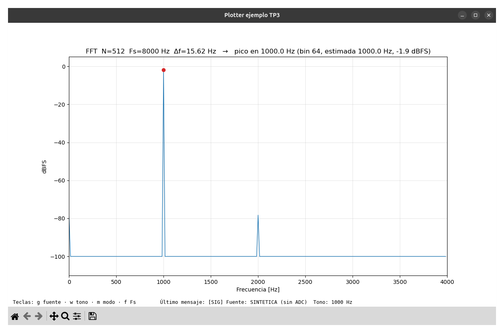 | 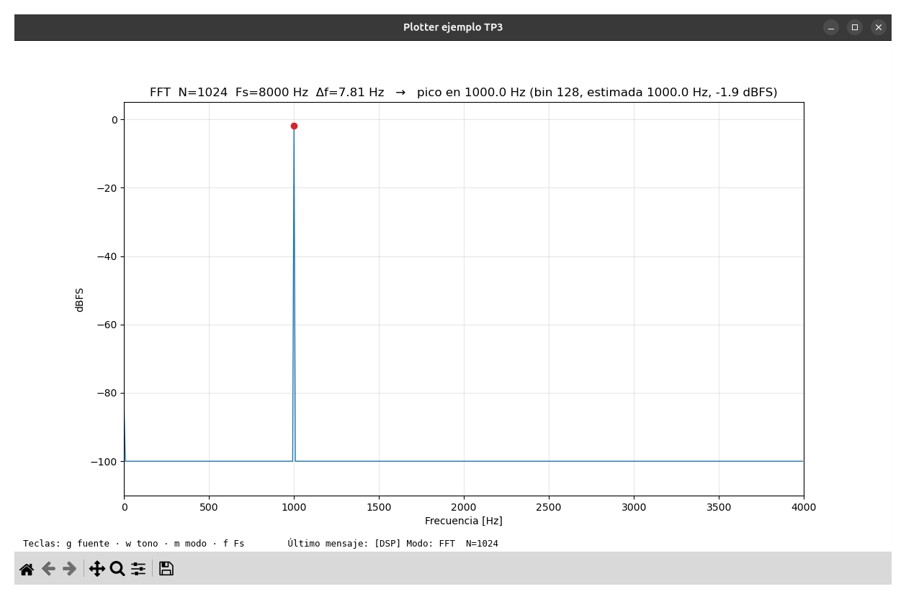 |

En ambas configuraciones el pico se clava en **$-1{,}9\text{ dBFS}$** en el bin exacto, sin fuga en los bins adyacentes. En la captura de $N = 512$ se observa un único pico residual en **2000 Hz a $-78\text{ dB}$** (y en 0 Hz), correspondiente a **$1\text{ LSB}$** de `arm_cmplx_mag_q15` ($\text{mag} = 1 \implies -78{,}3\text{ dBFS}$) originado por el truncamiento sistemático al dividir por 2 en cada etapa de `arm_cfft_q15`; como hay exactamente 8 muestras por período, el error periódico se concentra en múltiplos de $1000\text{ Hz}$ y depende de la fase inicial de cada ventana. Los demás bins valen `0` y el firmware los fija en `PROCESSING_DB_FLOOR_X100` ($-100\text{ dB}$).

### 7.2 Fuga espectral (*spectral leakage*) y pérdida por festoneado (*scalloping loss*)

Al desplazar el tono apenas **4 Hz** hacia **1004 Hz** manteniendo $f_s = 8\text{ kHz}$ y $N = 1024$ ($\Delta f = 7{,}8125\text{ Hz}$), la señal cae en el bin **$128{,}5$** (peor caso, equidistante de dos bins):

<p align="center">
  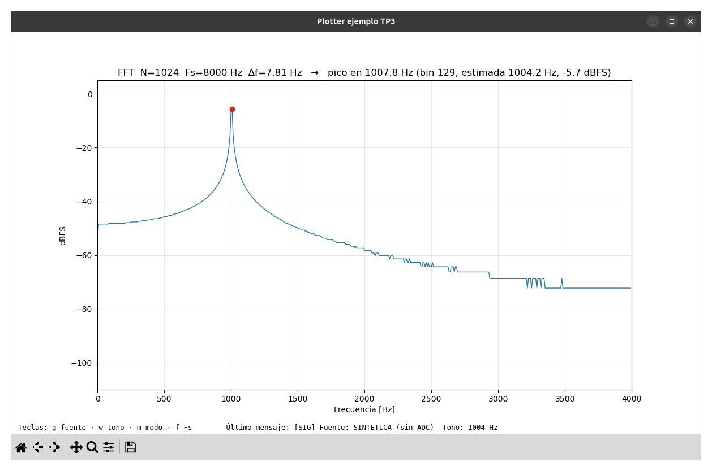
</p>

El pico máximo cae al bin 129 ($1007{,}8\text{ Hz}$) con nivel **$-5{,}7\text{ dBFS}$** ($3{,}8\text{ dB}$ de *scalloping loss* frente al caso coherente, en concordancia con los $3{,}73\text{ dB}$ calculados en la notebook), mientras que la energía se reparte a través de todo el espectro en una falda decreciente desde $-48\text{ dB}$ (cerca de DC) hasta $-72\text{ dB}$ (cerca de $4\text{ kHz}$).

El mismo fenómeno se comprueba a **$f_s = 48\text{ kHz}, N = 512$** ($\Delta f = 93{,}75\text{ Hz}$), comparando un tono no coherente de **5000 Hz** (bin $53{,}33$) contra uno coherente de **3000 Hz** (bin $32$ exacto):

| $5000\text{ Hz}$ @ $48\text{ kHz}, N = 512$ (bin $53{,}33$ — fuga) | $3000\text{ Hz}$ @ $48\text{ kHz}, N = 512$ (bin $32$ — coherente) |
| --- | --- |
| 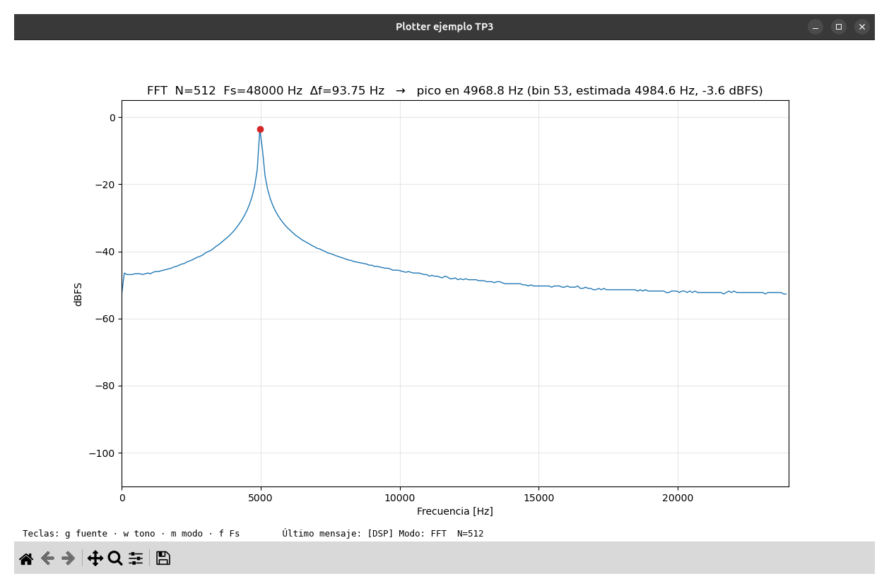 | 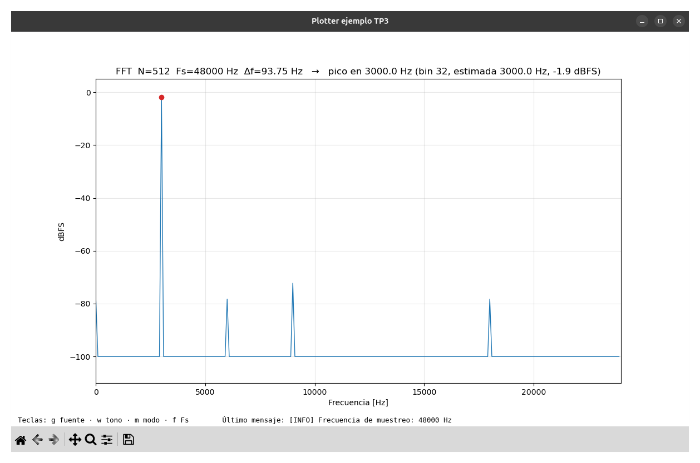 |

A $5000\text{ Hz}$ la fuga levanta un piso aparente entre $-47$ y $-53\text{ dB}$ en todo el ancho de banda y atenúa el pico a $-3{,}6\text{ dBFS}$; al pasar a $3000\text{ Hz}$ sin modificar ni $f_s$ ni $N$, ese piso desaparece por completo (salvo los picos de $1\text{–}2\text{ LSB}$ por redondeo en múltiplos de $3\text{ kHz}$) y el pico recupera los $-1{,}9\text{ dBFS}$.

### 7.3 Verificación del teorema del muestreo y *aliasing*

Con un tono de **5000 Hz** y $N = 512$, al muestrear por debajo del criterio de Nyquist ($f_s = 8\text{ kHz} \implies f_s/2 = 4000\text{ Hz}$) la componente se refleja sobre $8000 - 5000 = \mathbf{3000\text{ Hz}}$ (bin 192). Al elevar $f_s$ a **16 kHz** ($f_s/2 = 8000\text{ Hz}$), el tono aparece en su posición real de $5000\text{ Hz}$ (bin 160):

| $5000\text{ Hz}$ @ $f_s = 8\text{ kHz}$ (alias en $3000\text{ Hz}$) | $5000\text{ Hz}$ @ $f_s = 16\text{ kHz}$ (pico en $5000\text{ Hz}$) |
| --- | --- |
| 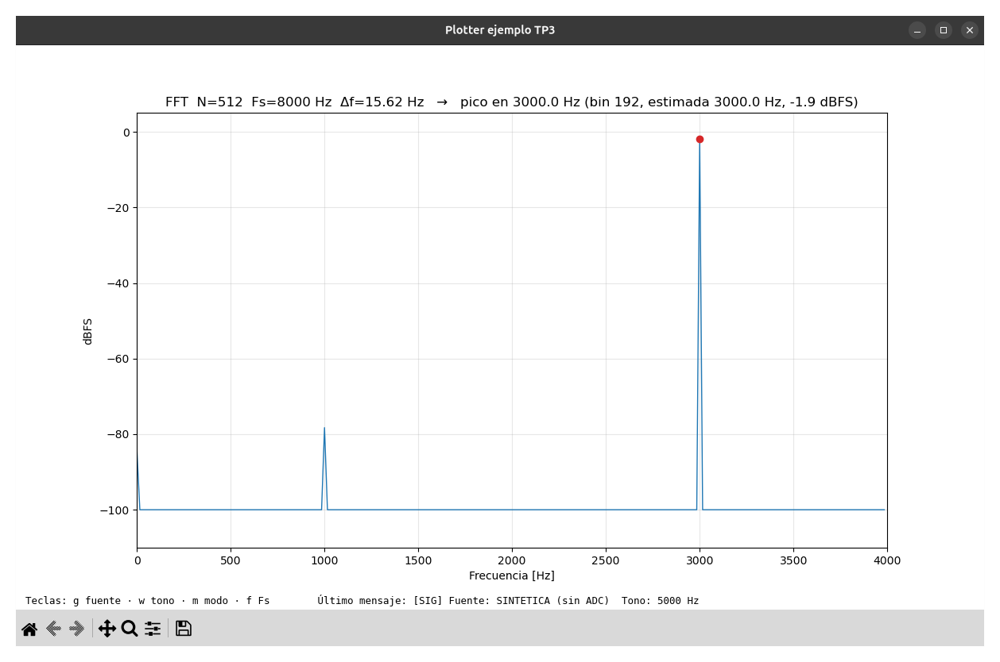 | 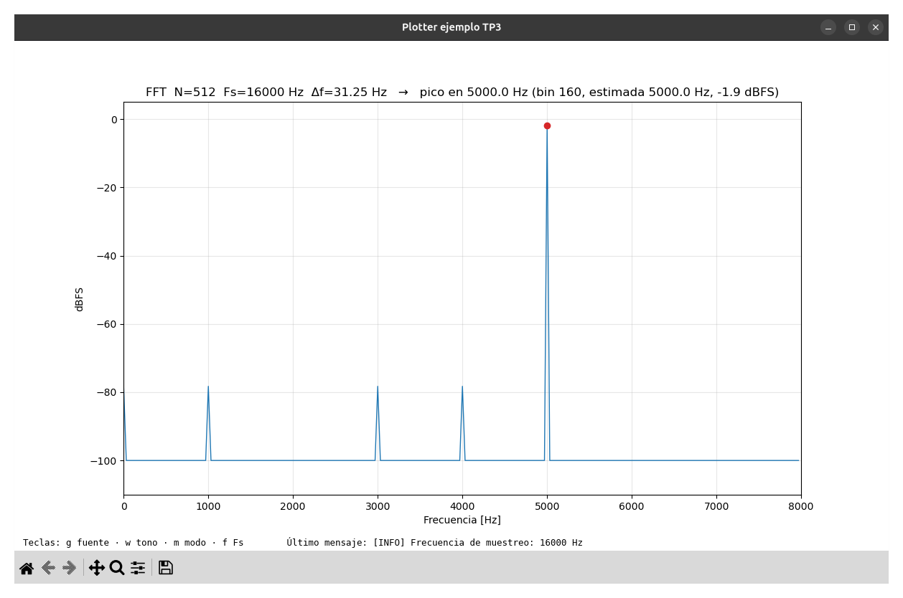 |

### 7.4 Ensayos de la cadena analógica completa en lazo físico (`DAC LOOPBACK`)

Conectando físicamente `J1[4]` (`DAC0_OUT`) con `J9[23]` (`ADC1_A23`), la señal recorre el camino completo **DDS digital $\rightarrow$ DAC 12 bits $\rightarrow$ cable $\rightarrow$ LPADC 16 bits $\rightarrow$ FFT Q15**. En modo **BYPASS** ($250\text{ Hz}$ a $f_s = 8\text{ kHz}$) se comprueba la ausencia de recortes o saltos de muestreo a lo largo de la ventana:

<p align="center">
  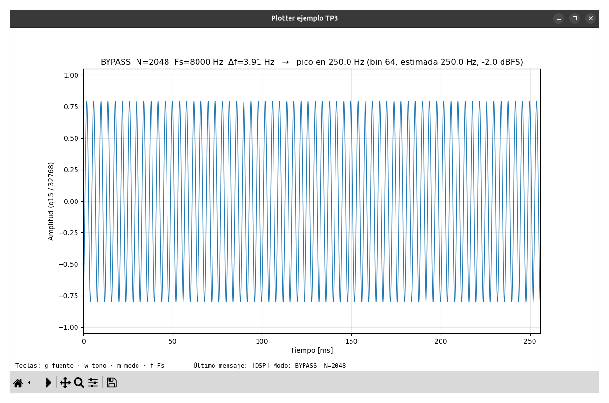
</p>

Comparando las capturas espectrales de **1000 Hz** ($f_s = 8\text{ kHz}$, $N = 1024$ y $N = 2048$) y **3000 Hz** ($f_s = 48\text{ kHz}$, $N = 512$) en lazo físico contra la fuente sintética:

| $1000\text{ Hz}$ @ $8\text{ kHz}, N = 1024$ | $1000\text{ Hz}$ @ $8\text{ kHz}, N = 2048$ | $3000\text{ Hz}$ @ $48\text{ kHz}, N = 512$ |
| --- | --- | --- |
| 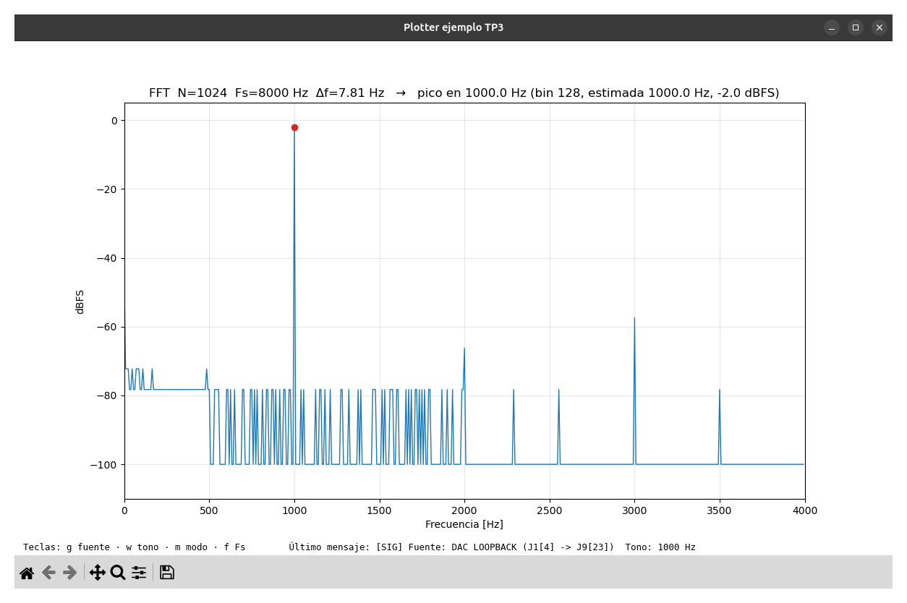 | 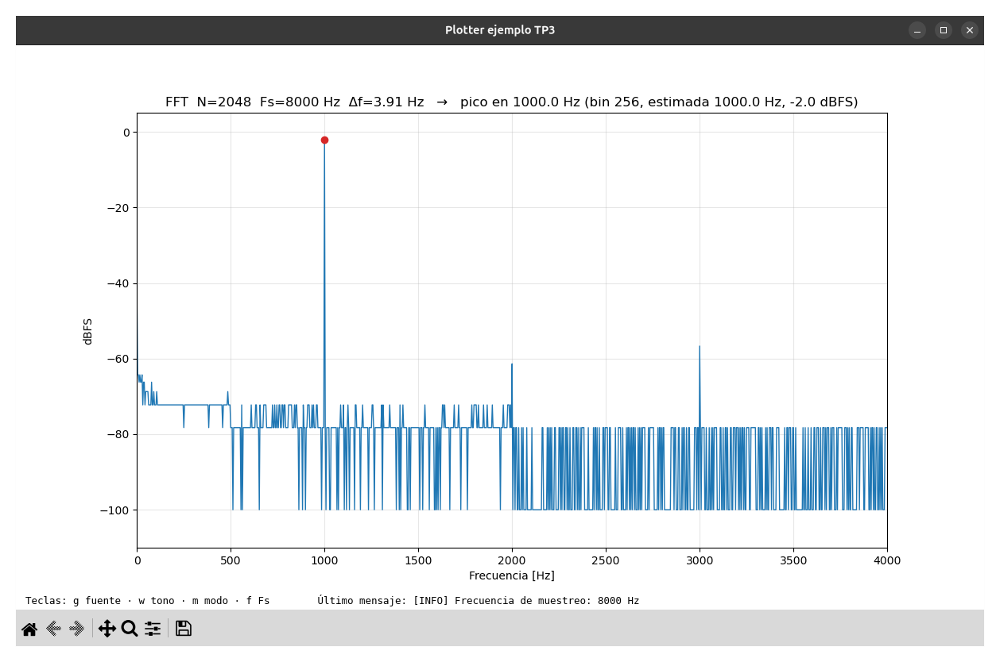 | 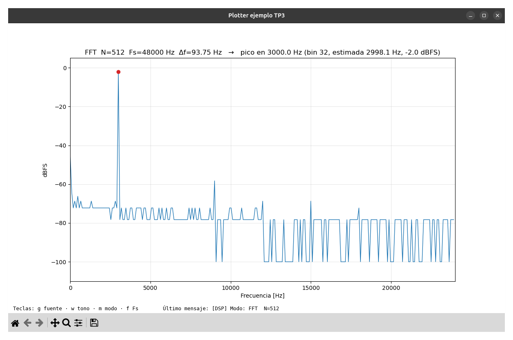 |

El contraste directo permite aislar el origen de cada característica observada:

1. **Coincidencia de escala y frecuencia:** el pico cae en los mismos bins (128, 256 y 32) con amplitud **$-2{,}0\text{ dBFS}$** frente a $-1{,}9\text{ dBFS}$ en sintética (acuerdo de ganancia DAC + ADC dentro de $\sim 0{,}1\text{ dB}$).
2. **Distorsión armónica analógica:** aparece un **3.er armónico** constante a **$-57\text{ dB}$** (y en menor medida un 2.º armónico entre $-61$ y $-66\text{ dB}$, ausentes en la señal sintética), compatible con una ligera compresión simétrica en los extremos de excursión del DAC/ADC.
3. **Componente de continua (DC):** pico en $0\text{ Hz}$ entre **$-58$ y $-45\text{ dB}$** debido a la pequeña diferencia de punto medio entre el DAC0 y el ADC1 (el firmware no resta el valor medio de la ventana).
4. **Piso de ruido físico y límite Q15:** en reemplazo del piso plano en $-100\text{ dB}$, surgen bins distribuidos en **$-78$ y $-72\text{ dB}$** ($1\text{–}2\text{ LSB}$, producto de la cuantización del DAC de 12 bits y el ruido del ADC). Al duplicar $N$ de $1024$ a $2048$ el piso no desciende, ya que el ruido físico ya se sitúa en el límite de $1\text{–}2\text{ LSB}$ de `arm_cmplx_mag_q15` y una FFT de 2048 puntos ejecuta una etapa adicional de redondeo.
5. **Cumplimiento en tiempo real a 48 kHz:** a $f_s = 48\text{ kHz}$ (`loop_3000_fs48k.png`) el piso de ruido se mantiene en $1\text{–}2\text{ LSB}$ sin espurios fuera de armónicos ni degradación espectral, confirmando que la adquisición en ISR, el cálculo en PendSV y el enlace UART a `921 600` baudios operan sin pérdida de muestras.

#### Validación cruzada: Placa real vs. Cuaderno de Jupyter

| Tono | $f_s$ | $N$ | Placa (bin) | Placa (dBFS) | Notebook (bin) | Notebook (dBFS) | Fenómeno verificado |
| :---: | :---: | :---: | :---: | :---: | :---: | :---: | --- |
| **1000 Hz** | 8 kHz | 512 | 64 | −1,9 | 64 | −1,94 | Coherente + piso Q15 en 2 kHz |
| **1000 Hz** | 8 kHz | 1024 | 128 | −1,9 | 128 | −1,94 | Coherente exacto |
| **1004 Hz** | 8 kHz | 1024 | 129 | −5,7 | 129 | −5,67 | Fuga + *scalloping loss* (3,7 dB) |
| **5000 Hz** | 8 kHz | 512 | 192 | −1,9 | 192 | −1,94 | *Aliasing* ($8000 - 5000 = 3000\text{ Hz}$) |
| **5000 Hz** | 16 kHz | 512 | 160 | −1,9 | 160 | −1,94 | Recuperación sobre Nyquist ($f_s/2 = 8\text{ kHz}$) |
| **5000 Hz** | 48 kHz | 512 | 53 | −3,6 | 53 | −3,59 | Fuga espectral en banda ancha |
| **3000 Hz** | 48 kHz | 512 | 32 | −1,9 | 32 | −1,94 | Coherente a máxima $f_s$ |

### 7.5 Ensayos con generador de señales externo y osciloscopio (Fuente ADC)

Finalmente, con la fuente en su modo por defecto (`ADC`) se adquieren señales analógicas reales desde el generador de funciones en `J9[23]` (montadas sobre $1{,}65\text{ V}$ de continua), monitoreando simultáneamente la señal muestreada en `DAC0_OUT` (`J1[4]`) mediante el osciloscopio y el espectro resultante en la GUI de PC.

> **[PLACEHOLDER 4 — Captura pendiente]:** Captura experimental con generador de señales externo conectado al `ADC1` (`J9[23]`) y/o fotografía del osciloscopio sobre `DAC0_OUT` (`J1[4]`) verificando la adquisición analógica real y el fenómeno de *aliasing* físico del conversor A/D (por ejemplo, entrada de $5\text{ kHz}$ muestreada a $f_s = 8\text{ kHz}$ reflejada en $3\text{ kHz}$).  
> *Ruta sugerida:* `./images/adc_externo_aliasing.png`

---

## 8. Limitaciones conocidas

1. **Ventana rectangular fija y ausencia de remoción de DC en el firmware:** se decidió no aplicar ventana Hann ni restar la media antes de `arm_cfft_q15` para priorizar la mínima anchura del lóbulo principal y no consumir ciclos/RAM adicionales. Como consecuencia, los tonos no sincronizados con $\Delta f$ presentan lóbulos laterales de $-13{,}3\text{ dB}$ y el eventual desbalance entre el punto medio del DAC/generador y el del ADC genera una componente en el bin 0.
2. **Piso aritmético de $-78{,}3\text{ dBFS}$ en punto fijo Q15:** el escalado por $1/N$ dentro de `arm_cfft_q15` limita la resolución mínima a $\text{mag} = 1\text{ LSB} \equiv -78{,}3\text{ dBFS}$. Esto impide observar la reducción de $3\text{ dB}$ del piso de ruido esperada teóricamente al duplicar $N$ de $1024$ a $2048$; para superar ese límite habría que pasar a `arm_cfft_q31` o `arm_cfft_f32` (con el doble de memoria en RAM y trama serie).
3. **Descarte marginal en modo BYPASS a 48 kHz:** en modo `BYPASS` ($N = 512$), cada trama transmite las $512$ muestras completas ($1033\text{ bytes} \implies T_{\text{tx}} = 11{,}2\text{ ms}$ a $921\,600\text{ bps}$), superando levemente los $10{,}7\text{ ms}$ de la ventana a $48\text{ kHz}$, por lo que se descarta aproximadamente 1 de cada 20 tramas. En los tres modos `FFT` ($N/2$ bins) no existe descarte a ninguna $f_s$.
4. **Resolución del pico en OLED restringida al paso $\Delta f$:** el display OLED informa el centro del bin máximo ($k_{\text{max}} \cdot f_s / N$), sin interpolación parabólica entre bins vecinos.

---

## 9. Conclusiones

1. **Compromiso fundamental entre resolución espectral $\Delta f$, tiempo de ventana $T_w$ y ancho de banda $f_s/2$:**
   - Los ensayos y simulaciones confirman que $\Delta f = f_s / N$ solo mejora aumentando el tiempo de observación $T_w = N / f_s$. Duplicar o cuadruplicar $N$ (de $512$ a $2048$ muestras) reduce $\Delta f$ a la cuarta parte (de $15{,}6\text{ Hz}$ a $3{,}9\text{ Hz}$ a $8\text{ kHz}$), permitiendo resolver tonos cercanos a costa de una ventana cuatro veces más larga ($256\text{ ms}$) y mayor tamaño de buffer.
   - Aumentar $f_s$ (hasta $48\text{ kHz}$) amplía el rango observable libre de *aliasing* hasta $24\text{ kHz}$, pero degrada proporcionalmente la resolución ($\Delta f = 93{,}8\text{ Hz}$ con $N = 512$) si no se incrementa $N$ en la misma proporción.
2. **Muestreo coherente, fuga espectral y elección de ventana:**
   - Cuando la señal completa un número entero de ciclos dentro de la ventana ($f_0 / \Delta f \in \mathbb{Z}$), la FFT con ventana rectangular concentra toda la energía en un solo bin sin fuga.
   - Fuera de coherencia, el corte en los bordes genera *scalloping loss* (hasta $3{,}92\text{ dB}$ con ventana rectangular) y lóbulos laterales que levantan un piso aparente capaz de ocultar componentes débiles; el análisis en [`notebooks/fft_ventanas_y_fenomenos.ipynb`](./notebooks/fft_ventanas_y_fenomenos.ipynb) demuestra cómo la ventana **Hann** resuelve ese enmascaramiento a costa de ensanchar el lóbulo principal al doble.
3. **Separación entre efectos aritméticos Q15 y no linealidades analógicas:**
   - Disponer de un generador interno con modo `SINTÉTICA` y `DAC LOOPBACK` permitió comprobar que el piso discreto de $-78{,}3\text{ dBFS}$ y los picos residuales en armónicos de $1\text{ LSB}$ provienen del redondeo entero por etapa de `arm_cfft_q15`, mientras que el 3.er armónico en $-57\text{ dBFS}$, el offset en $0\text{ Hz}$ y el piso de ruido de $1\text{–}2\text{ LSB}$ son propios de la cadena física DAC–ADC.
4. **Arquitectura en tiempo real y ecosistema de verificación:**
   - El desacople entre la ISR del ADC (prioridad 0) y `PendSV` (prioridad 7) mediante ventanas ping-pong, el salto del puerto serie a **921 600 baudios** con recepción por buffer circular y arbitraje de turno de texto, la actualización parcial del display OLED y el ecosistema de análisis en PC (`tools/fft_gui.py`, `tests/fake_board.py` y `notebooks/fft_ventanas_y_fenomenos.ipynb`) conformaron un instrumento de medición estable, verificable y extensible sin pérdida de muestras en todo el rango de operación.

---

## 10. Anexo: compilación y ejecución de las herramientas entregadas

### 10.1 Firmware (`MCXN947_Project_TP3`)

1. Abrir **MCUXpresso IDE 25.6** (con el **SDK MCXN947 26.06.00** instalado).
2. Importar el proyecto desde `File > Import > Existing Projects into Workspace` apuntando a [`TP3/MCXN947_Project_TP3/`](./MCXN947_Project_TP3/).
3. Compilar preferentemente en configuración **Release** (`-O3`, optimizaciones SIMD/FPU activas) y cargar en la placa mediante *LinkServer Release* conectando el puerto USB MCU-Link.

### 10.2 Interfaz gráfica, simulador y tests unitarios en PC

Desde la carpeta `TP3/tools/` (en Linux puede requerirse el paquete del sistema `python3-tk`):

```bash
cd TP3/tools
python3 -m venv venv
venv/bin/pip install -r requirements.txt

# Lanzar la interfaz gráfica (conectar al puerto de la placa a 921600 baudios)
venv/bin/python3 fft_gui.py
```

Para ejecutar las pruebas unitarias del decodificador de tramas o probar la GUI sin hardware conectado mediante el simulador PTY:

```bash
# Pruebas unitarias de FrameParser
venv/bin/python3 ../tests/test_frame_parser.py

# Simulador de placa en una terminal aparte (copiar el /dev/pts/N impreso en la GUI)
venv/bin/python3 ../tests/fake_board.py
```

### 10.3 Cuaderno de Jupyter de la FFT

Desde `TP3/tools/`:

```bash
venv/bin/pip install jupyter
venv/bin/jupyter notebook ../notebooks/fft_ventanas_y_fenomenos.ipynb
```
